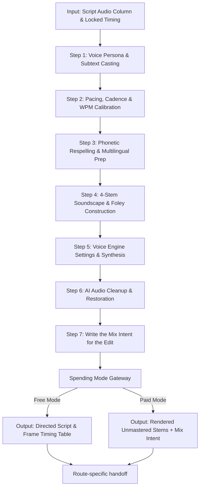

# How Phase 4 Works: Audio, Narration & Complete Sound Architecture

Phase 4 takes the raw narration, dialogue, and sonic cues produced in Phase 2 (Screenplay & Dialogue) — and in Phase 3 (Shooting Script) only where it ran first; on a narrated piece this phase runs before it — and turns them into **directed voice, written mix intent, and the four stems the edit will need**. It pairs **260 specialized craft cards** across its modules covering vocal persona, ElevenLabs TTS directing, subtext acting, the 4-stem architecture, foley design, multilingual dubbing, artefact diagnosis, and orchestral dynamics.

> **Where this phase stops.** Phase 4 does not mix. **Levels, ducking, loudness and the final mix are
> set in the edit**, by hand, against the actual material, by the person doing the montage. What
> leaves this phase is unmastered audio with its headroom intact, plus notes saying what the mix has
> to achieve: what sits under what, where speech has to stay clear, which space a voice belongs in,
> which loudness standard the destination enforces, and where a silence is wanted. The value behind
> each of those — the gain, the ratio, the threshold, the ceiling, the length of the silence — is set
> on the timeline by the person making the move. This is the same boundary already drawn around
> montage and subtitles: the phase specifies, the edit decides.
>
> The one exception runs *upstream* of generation: the pre-flight cleaning of a voice-cloning sample
> is done here and keeps its values, because it decides what the cloned voice is rather than what the
> edit does with it afterwards.

---

## Complete Audio Pipeline Workflow

---

**Before Step 1: the language check travels, it does not wait.** A performed line in a language
nobody on the project reads natively carries `pending_language_check` — `sub.high_context_indirection`
is the usual way one arrives. Check it the way anything else is settled: the skill, then a web search,
then the closest reasonable form; record the choice under `decisions`, keep the marker beside the line
as a note in the handoff if a native reader should still look, and carry on — recording is never held
for it. For a constructed language, its own written rules are the reference
([`../ENGINE-CHECK.md`](../ENGINE-CHECK.md) §3).

### Step 1: Voice Persona, Casting & Subtext Delivery
- Open [voice-casting-profiles.md](voice-casting-profiles.md), [voice-acting-subtext.md](voice-acting-subtext.md), and [../phase-02-screenplay-dialogue/cat-voice.md](../phase-02-screenplay-dialogue/cat-voice.md).
- Select primary vocal archetype:
  - **Monumental Historical Authority:** `voice.cast_authoritative_historian` (unhurried baritone; it reads at the documentary rate, which is on `pacing.wpm_documentary`, and on a heritage feed reel, in any aspect, at `pacing.wpm_vertical_heritage`).
  - **Ancient Sovereign / Royal Decree:** `voice.cast_epic_mythological` (cavernous weight; the rate is on `pacing.wpm_epic_mythology`).
  - **High-Retention Reel Hook:** `voice.cast_hook_retention_reels` (crisp dynamic attack; the rate is on `pacing.wpm_social_reels`).
  - **Or any other `voice.cast_*` card in the file** — these three are the commonest, not the only ones: a
    dramatic pair `voice.cast_opposed_pair`, a regional dialect `voice.cast_regional_iraqi_dialect`, an
    elder storyteller `voice.cast_folkloric_elder`, a commercial read `voice.cast_warm_commercial_guide`.
- **A child character's voice: three cases, and only one step in one of them ever waits.**
  1. **A designed, synthetic child voice**, built with no sample from a real child
     (`voice.cast_designed_child`): allowed in full. No stop, no warning, no marker.
  2. **An adult performer playing the child**: allowed in full, cast and directed like any other voice.
  3. **A clone of a real child's voice from a recording**: the rest of the work carries on as usual.
     Only the cloning step itself waits until the parent's or guardian's consent is recorded, with
     their name and the date, in `child_voice_clone_consent` in `project.yaml`, because the voice platforms
     require it (`elevenlabs.voice_cloning_hygiene`). A real child's own recorded voice used as
     recorded, not cloned, is cast like any other voice.
- Apply emotional subtext directing:
  - Suppressed cold rage (`vocal_subtext.suppressed_cold_rage`).
  - Vocal fold fracture under grief (`vocal_subtext.grief_vocal_fracture`).
  - Sarcastic compliance cadence (`vocal_subtext.sarcastic_compliance`).

---

### Step 2: Pacing, Cadence & WPM Calibration
- Open [pacing-cadence-wpm.md](pacing-cadence-wpm.md), which owns the **register** rates listed below. A few drafting figures for commercial and corporate work live on their own cards and cite their owner; the table below is the register set, not every number in the package.
- Estimate the script word count against the runtime. **The rate itself lives on the card, and this
  page deliberately does not repeat it** — a figure copied into a second file is a figure that can
  drift, and this one had. Open the card named for the register and read the number there:
<!-- GENERATED:rate-cards — do not edit by hand. Generated in the source package -->

**Every speaking rate in the package, and the register each one owns.** Generated from the cards in [`pacing-cadence-wpm.md`](pacing-cadence-wpm.md); a figure quoted elsewhere cites its owner here rather than standing alone.

| Card | Register | Best in |
| :--- | :--- | :--- |
| `pacing.wpm_arabic` | Arabic Narration Rate | Documentary, Heritage Reel, Commercial, Podcast |
| `pacing.wpm_children` | Children's Narration Rate | Kids Content, Educational, Museum Family Track |
| `pacing.wpm_commercial_promo` | Commercial Promotional Cadence | Commercial / TVC, Radio Promo |
| `pacing.wpm_documentary` | Documentary Baseline Tempo | Documentary Feature, Heritage / Historical Documentary, Video Essay |
| `pacing.wpm_dramatic_dialogue` | Dramatic Scene Dialogue Cadence | Feature Film, Drama Series Episode, Short Film |
| `pacing.wpm_epic_mythology` | Ancient Epic & Hymnal Gravitas | Feature Film Prologue, Heritage Audio Experience |
| `pacing.wpm_narrated_fiction` | Narrated Fiction Rate | Short Film, Narrative Podcast, Audio Drama, Vertical Short-Form (Reels, Shorts,  |
| `pacing.wpm_social_reels` | Social Media High-Retention Pacing | Vertical Short-Form (Reels, Shorts, TikTok) |
| `pacing.wpm_to_camera` | To-Camera Dialogue Rate | Vertical Short-Form (Reels, Shorts, TikTok), Explainer, Kids Content, Museum Ins |
| `pacing.wpm_vertical_heritage` | Vertical Heritage Reel Cadence | Vertical Short-Form (Reels, Shorts, TikTok), Heritage / Historical Documentary |

<!-- /GENERATED:rate-cards -->
- **Then treat what you calculated as an estimate.** Every rate in this phase is a planning figure;
  the real duration comes from the rendered audio file, measured. A synthesiser does not hold a fixed
  words-per-minute, so `words ÷ rate` tells you roughly how much to write and nothing more. Measure
  the render, then build the picture to it — never the reverse, and never trust the arithmetic over
  the waveform.
- Insert punctuation cadencing:
  - Micro-beat comma pause (`pacing.pause_micro_beat`).
  - Dramatic caesura pause before shock revelations (`pacing.pause_dramatic_caesura`).
  - Act-break reset silence (`pacing.pause_act_break`).

**If the piece also carries on-screen text that is *different* from the spoken line — a label, hook
copy, a lower third, a title card — narration and that text may not be given the same seconds.**
Subtitles and captions *of the spoken words* are not this case: they run with the voice by
definition (`vertical.captions`). A narrated film with a text card over the voice, or a vertical
cut with hook copy under it, is
asking one stretch of timeline to deliver two channels at once, and the audience takes one of them —
usually the text, because reading is involuntary. Where they must overlap, **the text wins and the
voice yields**: keep the narration line short there, move it, or let the picture carry the beat
alone. Decide it on the timeline *before* the voice is recorded, because the cheap repair is a
rewrite and the expensive one is a re-record. `pacing.wpm_arabic` names the bilingual
subtitle case as the one that bites hardest and hands you a word rate, which measures one channel;
the subtitle track, running with the voice, has to clear the reading rate in `tens.subtitle_preempt`.

---

### Step 3: Phonetic Directing & Multilingual Localization
- Open [pronunciation-and-accents.md](pronunciation-and-accents.md) and [multilingual-dubbing-lipsync.md](multilingual-dubbing-lipsync.md).
- Respell ancient Mesopotamian, Akkadian, and Sumerian names into hyphenated phonetic guides, each taken from the skill, then a web search, then the closest reasonable respelling, recorded under `decisions`, by the method in `pronounce.mesopotamian_names`. The two below are worked examples of that method and its record, not a list to apply:
  - `Ashurbanipal` -> `ash-ur-BAH-nee-pahl` (`pronounce.phonetic_spelling_tts`).
  - `Enheduanna` -> `En-hed-oo-AN-na` (`pronounce.dialect_consistency`).
  - Both respellings are the owner's decision of 2026-09-23. No reference in the package gives a pronunciation for either name, so the owner chose these, and every respelling of either name in the package uses them. The record is on `pronounce.dialect_consistency`.
- **Only when an English script is translated into Arabic to run the same length** (a dub, or a bilingual release), apply the duration compensation factor:
  - `English_words * 0.82 = Target_Arabic_words` (`dubbing.arabic_english_syllable_ratio`).
- Align bilabial consonants (M, B, P) to visible on-screen lip closures (`dubbing.bilabial_lipsync_alignment`).

---

### Step 4: 4-Stem Soundscape & Foley Construction
- Open [soundscape-sfx-score.md](soundscape-sfx-score.md), [foley-and-sound-design.md](foley-and-sound-design.md), and [../phase-03-shooting-script/sound-as-visual.md](../phase-03-shooting-script/sound-as-visual.md).
- Structure audio into the 4-Stem Master Architecture (`soundscape.stem_master_architecture`):
  1. **Stem 1 (Dialogue / VO):** Dry speech, de-essed, EQ carved (`soundscape.stem_dialogue_dry`).
  2. **Stem 2 (SFX / Foley):** The materials of the piece's own world. On a Mesopotamian subject that means authentic historical materials (bronze sickle-swords, mud-brick footsteps, chariot creaks, cuneiform reed stylus clicks); on any other piece, the objects its script actually handles.
  3. **Stem 3 (Ambience / Room Tone):** Continuous environmental bed of the place the piece is set in — on a Mesopotamian subject, arid desert winds, marsh reed lap, palace hall IR; elsewhere, that place's own air.
  4. **Stem 4 (Music / Score):** A slot, empty at this step: Phase 5 Route C fills it later with the score it directs — a tradition's instruments (Oud, Ney, frame drums) where the subject has one, the score shelf's colour where it does not — or the edit does. It arrives full and unducked. It is required to sit under the voice; how far under is set in the edit (`soundscape.ducking_ratio`).
- Where the piece's register wants an impact — a trailer, a reveal, an action beat — deploy cinematic impacts; a reverent or contemplative piece usually wants none of them:
  - Hollywood Braam brass hits (`foley.cinematic_braam_hit`).
  - Sub-Drop 50Hz revelation detonations (`foley.sub_drop_50hz`).
  - Shepard Tone infinite tension risers (`foley.shepard_tone_riser`).

---

### Step 5: Voice Engine Settings & Synthesis
- Open [elevenlabs-engine-craft.md](elevenlabs-engine-craft.md) for the craft, and the engine's adapter in [`../ENGINE-CHECK.md`](../ENGINE-CHECK.md) §7 for its current model names, settings and ranges. No model name or setting value is written here: they are the vendor's, and they move.
- Choose the model tier by the job: the expressive tier for drama and the fast tier for volume work, as the adapter names them today. The model cards carry the craft; the adapter's status column says which of their claims still hold.
- Set steadiness against expressiveness per read (`elevenlabs.stability_tuning`), likeness to the source voice (`elevenlabs.similarity_boost`, `elevenlabs.speaker_boost`), and leave the style amplifier where the adapter records the vendor's advice (`elevenlabs.style_exaggeration`).
- Fix the seed where the engine offers one, as a best-effort aid to regeneration rather than a guarantee (`elevenlabs.seed_locking`).

---

### Step 6: Artefact Diagnosis & Clone-Sample Prep
- Open [audio-restoration-cleanup.md](audio-restoration-cleanup.md).
- **Done here, because it changes what gets generated:** clean any sample before it is enrolled in a voice clone (`restore.voice_training_decontamination`, `restore.spectral_hiss_suppression`, `restore.resonant_room_decluttering`, `mix.voice_de_reverberation`). A fault left in the sample is inherited permanently by the clone.
- **Diagnosed here, repaired in the edit:** audit the generated takes on closed-back headphones and list what needs a repair pass — saliva clicks (`restore.mouth_de_clicking`), neural sibilance (`restore.neural_sibilance_de_essing`), heavy gasps (`restore.breath_noise_attenuation`), DC offset (`restore.dc_offset_removal`). Name the fault and hand it over; the amount is dialled on the take, in the edit.
- Anything a repair cannot reach — a dropout that ate a syllable — comes back for regeneration rather than going forward.

---

### Step 7: Write the Mix Intent for the Edit
- Open [audio-mixing-mastering.md](audio-mixing-mastering.md) and [score-composition-dynamics.md](score-composition-dynamics.md).
- Write down what the mix has to achieve, not how far to move a fader:
  - Narration is the priority stem; the music carves for it rather than the voice being raised (`mix.frequency_slot_carving`, `mix.dialogue_to_music_ratio`).
  - Music and ambience duck to the voice automatically and recover on the pauses (`soundscape.ducking_ratio`, `mix.ducking_release_curve`).
  - Which space each voice belongs in (`mix.convolution_ir_matching`).
  - Which platform the piece lands on, so its current published loudness standard can be looked up and applied at master time (`mix.lufs_loudness_targets`, `mix.true_peak_ceiling`).
  - Where a silence is wanted, and what it is for (`foley.acoustic_vacuum_drop`, `score.pre_climax_score_vacuum`).
  - That the mix must survive being summed to mono on a phone speaker (`mix.mono_compatibility_audit`).
- **None of the above is executed here.** Every one of those values is set on the timeline, by ear, against material that exists.

---

### Step 8: Handoff to Downstream Phases

> **On a piece with no speech, this step inverts, and nothing else in this phase changes.**
> Where the intake answered **Audio Profile: Silent** — a wordless animated short, a gallery loop, a
> montage carried by music and effects — there is no narration to render, so **there is no measured
> audio for the picture to be cut to, and the rule below does not apply.** The durations are designed
> in Phase 3 and this phase is cut *to the picture* rather than the other way round: the shot table's
> timings are the authority, and the foley, ambience and score are built against them. Read as
> written, the paragraph below tells a silent film to derive its frame counts from a file that does
> not exist, which is the point a beginner stalls — it is the only instruction in this phase that a
> wordless piece cannot obey, and it contradicts Phase 3, which correctly says such durations are
> designed. Everything else in Step 8 stands: the stems are still delivered unmastered, with their
> headroom, and the mix intent is still written. **A music-led piece with no speech follows Phase 5's
> timing map instead**, exactly as the routing questions say.

- Output the four **unmastered** stems with their headroom intact, the mix-intent notes, the measured duration and frame timing markers to the successor the generated table below names for the active route. That table, from `PROJECT-STATE.md`, is the only place the successor is named.
  - **On a picture-less piece the destination is different, and it is not Phase 6.** Routing question 1 drops Phases 3, 6 and 8 for an audio-only piece, and there are no *frame* timing markers because there are no frames — the timing plan is by movement or by chapter, against the measured audio. What that piece hands on is the measured runtime, the voice and soundscape record, and the identity, palette and series decisions: to the edit on `audio_only`, and to **Phase 7** on `audio_with_cover`, which needs them for the cover image. **This is a different case from the silent piece above**: a silent piece has a picture and no speech, an audio-only piece has speech and no picture, and the two fail in opposite directions.
- **Where the brief or the genre kit asks for subtitles or captions (the Reels, Shorts and TikTok kits make captions mandatory), or for a translated caption track, the timed subtitle file is this phase's deliverable too**, cued to the measured narration: line length from `dubbing.subtitle_vs_spoken_rate`, break points from `rhythm.subtitle_beat`. On a run where nothing is measured — a prompts-only run renders no narration — the file is still written, cued to the planned timings and marked provisional under `pending_measured_duration` until the render is measured. It is burned in the edit and never generated into a frame (the canon's `heritage-rules.md` §5 on a heritage piece).

<!-- GENERATED:route-handoffs — do not edit by hand. Generated in the source package -->

**Route-specific handoffs.** Generated from the route-profile table in [`PROJECT-STATE.md`](../PROJECT-STATE.md). This table, not a phase number or a prose sentence elsewhere, decides what comes before and after this phase.

| Route profile | Receives from | Hands to |
| :--- | :--- | :--- |
| `full_narrative` | `phase-02-screenplay-dialogue` | `phase-03-shooting-script` |
| `narrated_documentary` | `phase-02-screenplay-dialogue` | `phase-03-shooting-script` |
| `commercial_narrated` | `phase-02-screenplay-dialogue` | `phase-03-shooting-script` |
| `audio_only` | `phase-02-screenplay-dialogue` | `delivery / edit` |
| `audio_with_cover` | `phase-02-screenplay-dialogue` | `phase-07-image-prompt-engineering` |
| `supplied_script_voiceover` | `external / intake` | `delivery / edit` |
| `supplied_audio_cleanup` | `external / intake` | `delivery / edit` |
| `interactive_branching_audio` | `phase-02-screenplay-dialogue` | `phase-03-shooting-script` |
| `data_led_built` | `phase-02-screenplay-dialogue` | `phase-03-shooting-script` |

The rows show each profile as declared. When the story itself contains a song that sets timing, Phase 5 is added after Phase 4 and before Phase 3 on any route that runs Phase 3, and the neighbours shift accordingly ([`PROJECT-STATE.md`](../PROJECT-STATE.md) §2).

<!-- /GENERATED:route-handoffs -->
- Do not deliver a stem already normalised, limited or ducked — it takes a decision away from the edit and cannot be undone there.
- Frame counts in video generation are derived from locked audio duration (`pacing.locked_audio_timing`),
  and **locked means rendered and measured, not calculated.** Where Phase 3 ran before this
  phase — it was entered first, or the script changed after the table was drawn — it has written
  provisional timecodes from a word-count estimate. **Those cells are re-cut against the file.** On a
  narrated piece taken in route order Phase 3 has not run yet, and it builds its table to this measurement. A synthesiser does not hold
  a fixed words-per-minute — the same script comes back at different lengths depending on the voice, the
  stability setting and how it decides to breathe — so the arithmetic is for deciding how much to write
  and the waveform is for deciding how long it is. Measure the audio, then build the picture to it.
