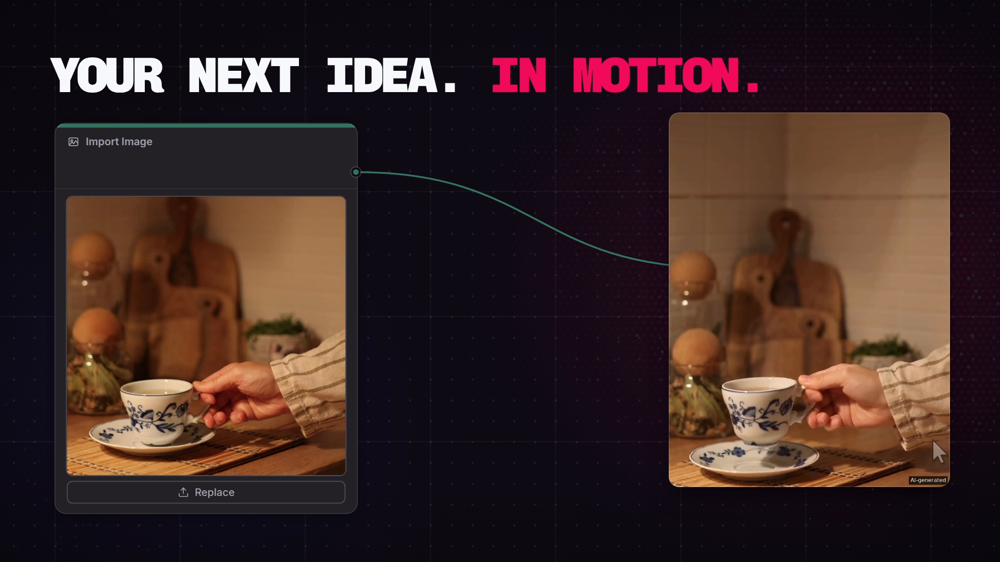

# Nova Creative

Create images, videos, talking avatars, audio, 3D assets and creative variations with the capabilities available to your connected Nova account, then keep refining the same saved workflow.

## What you can do

- Explore visual directions, create reference-based images, and animate product images.
- Create, open, rename, and incrementally revise saved projects for new feedback.
- Review available models and estimated usage, then approve the exact scope and cost in chat when supported or use the optional Nova card.
- Follow or cancel a run, see previews, download finished files, and return to the editable project.
- Discover GPU models, templates and runtimes. When the required tools are exposed, review the selected card, disk, idle timer, prepaid first hour and hourly rate before approving rental. Install models and generate only after their separate reviews. Available actions depend on the host tools and account grants.

Connect your Nova Creative account to get started. Models, supported formats, upload limits and GPU access come from the live tools and `nova_capabilities`; the plugin package version is separate from the server feature version. If a server action is not exposed by this host, the plugin reports that limitation.

Ordinary Output nodes are optional: every node retains its own saved outputs, and generated media can be retrieved through the run-results tools. Existing Output nodes and required reusable-template outputs are preserved during revisions. Generation requires approval of the exact saved revision and estimate through the supported chat or optional native-card flow. Rental uses the exposed gpu_server_start after approval of the exact quoted card, maximum rate, disk and idle cutoff; a missing tool is reported as a host/review limitation. Installation on an existing accessible GPU requires explicit approval of the exact operation and any ongoing charges; server termination permanently deletes the selected existing rental and disk.

- [Product and connection guide](https://creative.novastorm.ai/mcp/)
- [Support](https://app.creative.novastorm.ai/docs/support.md)
- [Privacy policy](https://app.creative.novastorm.ai/docs/privacy.md)
- [Terms of service](https://app.creative.novastorm.ai/docs/terms.md)

## Product film

[Nova Creative promo — Full HD](assets/nova-creative-promo-1080p.mp4)

The supplied final film is 1920 × 1080, 30 fps, 56 seconds, with H.264 video and AAC audio. It is included unchanged from the creator's original. Ask “Show the Nova Creative promo” to access the packaged video through the host's supported preview or attachment feature.

## Official brand assets

The [full Nova Creative logo](assets/nova-creative-logo.svg) and [original orbit vector](assets/nova-symbol.svg) match the current landing-page files. The listing and composer use one high-contrast square badge on both themes. The white planet and pink orbit sit on a near-black #0E0B14 tile with transparent outer corners. Using the same asset for the default and dark fields also keeps clients that ignore `composerIconDark` readable. The original vector and horizontal wordmark remain available.

- [Theme-independent app and composer icon](assets/nova-brand-icon-f20c59.png)
- [Nova Creative landing page](https://creative.novastorm.ai/)

The icon uses the original Nova brand pink `#F20C59`, background `#0E0B14`, white `#FFFFFF` and edge `#2A2F3D`.
