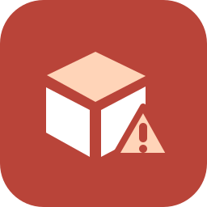

# Product Recall Checker

Version 0.1.3. Use this when you need CPSC recall candidates and exact model-number evidence for up to three household products.

[Product homepage](https://recallmatch-mcp.sunrysetech.com/)

## Install and public review

This is a dedicated-host public-review package, not an approved public-directory listing. This build prepares files only; it does not submit, approve, publish, deploy, or verify domain ownership.

Remote MCP URL: [https://recallmatch-mcp.sunrysetech.com/mcp](https://recallmatch-mcp.sunrysetech.com/mcp)

Authentication: none. Use Streamable HTTP. The host must connect to the deployed endpoint; this ZIP does not run a server. Host plan and administrator settings may control access.

The portable Agent Plugins 1.0.0 archive contains exactly five files: root `plugin.json`, `mcp.json`, `README.md`, `assets/icon.png`, and `assets/icon.svg`. It retains five positive and three negative review cases using public or synthetic inputs. Reviewer walkthrough: [Watch the recorded demo](https://recallmatch-mcp.sunrysetech.com/review-demo.mp4).

[Support](https://recallmatch-mcp.sunrysetech.com/support) · [Privacy policy](https://recallmatch-mcp.sunrysetech.com/privacy) · [Terms](https://recallmatch-mcp.sunrysetech.com/terms)

Follow the [OpenAI packaging guide](https://developers.openai.com/plugins/build/plugins) and [submission requirements](https://developers.openai.com/plugins/deploy/submission). Domain verification, endpoint availability, current tool scans, developer identity, actual host conversations, and review materials are separate submission gates. Serve only this plugin's portal-issued token at the challenge URL shown in its draft; do not replace another plugin's token.

## Interactive workspace and usage guide

In a compatible ChatGPT surface, ask to open Product Recall Checker. The `open_app` tool opens a task selector and input form. Review the inputs before running a task; examples are synthetic scenarios or public samples, not saved customer records. The interface adds no account access, persistence or background automation.

The [public usage guide](https://recallmatch-mcp.sunrysetech.com/) contains a labeled example, usage steps and sample prompts in the current navy/blue design. No public ZIP download is required.

The retained recording at https://recallmatch-mcp.sunrysetech.com/review-demo.mp4 demonstrates the earlier tool workflow and predates the interactive workspace. Current direct MCP checks verify `open_app`, the deployed UI resource and the functional data-tool cases. These checks do not establish ChatGPT rendering, user interaction or model refusals.

## What it does

- `search`: Search CPSC product recall records. Use this when a household product name needs a CPSC recall search. Returns up to five source-linked candidates; no result is not a safety clearance.
- `fetch`: Read a CPSC recall by exact ID. Use this when a search result recall ID needs its official description, dates and published remedy. Accepts a numeric CPSC record ID, never an arbitrary URL.
- `match_products`: Compare product identifiers with CPSC evidence. Use this when up to three public product descriptions, model or lot identifiers need an evidence ledger. Exact model matching uses the whole structured Model field; missing identifiers and lot coverage remain unresolved.

## Inputs, sources and privacy

Public lookup queries and identifiers are sent only to the fixed public providers described below. In this suite, those provider API hosts are saferproducts.gov (CPSC), api.crossref.org (Crossref) and federalregister.gov (Federal Register); a dedicated workflow uses only its own stated provider. Public providers have their own policies.

The service has no customer-account access, OAuth credentials, receipt access, private-system integration, database, persisted progress or stored user session. Inputs and outputs are processed temporarily in memory. The supplied Worker configuration disables application request logs and traces; this statement does not describe retention by your AI host, network provider or public data provider. Send public or nonsensitive aggregate inputs only. Do not send passwords, account records, receipts, personal identifiers or confidential documents.

- [CPSC recall API programmer guide](https://www.cpsc.gov/s3fs-public/RecallRetrievalWebServicesProgrammersGuide20180917.pdf)
- [CPSC public recalls](https://www.cpsc.gov/Recalls)

## Bounds and limitations

Up to 3 product descriptions per match call and 5 returned candidates per product. Each CPSC read is limited to 8 seconds and 2 MiB; product matches run in parallel. Only exact structured model fields can support model identity; lot coverage remains unresolved.

The shared HTTP service caps each request at 48 KiB, data-tool response at 128 KiB (native UI resources have a separate 1 MiB ceiling) and execution at 20 seconds; those transport bounds also apply when an individual schema permits a larger combination of fields. Source failure, incomplete coverage and unresolved inputs must remain visible.

- CPSC candidate records are evidence to review, not a product safety certification. An empty result never proves that an item is unaffected by a recall.
- Search uses the provider's wildcard product-name match. Only whole normalized values in a structured Model field can create an exact model-identifier match.
- CPSC often omits structured model identifiers and has no documented structured lot field. Brand names, descriptions and substrings cannot establish exact identity.
- Read the linked official notice for affected production ranges and remedies. The tool covers CPSC records only and does not issue FDA or public recall alerts.
- Source text is bounded untrusted data. Inputs are processed in memory without customer accounts or retained product lists.

## Public or synthetic examples

These are input examples, not customer outcomes. Replace only with public or authorized nonsensitive inputs. They do not create accounts, send messages, submit comments, change contracts, cancel renewals, install calendar reminders or store study progress.

```json
[
  {
    "name": "search",
    "arguments": {
      "query": "Toddler"
    }
  },
  {
    "name": "fetch",
    "arguments": {
      "id": "10982"
    }
  },
  {
    "name": "match_products",
    "arguments": {
      "products": [
        {
          "label": "Public CPSC example",
          "product": "Esjay Toddler Busy Board Montessori Toys",
          "brand": "Esjay",
          "model": "unknown"
        }
      ]
    }
  }
]
```

## Verification boundary

The dedicated-host builder validates current official portable plugin and MCP schemas, listing bounds, the exact five archive members, updated review cases, preserved endpoint identity and unchanged icons, and source/output hashes. It reads back the completed ZIP. The schema and archive checks do not establish hosted endpoint availability, domain verification, AI-host behavior, submission, approval, or publication. See the accompanying submission-index.json and validation.json outside this individual ZIP for build evidence.

Publisher: Sun Ryse Software LLC.

## Brand assets

This package preserves the original 256 × 256 PNG icon and its SVG source. The manifest references the PNG as both listing logo and composer icon.
