# MayRetire Tutorial

## 1. Introduction
MayRetire is a retirement planning application for Canadians. It helps you model retirement cash flow, withdrawals, taxes, portfolio evolution, and estate outcomes for single or couple plans.

This draft reflects the latest sections documented from current app screens and source behavior.

## 2. Using The Interface
- Click the `?` icons for contextual help on fields and panels.
- Use panel chevrons to collapse or expand sections.
- You can work panel-by-panel; calculations use the full set of current inputs.
- For numeric fields, use `+ / -` controls or type values directly.

## 3. Personal Details

  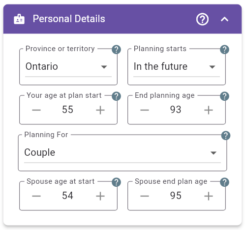

Figure 1: Personal Details - planning starts in the future

  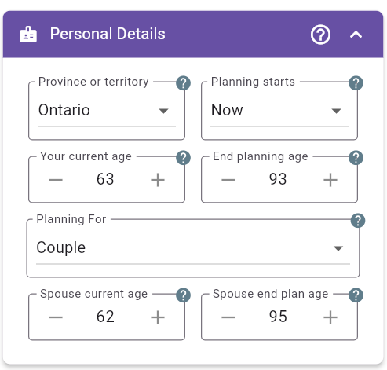

Figure 2: Personal Details - planning starts now

This panel establishes the timeline and household context for the entire model. Age inputs here affect pension start logic, tax modeling, survivorship projections, and how many years your assets must support spending.

- **Province or territory**
Select your current province or territory of residence. MayRetire applies province-specific tax brackets and credits to all annual calculations.

- **Planning starts (`Now` or `In the future`)**
Choose `Now` when the first plan year is the current year. Choose `In the future` when the projection should begin at a later age. This selection changes several fields between current and projected values so the model starts from the correct baseline.

- **Your age at plan start** *(planning starts in the future)*
Your age when the first plan year begins. This is the start of the financial projection and does not need to be the age when all employment ends.

- **Your current age** *(planning starts now)*
Your age in the current year. This positions the first plan year correctly and lets MayRetire apply age-triggered rules immediately.

- **End planning age**
The final age in the projection horizon. A longer horizon usually lowers apparent plan safety unless assets/spending assumptions are adjusted.

- **Planning For (`Single` or `Couple`)**
Chooses one-person or two-person household planning. Couple mode enables spouse timelines and tax-sharing logic used throughout the plan.

- **Spouse age at start** *(planning starts in the future + Couple)*
Your spouse's age when the first plan year begins. This aligns both timelines correctly for benefits and tax treatment.

- **Spouse current age** *(planning starts now + Couple)*
Your spouse's age in the current year.

- **Spouse end plan age** *(Couple)*
Final projection age for spouse. Important for longevity and survivor-risk analysis.

Practical guidance:

- Use realistic longevity assumptions (many users test to age 90 to 95+).
- In couple plans, even small age differences can materially change benefit timing and taxes.
- If uncertain, start conservative, then tune after reviewing simulation, stress-test, and backtest results.

## 4. Government Benefits

  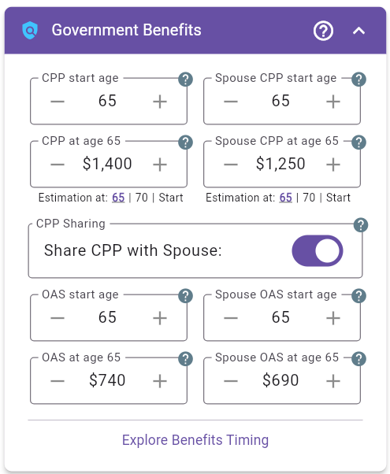

Figure 3: Government Benefits - planning starts in the future

  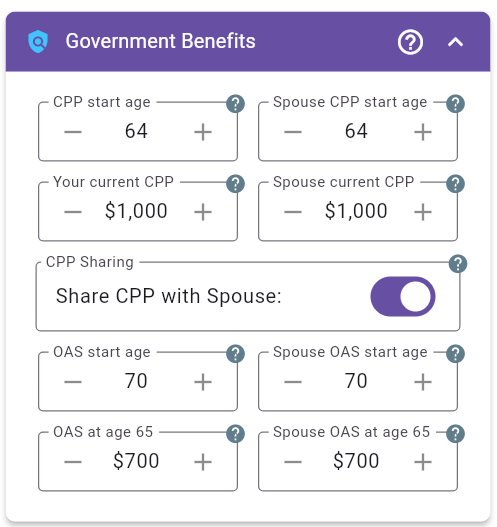

Figure 4: Government Benefits - planning starts now with CPP already started

This panel configures guaranteed government income from CPP/QPP and OAS for both partners (if applicable). These settings strongly influence required withdrawals, taxes, and long-run sustainability.

In couple mode, the left column is for you and the right column is for your spouse, with matching benefit fields aligned on the same row. In single mode, each applicable field expands to the full panel width.

- **CPP start age**
Choose the age CPP/QPP starts (typically 60 to 70). Starting earlier reduces monthly income; delaying increases monthly income.

- **OAS start age**
Choose OAS start age (typically 65 to 70). Deferral increases monthly OAS.

- **CPP amount** *(when entering a future benefit estimate)*
Enter your projected monthly CPP/QPP amount and then choose `Estimation at: 65 | 70 | Start`.
Use `65` if the amount is your estimated monthly CPP at age 65.
Use `70` if the amount is your estimated monthly CPP at age 70.
Use `Start` if the amount is your estimated monthly CPP at the age you plan to start CPP.
MayRetire converts this input into the correct CPP amount for both age 65 and your selected CPP start age.

- **OAS at age 65** *(when entering a future benefit estimate)*
Enter projected monthly OAS at age 65. MayRetire applies start-age adjustment.

- **Your current CPP / Your current OAS** *(planning starts now and the benefit has already started)*
Enter the current monthly payment instead of an age-65 estimate.

- **Spouse CPP/OAS fields** *(Couple mode)*
Use the same logic for your spouse: enter an estimate for a benefit that has not started, or the current payment when planning starts now and the benefit is already active.
For spouse CPP, `Estimation at: Start` means the estimated monthly CPP at the start of your spouse's CPP.

- **CPP Sharing**
Enabling CPP sharing does not change total household CPP. It changes taxable attribution between spouses and can improve tax efficiency.

Practical guidance:

- Use official CPP estimates where possible.
- Do not include Post-Retirement Benefit (PRB) in the CPP amount entered here.
- PRB does not participate in CPP sharing and does not affect CPP survivor benefit calculations.
- Enter PRB separately as an `Other` income source. It will be taxed as regular income to the CPP recipient.
- Keep start ages and amounts internally consistent.
- Test scenarios with CPP sharing both on and off for couple plans.

### 4.1 Explore Benefits Timing

When at least one CPP/QPP or OAS start age can still be changed, the Government Benefits panel shows an **Explore Benefits Timing** link. Select it to compare the valid start-age combinations without manually changing and recalculating the plan one age at a time.

  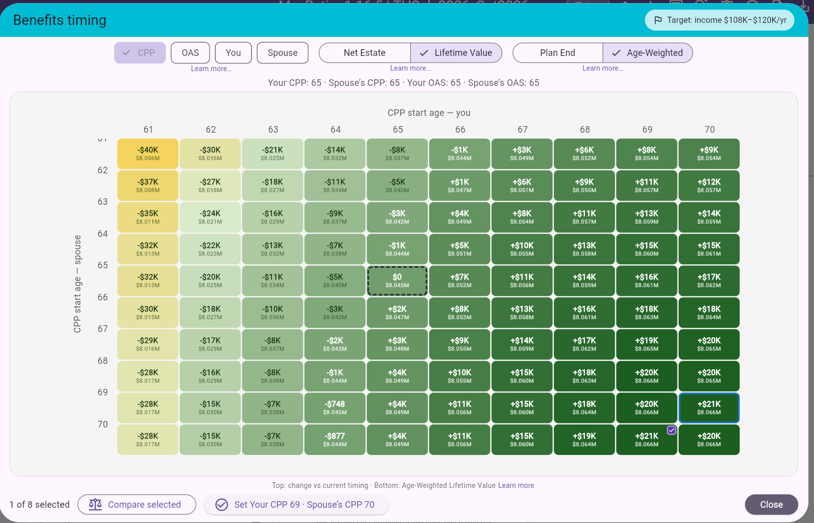

Figure 5: Explore Benefits Timing - grouped controls and Age-Weighted Lifetime Value results

The target badge in the upper-right corner identifies the income or estate objective used to determine whether each result succeeds. The left-hand button group controls which benefit ages are evaluated:

- **CPP/QPP** compares your CPP/QPP start age with your spouse's CPP/QPP start age.
- **OAS** compares both OAS start ages.
- **You** compares your CPP/QPP and OAS start ages.
- **Spouse** compares your spouse's CPP/QPP and OAS start ages.

Only applicable choices are shown. A benefit that has already started is not varied. When only one age remains variable, the heatmap becomes a single row or column while retaining the fixed benefit age on the other axis. Single-person plans do not need mode buttons and show CPP/QPP against OAS directly.

The additional buttons at the top let you choose the metric used to compare benefit timing outcomes and highlight the best tested result.

Choose **Net Estate** when your spending needs are already met and your priority is what remains for heirs. Choose **Lifetime Value** when you want to balance income received during life, donations, and inheritance.

Combine either choice with **Plan End** to focus on the full planning horizon, or **Age-Weighted** to account for possible earlier passing. For example, **Net Estate + Age-Weighted** suits an inheritance priority across possible passing ages, while **Lifetime Value + Plan End** balances lifetime income and final estate.

With **Target Estate**, final estates are already being targeted to a similar amount, so Lifetime Value helps reveal differences in income and giving.

In Figure 5, **CPP**, **Lifetime Value**, and **Age-Weighted** are selected. The grid therefore compares the two spouses' CPP start ages using **Age-Weighted Lifetime Value**. The configured ages below the controls are the current plan's reference, not the ages of the checked cell. The separate **Learn more** link below the heatmap explains cells, borders, selection, Compare, and Set.

On smaller screens, scroll the heatmap to reach additional ages. Its axis headers stay visible, and the cell text keeps its font size rather than shrinking to fit the entire grid.

Each heatmap cell represents one timing combination:

- The **top value** is the change in the selected metric compared with the currently configured timing. Negative values are lower and positive values are higher.
- The **bottom value** is the selected metric's value. Total Lifetime Value combines cumulative net income, actual donations, and final net estate.
- For a result that misses the plan target, the bottom line instead shows the funded-until age or the percentage of the estate target funded.
- Hover over a cell to see the timing combination, selected metric, after-tax estate, cumulative net income, total donated when applicable, and any funding-status details.

For definitions and a worked example, see [29.1 Understanding Value Metrics](#291-understanding-value-metrics).

Successful results use a yellow-to-green value scale, with darker green generally indicating a higher value for the selected metric. Peach cells miss the selected income or estate target. A dashed border marks the current timing, a solid blue border marks the best result, and a checkmark marks a selected cell.

You can select up to eight cells and choose **Compare selected** to inspect them in the plan-comparison dialog. When exactly one selected cell differs from the current plan, a **Set** button identifies the age or ages that will change. Confirming the change keeps the Benefits Timing dialog open, updates the current timing reference, and lets you continue exploring another mode. The changed timing is applied to the main plan when you close the dialog.

If a CPP/QPP estimate uses `Estimation at: Start`, MayRetire also adjusts the estimated monthly CPP/QPP payment when applying a different start age. Benefits that have already started are never changed.

Practical guidance:

- Each timing combination is evaluated using the plan's current withdrawal strategy and all other existing settings. Those settings may not be optimal for every benefit-timing combination, so results should be treated as comparisons under otherwise unchanged assumptions.
- Treat total lifetime value as a comparison measure, not as a guarantee of the best personal decision.
- Give priority to combinations that meet the plan target before comparing their value differences.
- Consider longevity, survivor needs, taxes, and near-term cash-flow requirements alongside the highlighted optimum.
- Use **Compare selected** to examine promising alternatives before changing the plan.

## 5. Registered Accounts

  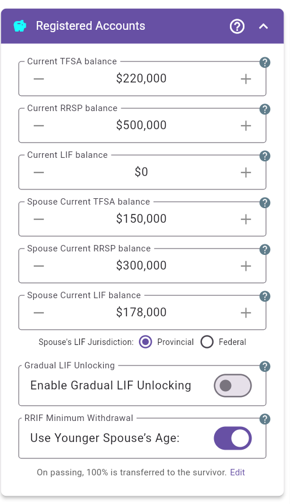

Figure 6: Registered Accounts - couple planning from now

This panel captures registered balances used to fund retirement in a tax-efficient way.

Use **Investment Portfolios** to model additional TFSA, RRSP, RRIF, LIRA, or LIF accounts separately. Do not include an additional portfolio's balance in the balance entered on this panel.

- **TFSA balance**
When planning starts in the future, enter the expected balance at plan start. When planning starts now, enter the current balance. TFSA withdrawals are generally tax-free and often used for late-stage tax control.

- **RRSP balance**
When planning starts in the future, enter the projected RRSP balance at plan start. When planning starts now, enter the current RRSP/RRIF balance. RRSP/RRIF withdrawals are taxable and central to drawdown-tax planning.

- **LIF / LIRA balance**
MayRetire shows LIF or LIRA based on age and the planning-start setting. LIRA is modeled as locked-in pension assets. For the balance entered on this panel, MayRetire models conversion at plan start or age 55, whichever is later. Depending on jurisdiction, an unlocked portion may transfer to RRSP/RRIF while the remainder becomes LIF.

- **LIF Jurisdiction (Provincial / Federal)**
Set governing regime for LIF calculations. This affects annual minimum/maximum withdrawal limits.

- **Gradual LIF Unlocking**
When available for the selected LIF jurisdiction, this option models an annual direct transfer of unused LIF maximum withdrawal room into an RRSP/RRIF. The transferred amount is treated as tax-deferred movement from locked-in funds to unlocked registered funds, not as spendable current-year cash and not as taxable LIF withdrawal income in the projection. In couple mode, the option applies to both partners where each person's LIF jurisdiction supports the strategy.

- **Spouse TFSA / RRSP / LIF (or LIRA)** *(Couple mode)*
Enter spouse balances separately so MayRetire can optimize household withdrawals and taxation.

- **Use Younger Spouse's Age** *(Couple mode)*
If you have already selected to use your younger spouse's age for RRIF minimum withdrawals, turn this option on. If you have not made the selection yet, use this setting based on what you plan to choose when opening your RRIF. Using a younger spouse's age can lower your minimum required withdrawals, helping defer taxes and preserve savings longer.

Practical guidance:

- Use one consistent as-of date across all account balances.
- Keep absent accounts at zero rather than leaving values implicit.
- Jurisdiction choice for LIF can noticeably change retirement cash-flow constraints.
- Confirm gradual LIF unlocking rules with the financial institution or the pension legislation governing the LIF, because availability and processing can depend on jurisdiction and account type.

Note:

- The LIF jurisdiction selector does not have a dedicated standalone help key in `help_info.dart`; wording above follows the app's LIF/LIRA modeling behavior.

### 5.1 Registered Account Transfers On Passing

  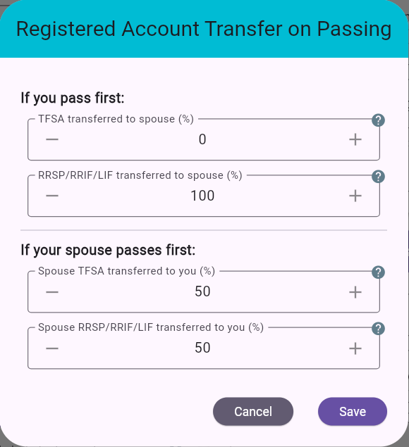

Figure 7: Registered Account Transfers On Passing

For couple plans, MayRetire assumes by default that 100% of TFSA and registered retirement accounts transfer to the surviving spouse on passing.

Use **Edit** at the bottom of the Registered Accounts panel only when part of those accounts is expected to go to someone outside the retirement plan.

- **TFSA transferred to survivor**
Set the percentage of TFSA assets transferred to the surviving spouse if that person passes first.

- **RRSP/RRIF/LIF transferred to survivor**
Set the percentage of RRSP/RRIF/LIF assets transferred to the surviving spouse if that person passes first. The remaining portion is treated as not transferring to the survivor.

Separate settings are available for your passing first and spouse passing first.

## 6. Non-Registered Account

  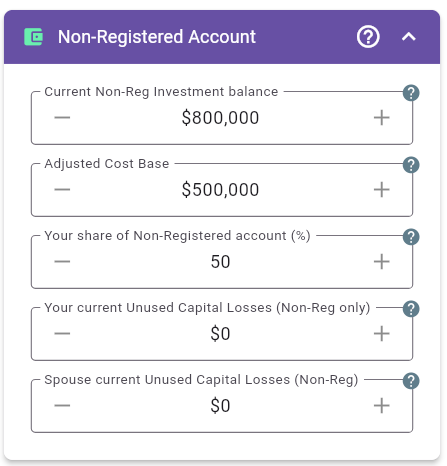

Figure 8: Non-Registered Account

This panel models taxable investment assets and their embedded tax profile.

Use **Investment Portfolios** for additional non-registered accounts. Keep their balances separate from the regular non-registered balance entered here to avoid double counting.

- **Current Non-Reg Investment balance**
Enter the current non-registered balance when planning starts now, or the projected balance at plan start when planning starts in the future.

- **Your share of Non-Registered account (%)** *(Couple mode)*
Defines tax attribution split between spouses.
Example: `50` means income and gains are attributed 50/50.

- **Adjusted Cost Base**
Enter the adjusted cost base (ACB) of the regular non-registered account. ACB is generally the amount originally invested, adjusted for purchases, sales, reinvested distributions, return of capital, and other tax cost-base adjustments.
MayRetire compares the account balance with ACB to estimate embedded capital gains or losses. This drives capital-gain tax when non-registered capital is withdrawn or deemed disposed.
Example: if the non-registered account balance is $250,000 and its ACB is $200,000, MayRetire treats the account as having an unrealized capital gain of $50,000. If the account balance is $90,000 and its ACB is $100,000, MayRetire treats it as having an unrealized capital loss of $10,000.

- **Current Unused Capital Losses for Non-Reg account**
Enter your carry-forward capital losses that can offset future realized capital gains, reducing projected tax.

- **Spouse Current Unused Capital Losses for Non-Reg account** *(Couple mode)*
Enter spouse carry-forward capital losses. MayRetire tracks unused capital losses separately because capital gains and losses are attributed to each spouse for tax purposes.

Practical guidance:

- Include taxable brokerage assets here only if they are not entered as separate Investment Portfolios.
- Keep ownership attribution aligned with actual tax reporting.
- Keep the non-registered balance and ACB as of the same date.
- Updating unused losses can significantly improve after-tax income projections.

## 7. Contribution Rooms

  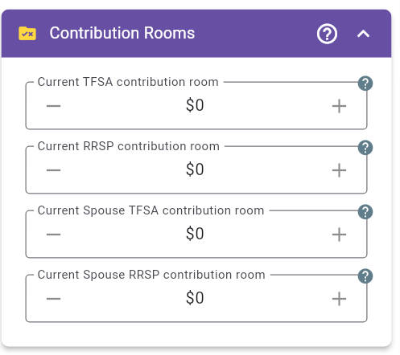

Figure 9: Contribution Rooms

This panel defines how much additional tax-sheltered contribution capacity is available.

- **Current TFSA contribution room**
Enter current available TFSA room. MayRetire increases TFSA room annually using the government limit assumption.

- **Current RRSP contribution room**
Enter RRSP room from your latest CRA Notice of Assessment. RRSP contributions are modeled as age-limited (through age 71).

- **Current Spouse TFSA contribution room** *(Couple mode)*
Same logic for spouse TFSA room.

- **Current Spouse RRSP contribution room** *(Couple mode)*
Same logic for spouse RRSP room, including age-71 contribution limit.

Practical guidance:

- CRA Notice of Assessment is the preferred source for RRSP room.
- If uncertain, start conservative and refine.
- In MayRetire assumptions, new RRSP room is not earned once retirement is underway.

## 8. Management Fees

  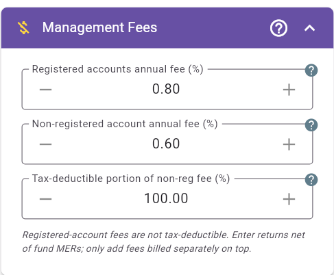

Figure 10: Management Fees for registered and non-registered accounts

This panel models annual investment costs for the regular registered and non-registered accounts. Fees for separately tracked Investment Portfolios are configured within each portfolio instead.

- **Registered accounts annual fee (%)**
Enter the annual percentage cost applied to TFSA, RRSP/RRIF, and LIF/LIRA balances. A single rate applies across the registered accounts, so use a reasonable balance-weighted average when the underlying investments have different fees. Registered-account fees reduce account balances but are not tax-deductible.

- **Non-registered account annual fee (%)**
Enter the annual percentage cost applied to the regular non-registered account. The cost can represent embedded fund expenses such as management expense ratios (MERs), separately billed management or advisory fees, or a combination of these costs. If the account contains investments with different fees, use a reasonable balance-weighted average.

- **Tax-deductible portion of non-reg fee (%)**
This field appears when the non-registered fee is greater than zero. Enter only the portion eligible for a personal tax deduction. In couple plans, MayRetire allocates the deduction using the ownership share of the regular non-registered account. Use `0%` for an embedded ETF or mutual-fund MER because that expense is reflected within the fund rather than claimed separately on the investor's tax return. For separately billed fees, exclude non-deductible components such as financial-planning services.

### 8.1 Two Ways To Account For Investment Fees

Investment costs can be reflected either in the expected return or as a separate Management Fee. Both approaches can produce a reasonable long-term projection, but the same cost must not be included twice.

| Situation | Return assumption | Management Fee input | Tax-deductible portion |
|---|---|---|---|
| Published ETF or fund return already reflects its MER | Use the net return | Do not enter the MER again | `0%` |
| Gross return or FP Canada asset-class return | Use the before-fee return | Enter the applicable MER or other fee | `0%` for an embedded MER |
| Separately billed eligible fee for a non-registered account | Use a return before that fee | Enter the billed rate | Enter only the eligible percentage |
| Fee applied to registered accounts | Use a return before that fee | Enter the applicable rate | Not deductible |

Using the separate Management Fee input is generally clearer when the return assumption is before fees. It shows the cost explicitly in results and allows MayRetire to apply eligible non-registered deductions. If a separately billed deductible fee is absorbed into a net return instead, its tax deduction cannot be modeled.

Account-level fees are percentage-based. Fixed-dollar fees are available only for individual Investment Portfolios.

### 8.2 How Fees Affect The Projection

- MayRetire calculates fees from opening balances and removes them at the start of each projection year. This is a practical annual approximation for costs such as an MER, which is normally reflected gradually in a fund's value.
- Subsequent income, withdrawal, tax, and return calculations use the balances remaining after fees.
- A fee charged to the regular non-registered account reduces its market balance but is not treated as a sale. It does not realize a capital gain or loss, and its implied adjusted cost base remains unchanged.
- Eligible non-registered and Investment Portfolio fees are included in tax-deductible expenses. Registered-account fees remain non-deductible.
- When fees occur, result summaries show total management fees and applicable deductible totals. The Detailed Projections table also offers a `Management Fee` column group, hidden by default, with only the relevant non-zero columns included.

## 9. Withdrawal Strategy

  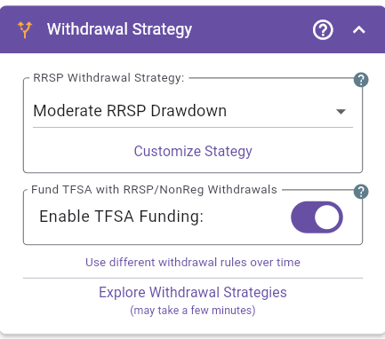

Figure 11: Withdrawal Strategy - Preset

  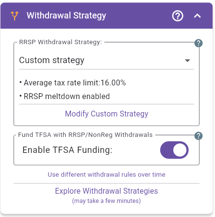

Figure 12: Withdrawal Strategy - Custom Summary

This panel controls account drawdown behavior and tax constraints across RRSP/RRIF, non-registered assets, and TFSA.

- **RRSP Withdrawal Strategy**
Choose a predefined style (`Conservative`, `Moderate`, `Progressive`, `Accelerated`) or define a `Custom strategy`.

- **Preset mode**
Applies a ready profile to speed up scenario testing.

- **Custom mode**
Displays your active custom constraints (for example: amount limits, tax limits, meltdown, OAS-clawback adjustment).

- **Customize Strategy / Modify Custom Strategy**
Opens the full strategy editor.

- **Fund TFSA with RRSP/Unreg Withdrawals**
When enabled, MayRetire may withdraw beyond immediate spending needs to use TFSA room. TFSA can become a destination account for tax-efficient repositioning.

- **TFSA withdrawal rate (0 to 100)** *(shown when TFSA funding is disabled)*
Controls the share of remaining shortfall covered from TFSA.
Example: if remaining shortfall is $10,000 and rate is 20, TFSA contributes about $2,000 before fallback rules apply.

- **Explore Withdrawal Strategies**
Opens a setup dialog to choose the rates and options to evaluate, followed by a heatmap for comparing results and applying a strategy. Evaluation may take a few minutes. If the plan has multiple time ranges, select the range to explore first. See [9.3 Explore Withdrawal Strategies](#93-explore-withdrawal-strategies).

### 9.1 Withdrawal Strategy Over Time

  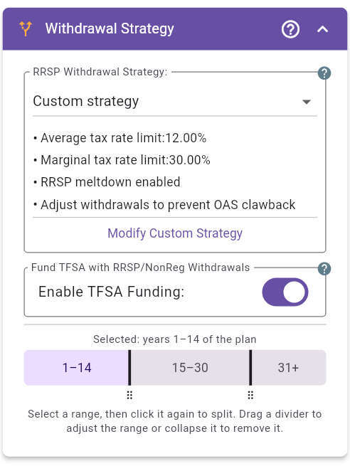

Figure 13: Withdrawal Strategy - different settings over time

You can configure different withdrawal settings for different periods of the plan, such as early retirement, later retirement, or a survivor period. Each range uses its own RRSP withdrawal strategy and TFSA settings.

- The timeline uses plan years, beginning with year 1. Ranges are consecutive and cannot overlap.
- Select a range on the timeline to view and edit the withdrawal settings that apply to that period.
- Click the selected range again to split it at that plan year, creating a new range with its own settings.
- Drag a divider to adjust where two ranges meet.
- Collapse a divider to remove it and merge the adjacent ranges.

When only one range covers the planning period, the panel continues to work as a single set of withdrawal settings.

Practical guidance:

- Use presets first to map the strategy space quickly.
- Use custom controls for tax-aware optimization.
- Compare with TFSA funding on/off to see long-term estate-tax effects.

### 9.2 Custom RRSP Withdrawal Strategy

  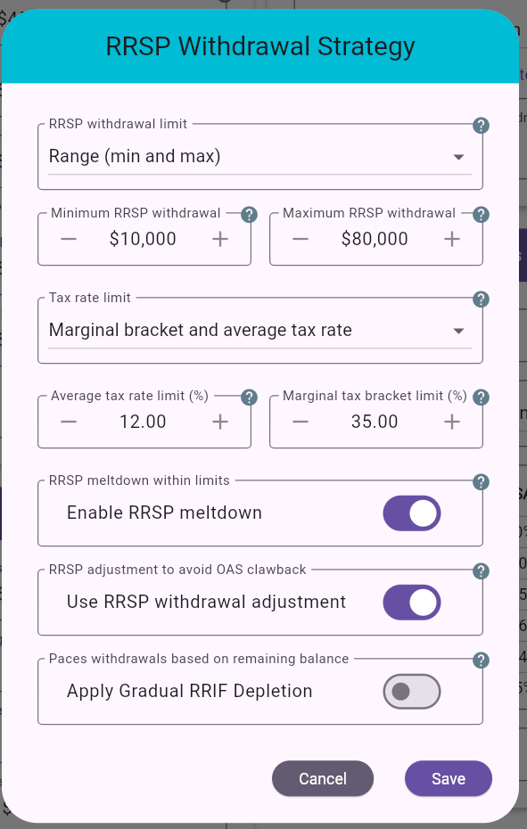

Figure 14: RRSP Withdrawal Strategy Dialog

Use this dialog to define annual withdrawal limits and tax targeting behavior.

- **RRSP withdrawal limit**
Options include range, min-only, max-only, fixed amount, or no amount limit.

- **Minimum RRSP withdrawal / Maximum RRSP withdrawal**
Used when floor/ceiling control is enabled.

- **Tax rate limit**
  Choose tax control mode:
  - marginal + average
  - marginal only
  - average only
  - RRSP tax-cost limit
  - no tax limit

- **Average tax rate limit (%)**
Best-effort ceiling for average effective tax burden.

- **Marginal tax bracket limit (%)**
Best-effort ceiling for marginal tax on the next withdrawal dollar.

- **Enable RRSP meltdown**
Allows RRSP withdrawals above required income (within limits), often to reduce future tax concentration. Excess can be redirected to TFSA (if room exists) or non-registered account.

- **Use RRSP withdrawal adjustment** *(avoid OAS clawback)*
Reduces RRSP withdrawals where possible to lower OAS clawback while respecting mandatory minima.

- **Apply Gradual RRIF Depletion**
Adds a minimum pace intended to avoid very large end-of-plan RRIF balances and associated estate-tax spikes.

- **Conditional options you may also encounter**
Bridging before CPP/OAS, fixed-amount override behavior, RRSP tax-cost limit, and other mode-specific controls.

### 9.3 Explore Withdrawal Strategies

Select **Explore Withdrawal Strategies** at the bottom of the Withdrawal Strategy panel. It evaluates combinations of **Average Tax Limit** and **RRSP Withdrawal Rate or Meltdown**, together with the options chosen in setup. Review the results in an interactive heatmap. If these parameters differ across plan-year ranges, select the range you want to explore on the timeline first. Candidate settings apply to that period; settings for other periods remain unchanged. Each candidate is calculated over the full plan, using the same sequence of investment returns, so later effects are included in its score.

#### 9.3.1 Choose Ranges and Options

  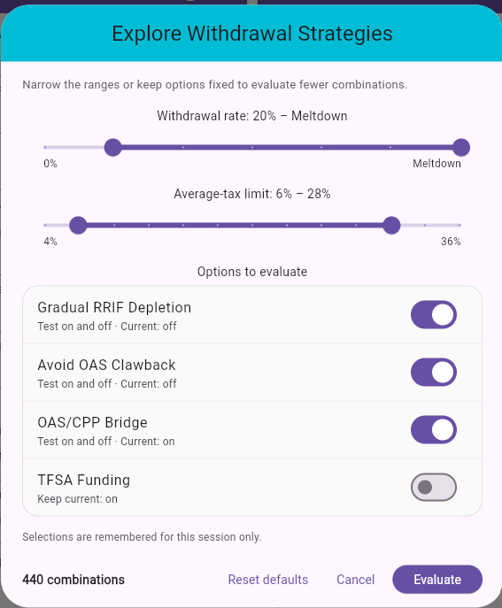

Figure 15: Explore Withdrawal Strategies - setup

**Before calculation**, a setup dialog lets you narrow both ranges with discrete two-handle sliders. Each option switch controls whether to test both on and off; turning it off keeps that option at the current strategy's value. A live combination count shows the effect. **Reset defaults** restores the suggested ranges and options for the current plan-year period. **Cancel** starts no calculations. Confirmed options are remembered **only in memory for the current session**, including across plan changes; they are not stored in saved plans or preferences.

Choose **Evaluate** to start the calculation. A compact progress dialog shows progress before the heatmap opens. Narrowing the ranges or keeping options fixed reduces the number of combinations and the calculation time.

#### 9.3.2 Read the Heatmap

For definitions and a worked example, see [29.1 Understanding Value Metrics](#291-understanding-value-metrics).

  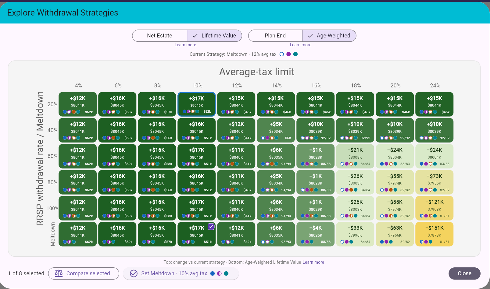

Figure 16: Explore Withdrawal Strategies - grouped metric controls and Age-Weighted Lifetime Value results

A right-hand title badge identifies a partial-plan range using the timeline notation (for example, **Years 3–10** or **Years 11+**); no range badge is shown when evaluating the entire plan. The compact **Current Strategy** summary above the heatmap is always visible.

The vertical axis shows RRSP withdrawal rates and a separate **Meltdown** row. The horizontal axis shows average-tax limits from 4% to 20% in 2-point steps and 24% to 36% in 4-point steps; unlimited tax is not tested. Withdrawal rates run from 0% to 100% in 20-point steps. Only test points within the selected ranges are evaluated; current settings do not add extra rows or columns. The **Current Strategy** reference shows its actual withdrawal rate or Meltdown, active average and/or marginal tax limits or RRSP withdrawal tax cost, fixed/minimum/maximum amounts, and option indicators, even when that strategy is outside the tested grid. Row headers remain fixed during horizontal scrolling, and column headers remain fixed during vertical scrolling. These candidates use no withdrawal amount limit; mandatory withdrawals and the engine's spending fallback rules still apply.

Each cell shows the best successful candidate among combinations of **Gradual RRIF Depletion**, **Avoid OAS Clawback**, **CPP/OAS Bridging**, and **TFSA Funding**. When all four option switches are enabled, there are 16 combinations per withdrawal-rate cell, and eight in the Meltdown row because bridging is ignored there. Keeping options fixed reduces the count. Fixed options retain their current values and are not marked as having no impact, since both values were not tested. Depletion retains its existing behavior: its minimum pace starts at age 72. When all candidates in a cell fail, the cell displays its funding status.

The buttons at the top let you choose the metric used to compare withdrawal strategies and highlight the best tested result.

Choose **Net Estate** when required spending is met and leaving more to heirs is your priority. Choose **Lifetime Value** when you also value income received during life and donations alongside inheritance. Combine either with **Plan End** to compare outcomes over the full planning horizon, or **Age-Weighted** when possible earlier passing should influence the comparison.

For example, **Net Estate + Age-Weighted** helps compare what heirs might receive at different passing ages. **Lifetime Value + Age-Weighted** also accounts for income and donations received or made up to those ages. Under **Target Estate**, Lifetime Value is used because similar final estate targets can conceal meaningful differences in income and giving.

The upper cell value is the change from the current strategy; the lower value is the selected metric. The blue border identifies the best tested successful result, and a dashed border identifies Current Strategy only when the displayed candidate matches its active settings, including options. That exact match is initially selected; a rate/tax match alone is insufficient.

Figure 16 illustrates **Lifetime Value + Age-Weighted**, which balances income, giving, and estate across possible passing ages.

The **Learn more** links beneath the two groups explain what each choice means and when to prefer it. The separate link below the heatmap explains the result cells and how to compare or apply a strategy. Changing the metric keeps your selected combinations; their check marks and the best-result border have different meanings.

#### 9.3.3 Understand Option Indicators and Account Balances

  

Figure 17: Explore Withdrawal Strategies - enlarged cell examples

Read the examples from top to bottom:

- **Top amount — change versus Current Strategy:** `+$32K` means the selected metric is about $32,000 higher; `−$44K` means about $44,000 lower. `−$0K` indicates a small negative difference that rounds to zero at the displayed precision.
- **Middle amount — selected metric value:** `$4475K` is approximately $4,475,000. It is the candidate's value for the metric selected above the heatmap, rather than its change from the current strategy.
- **Coloured circles — strategy options:** from left to right, blue is Gradual RRIF Depletion, purple is Avoid OAS Clawback, amber is OAS/CPP Bridge, and teal is TFSA Funding. Filled, empty, and half-filled circles mean on, off, and no impact, respectively. Inapplicable options are omitted.
- **Bottom-right amount or ages — registered funds:** `$84k` means approximately $84,000 remains in the combined registered accounts at plan end. `92/91` means those accounts became and remained depleted at your age 92 and your spouse's age 91. Larger balances use notation such as `$1.2m`.
- **Check mark — selected candidate:** the first example is selected for comparison or applying. Selection is separate from the blue border marking the best tested result and the dashed border identifying an exact match to Current Strategy; those borders are visible in the full heatmap above.
- **Background colour — relative result:** darker green indicates a higher value for the selected metric among the displayed successful candidates; yellow indicates a lower value. A green cell can still be below Current Strategy, so use the signed top amount to judge improvement.

Four distinct colours identify the options. A filled circle means enabled, an empty circle means disabled, and a half-filled circle means **no impact** on the selected metric and funding status within a one-cent tolerance. Compact text uses **n/i** for this status. Every on/off combination of the n/i options is checked together, so interacting options are only marked n/i when they are jointly neutral. This does not imply identical annual cash flows. Inapplicable options are omitted. Hover over an indicator for its name and on/off or no impact status. The bridging option is labelled **OAS/CPP Bridge** (additional RRSP withdrawals for CPP/OAS bridging).

The bottom row aligns option circles left and a compact balance or depletion age right, for example `$207k`, `$1.2m`, or `91/92`. Two ages are in you/spouse order. Hover over a cell for the full balance or depletion explanation.

Each cell's tooltip shows **Balance** for the combined RRSP/RRIF/LIF/LIRA funds remaining at plan end, or **RRSP/LIF depleted by age** when those accounts became and remained empty. Couples see both spouses' ages. Temporary zero balances followed by later funding do not count as depletion. These details match the settings used by Compare and Set, including preserved no-impact options.

#### 9.3.4 Compare and Apply a Strategy

Select up to eight concrete combinations, then choose **Compare** to view their full-plan results alongside **Current Strategy**. Changing the metric updates the heatmap's winners without replacing your selected combinations. Check marks identify cells containing selected combinations; tapping a checked cell removes its selections. **Set** appears only when exactly one combination is checked and applying it would change the current strategy. Its label and option indicators show the settings that will update the evaluated strategy range. Half-filled n/i options preserve their current values when setting, as do inapplicable options. Compare uses those same settings to preview the plan that Set will apply; switching metrics can change which options are neutral. The dialog shows the selection count without a selected-strategy details panel. **Learn more** contains the detailed metric, option, and selection explanations. In the comparison dialog, the baseline and its include toggle are named **Current Strategy**. The original RRSP strategy evaluation table remains a separate feature.

Comparison labels abbreviate withdrawal as **WD** and list only enabled options that have an impact: **deplete**, **avoid clw**, **bridge**, and **tfsa**. For example: `80% WD · 14% tax (deplete,tfsa)`. Disabled, inapplicable, and no-impact options are omitted. The comparison dialog opens on its usual first metric, **After Tax Estate**, regardless of the heatmap's selected metric.

## 10. Investment Assumptions

  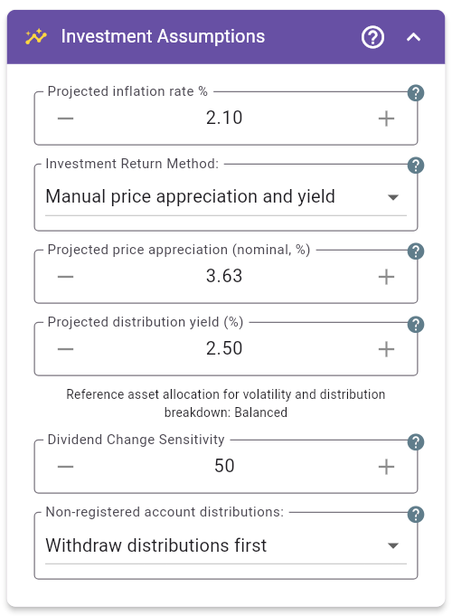

Figure 18: Investment Assumptions - Manual price appreciation and yield

  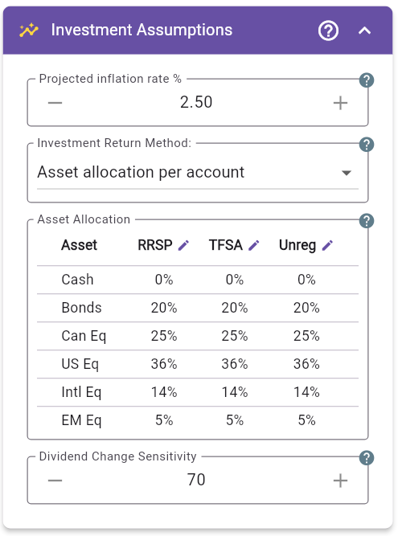

Figure 19: Investment Assumptions - Asset Allocation per Account

This panel sets inflation and return modeling assumptions for the accounts entered on the main page. Additional Investment Portfolios have their own return settings. Both methods support Calculate, Simulate, Stress Test, Backtest, Corporate Accounts, Investment Portfolios, and Suggested Adjustments.

- **Projected inflation rate (%)**
Long-term inflation assumption.
MayRetire uses inflation to keep results in real-dollar terms and for calculations that require nominal tracking (for example, capital-gain tax effects).

- **Investment Return Method**
Choose one of two approaches:

  1. `Manual price appreciation and yield`: enter projected nominal price appreciation and distribution yield for the accounts entered on the main page.
  2. `Asset allocation per account`: define account-level asset mixes; MayRetire derives returns using FP Canada Projection Assumption Guidelines.

Changing this setting does not change the return mode selected for an additional Investment Portfolio.

### 10.1 Manual price appreciation and yield

Use this method when you want to specify the return components directly rather than derive them from an asset mix. MayRetire uses a Balanced asset allocation as the reference for volatility in simulations and for estimating the non-registered distribution breakdown. The reference allocation is not selectable on this panel at present.

- **Projected price appreciation (nominal, %)**
Expected annual price growth before distributions, expressed in nominal rather than inflation-adjusted terms. Do not include the distribution yield in this input.

- **Projected distribution yield (%)**
Expected annual distributions as a percentage of portfolio value.

The app displays projected results in today's dollars where applicable; it uses the inflation assumption to translate between nominal and real values.

### 10.2 Asset allocation per account

  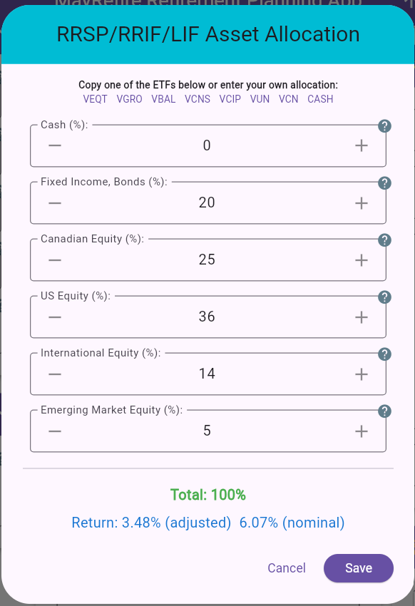

Figure 20: Asset Allocation Dialog (RRSP/RRIF/LIF)

In this method, users input allocation weights, not return rates.

- MayRetire applies FP Canada asset-class assumptions.
- Account return expectations are derived from each account's mix.
- Each account column must total 100%.

Asset buckets and tax interpretation in non-registered context:

- **Cash**: interest-like return, taxed as regular income.
- **Fixed Income (Bonds)**: modeled with interest and price movement; interest is taxed as regular income.
- **Canadian Equity**: dividends typically modeled as eligible dividends.
- **US Equity**: dividends treated as foreign income (regular-income taxation).
- **International Equity**: dividends treated as foreign income.
- **Emerging Market Equity**: dividends treated as foreign income.

Editor features:

- ETF shortcuts for quick starting templates.
- Real and nominal implied return shown for the selected mix.

### 10.3 Settings shared by both methods

- **Dividend Change Sensitivity (DCS)**
Controls how distribution amounts respond to price changes. For example, DCS 50 means a 10% price move changes distributions by about 5% in the same direction. At DCS 100, distribution yield as a percentage of price remains roughly constant.

- **Non-registered account distributions**
  Choose one:
  - `Withdraw distributions first`: prioritize distributions before principal sales.
  - `As part of non-registered withdrawal`: use distributions as needed along with non-registered capital.

## 11. Income Requirements

  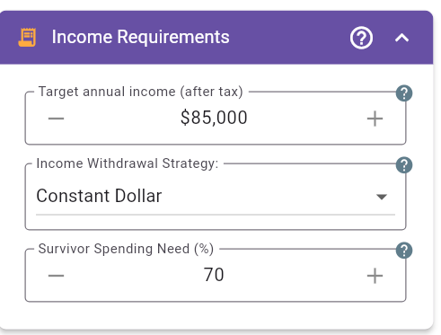

Figure 21: Income Requirements - Constant Dollar

  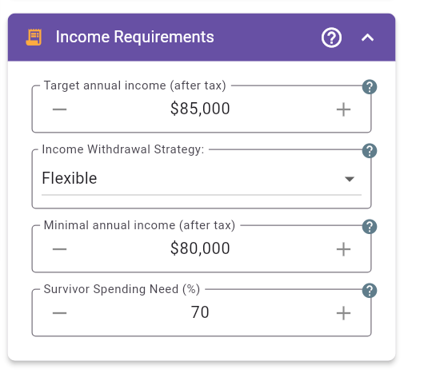

Figure 22: Income Requirements - Flexible

  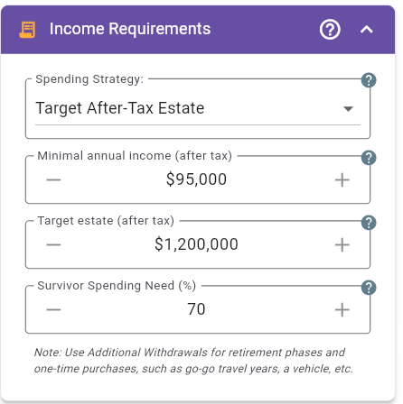

Figure 23: Income Requirements - Target After-Tax Estate

This panel defines after-tax spending requirements in today's dollars (real purchasing power).
Use it to choose whether the plan should target a specific spending level or find sustainable spending while preserving a desired estate.

- **Target annual income (after tax)** *(shown in Constant Dollar and Flexible modes)*
Preferred after-tax income level for normal retirement lifestyle spending.

- **Spending Strategy**
  - `Constant Dollar`: stable real spending target year to year.
  - `Flexible`: income can adjust between target and minimum based on plan strength and return conditions.
  - `Target After-Tax Estate`: finds sustainable spending while attempting to preserve the selected after-tax estate.

- **Minimal annual income (after tax)** *(shown in Flexible and Target After-Tax Estate modes)*
Lower after-tax income floor MayRetire attempts to protect in weak scenarios.

- **Target estate (after tax)** *(shown in Target After-Tax Estate mode)*
Desired after-tax estate at the end of the plan, including the modeled net value of the estate after applicable taxes and debts.

- **Survivor Spending Need (%)** *(Couple mode)*
Percent of combined household budget the surviving spouse is expected to need.
Common planning range is roughly 60% to 70%, because many fixed costs remain after one partner passes.

### 11.1 How Flexible Income Is Used

Flexible income is best understood as a planning guardrail, not an automatic real-life withdrawal rule.
The target income represents preferred lifestyle spending, while the minimum income represents a lower level the plan should try to preserve when markets, balances, or other assumptions are under pressure.

For Calculate-style runs, MayRetire first tests whether the plan can support the full target income.
If the target is not sustainable, it tests whether the minimum income is sustainable.
If the minimum works, MayRetire searches between the minimum and target to find the highest income level that can still keep the plan funded under the selected assumptions or return sequence.

For simulation and backtesting runs, MayRetire also compares each scenario's current asset path against a reference baseline.
If assets are tracking below the reference path, the current year's flexible income is reduced toward the minimum.
If assets are healthy, income can remain closer to the target.
The intent is to spend more when the plan has room and less when markets or balances are under pressure.

In practice, do not treat the flexible result as an exact spending rule for every future year.
A more practical approach is to create an updated plan at least annually using current account balances, current pension and income details, updated debt or insurance assumptions, current tax context, and any changed priorities.
At that point, you may also decide whether the target and minimum income range itself should move up or down.

The first year of the updated projection can then be used as guidance for the upcoming year's cash flow, including planned spending, account withdrawals, taxes, contributions, debt payments or advances, and other income sources.
In this sense, MayRetire helps answer: given where the plan stands now, what cash-flow plan looks reasonable for the next year while preserving the long-term plan?

Practical guidance:

- Start with Constant Dollar for baseline planning.
- Add Flexible strategy for robustness testing.
- Revisit the target and minimum income range whenever your plan is updated.
- Add known one-time or phase-based expenses separately in `Additional Withdrawals`, such as travel years, vehicle replacement, renovations, or health-care support.
- Run Calculate, Stress Test, and Simulate after major updates, then use the first projected year as guidance for the coming year.
- Revisit survivor percentage carefully, as it meaningfully affects required assets.

### 11.2 How Target After-Tax Estate Is Used

With `Target After-Tax Estate`, MayRetire searches for a sustainable spending level that also leaves the requested after-tax estate at the end of the plan.
The minimum annual income remains an important floor: a plan is not considered successful if that minimum spending cannot be sustained, even when the remaining estate is above the target.

The estate target represents inheritance after modeled estate taxes and debts and considers all modeled estate assets, including financial accounts, net real-estate equity, and insurance proceeds where applicable.

Reaching the precise target is not always possible.
The calculation searches using practical income increments, and taxes, account withdrawals, asset sales, insurance proceeds, and other modeled events can cause the final estate to move in uneven steps.
The projected estate may therefore finish somewhat above or below the requested amount.

Stress tests, simulations, and backtests apply different return and inflation paths without knowing those future paths in advance.
As a result, they may produce substantially different spending and estate outcomes from the baseline calculation.
For this strategy, a scenario is fully successful only when it sustains the minimum spending requirement and meets the estate target.

Setting `Target estate (after tax)` to `$0` is the special **Die with Zero** case.
It removes the requirement to preserve a positive inheritance and lets the calculation seek higher sustainable spending, but it does not guarantee that the final estate will be exactly zero.
A positive estate may remain, and the plan still fails if the minimum annual income cannot be sustained.

## 12. Additional Withdrawals

  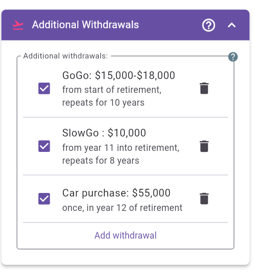

Figure 24: Additional Withdrawals panel with multiple planned withdrawals

This section lets you model discretionary or phase-specific spending that sits on top of your base income target. Typical use cases include travel phases, gifts, major purchases, family support, or one-time events.

Panel behavior:

- Each withdrawal appears as a separate item with amount and timing summary.
- Checkbox toggles include/exclude an item from the scenario without deleting it.
- Trash icon deletes an item.
- `Add withdrawal` creates a new item using the edit dialog.

### 12.1 Edit Dialog Fields

  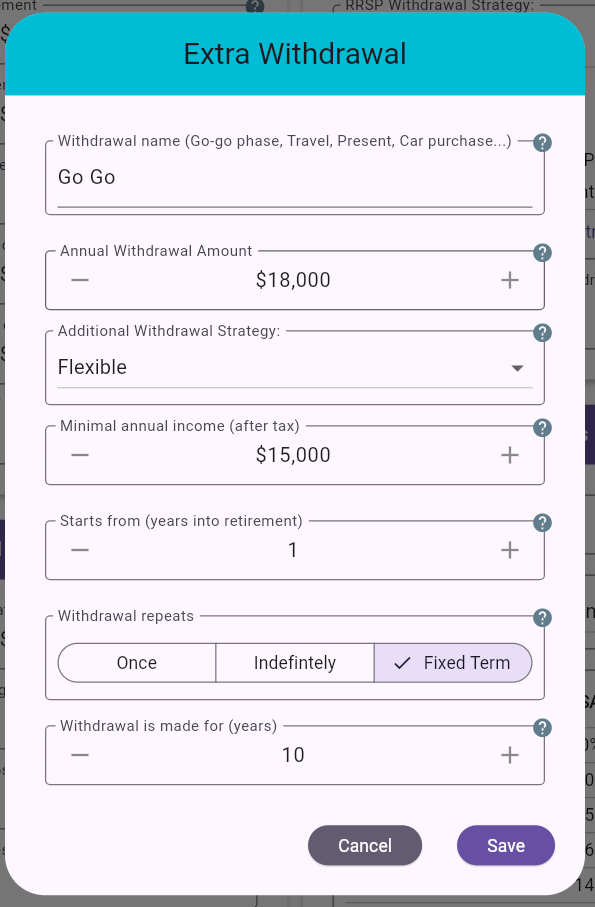

Figure 25: Additional Withdrawal edit dialog

- **Withdrawal name**
Use a descriptive label (for example: `Go-Go`, `Slow-Go`, `Car purchase`, `Family support`).

- **Annual Withdrawal Amount**
Target yearly amount for this withdrawal item.

- **Additional Withdrawal Strategy**
Choose one:

  - `Constant Dollar`: keeps the withdrawal amount fixed in real terms.
  - `Flexible`: allows the withdrawal to vary when needed, subject to a minimum floor.

- **Minimal annual income (after tax)** *(shown when strategy is Flexible)*
Minimum after-tax amount you still want to preserve for this withdrawal category.

- **Starts in plan year**
Choose when the withdrawal begins.
  - `1` means the first year.
  - `11` means plan year 11.

- **Withdrawal repeats**
Choose recurrence mode:

  - `Once`: one-time withdrawal.
  - `Indefinitely`: continues through the full remaining plan.
  - `Fixed Term`: continues for a specified number of years.

- **Withdrawal Frequency** *(shown when the withdrawal is not Once)*
Choose how often the withdrawal occurs within the selected period:
  - `Every year`: applies annually.
  - `Every 2 years`, `Every 3 years`, etc.: applies only in matching interval years, starting from the selected start year.

- **Withdrawal is made for (years)** *(shown for Fixed Term)*
Number of years the withdrawal repeats.

Practical guidance:

- Use multiple items instead of one large blended amount when goals occur at different times.
- Keep optional spending separate from core lifestyle spending (configured under Income Requirements) for clearer stress testing.
- Enable/disable items to run quick what-if comparisons without re-entering data.

## 13. Employment and Other Income

  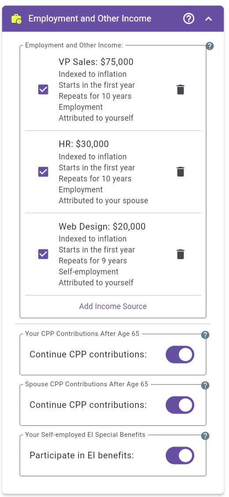

Figure 26: Employment and Other Income panel with employment, self-employment, and applicable payroll settings

Use this panel for employment, self-employment, and other non-portfolio income expected during the plan. MayRetire applies payroll and workplace-plan rules according to each source's income type.

Panel behavior:

- Each source shows its amount, timing, type, and owner.
- The checkbox includes or excludes a source without deleting its settings.
- The trash icon permanently removes a source.
- `Add Income Source` opens the edit dialog and defaults the new source to `Employment`.
- Person-level payroll settings appear below the income list only when they are applicable to the configured sources and planning ages.

### 13.1 Panel and Common Income Settings

Every source has a descriptive name, income type, annual amount, annual adjustment, owner, start year, and recurrence. Select the income type before entering the amount because the meaning and available settings change by type:

- `Employment` is gross salary or wages from an employer.
- `Self-employment` is net business income after deductible business expenses.
- `Other` covers pensions, annuities, dividends, sales, inheritances, and other income not calculated through payroll rules.

Employment and self-employment must be assigned to one person. Other income can be assigned to you, your spouse, or both. Existing income sources created before income types were introduced remain `Other`, preserving their previous treatment.

For timing, `Start in plan year 3` means the source begins in the third year of the plan. Choose `Once`, `Indefinitely`, or `Fixed Term`; a fixed-term source also requires the number of years it repeats. The annual adjustment determines whether the amount keeps pace with inflation or changes in real terms.

### 13.2 Employment Income

  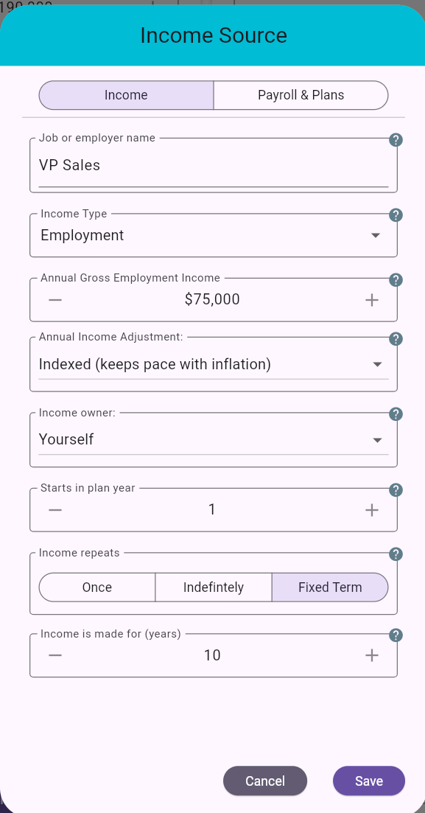

Figure 27: Employment income amount, owner, indexing, and timing settings

Enter **Annual Gross Employment Income** as cash salary or wages before income tax, CPP or QPP contributions, EI premiums, and employee workplace-plan deductions. Do not include employer retirement-plan contributions in this amount; MayRetire calculates them from the arrangements on the `Payroll & Plans` tab.

Employment income is treated as regular taxable income. MayRetire also calculates the applicable payroll contributions, deductions and credits, and RRSP earned income for each person and planning year.

#### 13.2.1 Payroll Classification

  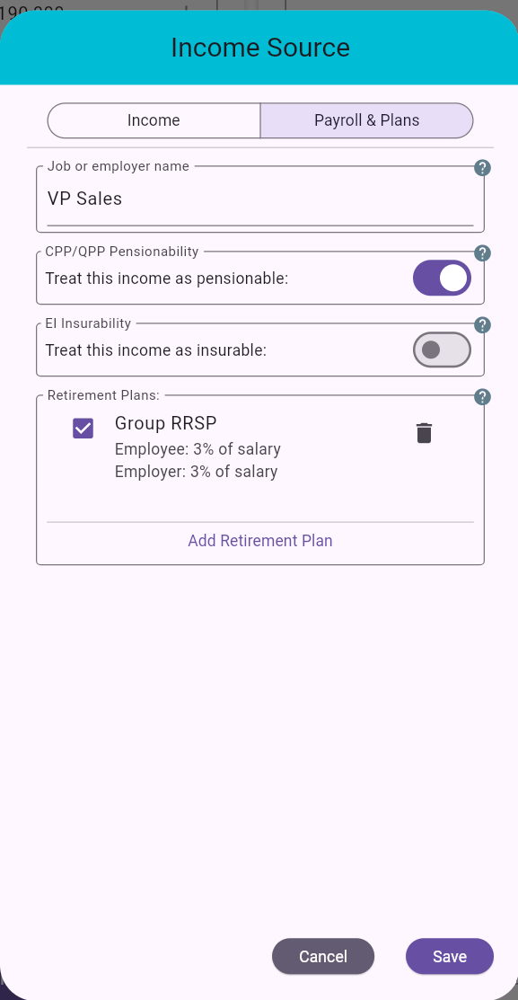

Figure 28: Employment-specific payroll classification and workplace retirement plans

The source-level payroll switches describe the employment itself:

- **CPP/QPP Pensionability:** Most employment is pensionable. Turn this off only when this employment is excluded. The person's age, CPP/QPP start age, and after-age-65 election are applied separately.
- **EI Insurability:** Most employment is insurable. Turn this off only for excluded employment, such as certain owner-manager or non-arm's-length arrangements. MayRetire uses your selection and does not determine legal insurability.

These settings belong to this job. The after-age-65 CPP/QPP and self-employed EI elections described in Section 13.5 belong to the person and apply across that person's relevant income sources.

#### 13.2.2 Workplace Retirement Plans

Workplace retirement plans are configured from the employment source's `Payroll & Plans` tab. Add each arrangement separately. Use its checkbox to include or exclude it without losing the configuration, or the trash icon to remove it.

Percentage contributions are based on that employment's gross salary. Fixed annual contributions are entered in today's dollars and remain constant in real terms. MayRetire applies the relevant RRSP-room, Pension Adjustment, statutory-limit, and age rules. Defined Contribution and Deferred Profit Sharing balances held by an employer are also tracked until they transfer to the appropriate personal registered account.

##### 13.2.2.1 Group RRSP

  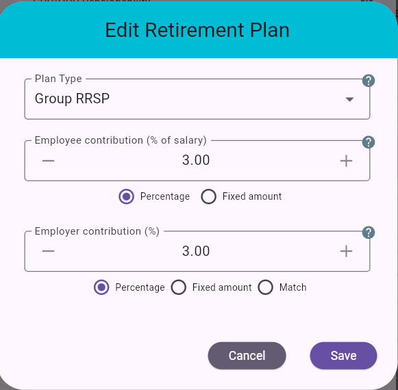

Figure 29: Group RRSP employee and employer contribution settings

The employee contribution can be a percentage of salary or a fixed annual amount. The employer contribution can be a percentage, a fixed amount, or a match of the employee's resolved contribution. If configured, an optional match limit caps the match at a percentage of salary.

Group RRSP contributions use the person's available RRSP room. When the requested employee contribution exceeds the room remaining after earlier arrangements, MayRetire reduces it and reports a warning. Employer Group RRSP contributions are modeled as taxable employment benefits and registered-plan contributions, then deposited into the person's RRSP.

##### 13.2.2.2 Defined Contribution

  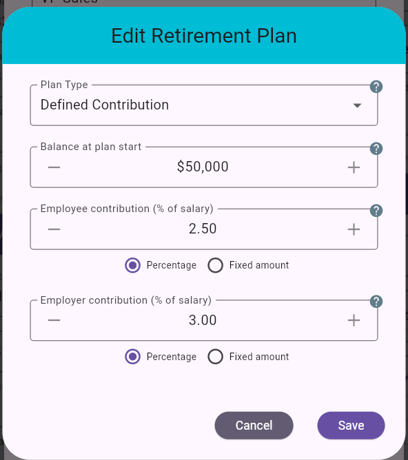

Figure 30: Defined Contribution opening balance and annual contributions

Enter any balance still held in the active employer plan at plan start, plus employee and employer contributions as percentages or fixed annual amounts. Do not include assets already transferred to a LIRA or LIF.

Employee and employer contributions build the employer-held balance and create a Pension Adjustment that reduces the following year's RRSP room. When the employment ends, or the plan reaches the modeled maturity deadline, the balance follows the applicable locked-in transfer path, such as a LIRA or LIF.

##### 13.2.2.3 Defined Benefit

  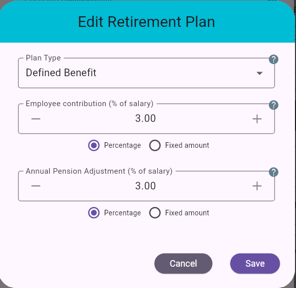

Figure 31: Defined Benefit employee contribution and Pension Adjustment settings

Enter the employee contribution as a percentage of salary or fixed annual amount. Enter the annual **Pension Adjustment** from T4 box 52 or an employer estimate, either as a percentage of salary or a fixed amount in today's dollars. The Pension Adjustment reduces the following year's RRSP room.

This arrangement models working-period deductions and RRSP-room effects only. Configure the eventual pension payment, bridge benefit, indexing, and survivor benefit separately in the **Defined Benefit Pensions** panel.

##### 13.2.2.4 Deferred Profit Sharing Plan

  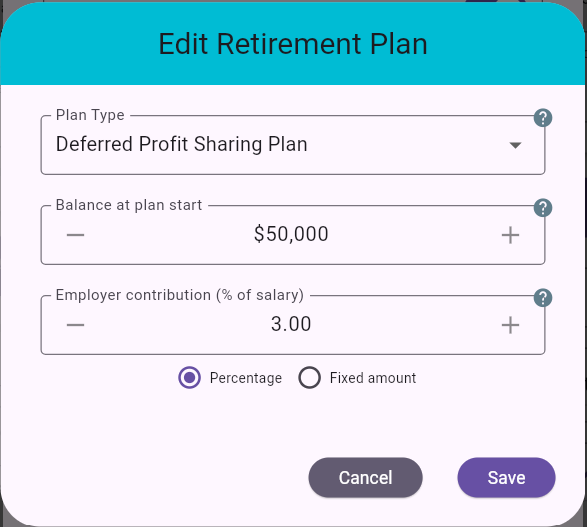

Figure 32: Deferred Profit Sharing opening balance and employer contribution

Enter any balance still held in the active employer plan at plan start and the employer contribution as a percentage of salary or fixed annual amount. A Deferred Profit Sharing Plan has no employee contribution.

Employer contributions build the employer-held balance and create a Pension Adjustment that reduces the following year's RRSP room. When the employment ends, or the plan reaches the modeled maturity deadline, MayRetire transfers the balance to the person's RRSP.

### 13.3 Self-Employment Income

  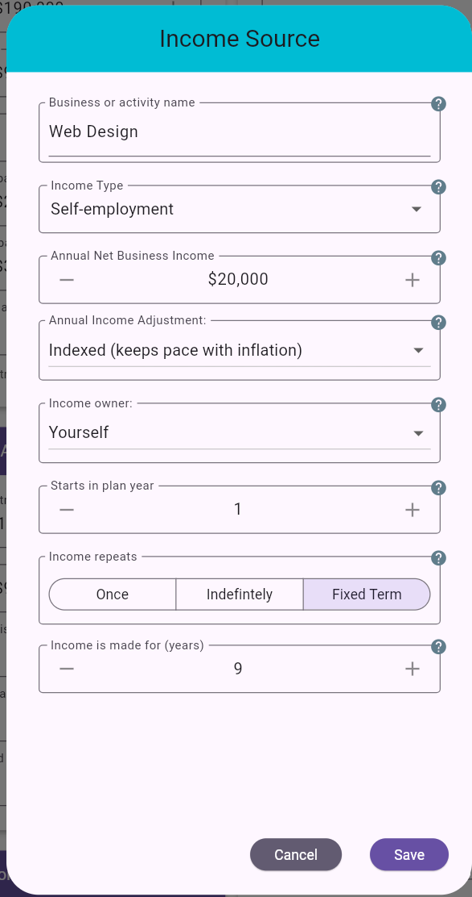

Figure 33: Self-employment net business income settings

Enter **Annual Net Business Income** after deductible business expenses, not gross revenue. You can enter a negative amount for a net business loss. MayRetire combines each person's employment and self-employment results when calculating the applicable CPP or QPP contribution and, for Quebec residents, QPIP premium.

Self-employed workers do not pay regular EI premiums. Participation in EI special benefits is a person-level election, described in Section 13.5, rather than a setting for each business. Workplace retirement plans are available only for employment sources.

### 13.4 Other Income

  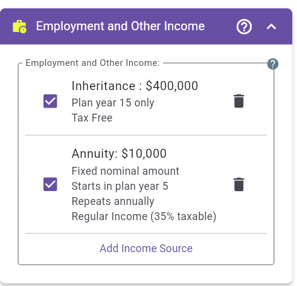

Figure 34: Other income sources with different timing and tax treatment

Use `Other` for income that should not pass through employment or self-employment payroll calculations. Examples include annuities, private pensions, dividends, a business or home sale, inheritances, and other cash inflows.

  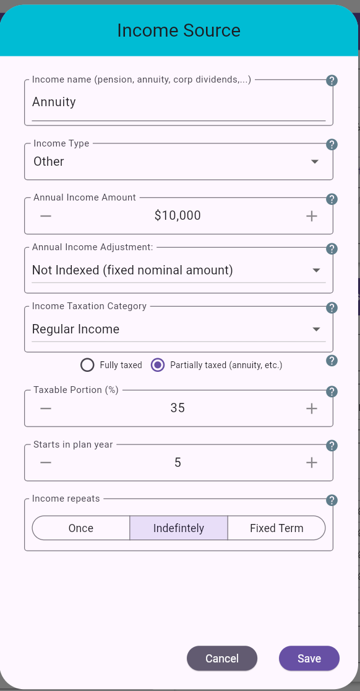

Figure 35: Other income source with a partially taxable annuity payment

For each source, select the taxation category that matches its treatment. Under `Taxed`, choose `Full amount` when the entire payment is taxable or `Partially (annuity, etc.)` when only the entered percentage is taxable and the remainder is tax-free. For example, an annuity containing a return-of-capital component can be represented using the appropriate tax category and its taxable percentage.

Enter separate sources when amounts have different owners, timing, indexing, or tax treatment. This also makes scenario comparisons easier because each item can be enabled or disabled independently.

### 13.5 Person-Level Payroll Elections

Applicable elections appear at the bottom of the **Employment and Other Income** panel. They are shown only when a configured source and the person's planning ages make the setting relevant:

- **CPP Contributions After Age 65:** Controls whether the person continues contributing on pensionable employment and self-employment income after age 65 while receiving CPP or QPP. Before age 65, required contributions remain automatic. The election applies to all of that person's pensionable earned income.
- **Self-employed EI Special Benefits:** Controls voluntary participation for all of that person's self-employment income. The program can provide maternity, parental, sickness, caregiving, and family-caregiver benefits; it does not provide regular EI benefits for loss of work.

MayRetire calculates the contributions associated with continued work after CPP or QPP starts. The resulting additional Post-Retirement Benefit or QPP retirement pension supplement payment is not yet generated automatically; if you want to include a known amount, add it separately as an `Other` income source.

Practical guidance:

- Create a separate employment source for each employer because pensionability, insurability, timing, and workplace plans can differ.
- Enter separate self-employment sources when businesses have different amounts or timing; person-level elections still apply across them.
- Review calculation warnings when requested contributions exceed available RRSP room or registered-plan limits.
- Confirm the source owner carefully because payroll, personal tax, RRSP room, and workplace-plan balances are calculated per person.

## 14. Withdrawal Overrides

  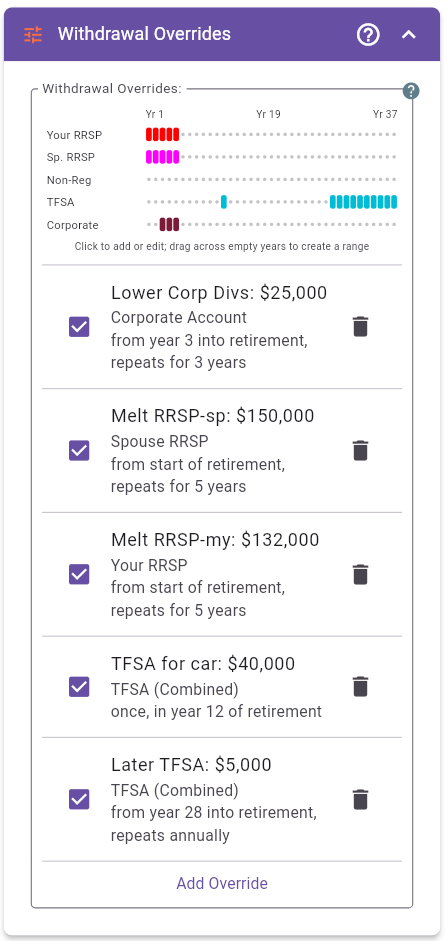

Figure 36: Withdrawal Overrides panel with account timeline and configured override periods

Withdrawal Overrides let you tailor selected account withdrawals when your preferences or planning objectives are not readily expressed through the automatic strategy settings. For example, you may prefer predictable, round-number RRSP withdrawals during the first plan years; reduce corporate dividends in a rental-property sale year to avoid layering dividend income on top of the sale's taxable income; or fund a large purchase, such as a car, from the TFSA without disrupting an otherwise smooth taxable-income and tax-rate profile. Overrides can therefore support personal preferences, manual coordination of unusual financial events, and simple mental accounting for specific goals.

Withdrawal Overrides are different from Additional Withdrawals:

- **Additional Withdrawals** increase the plan's spending requirement for items such as travel, gifts, or major purchases.
- **Withdrawal Overrides** change or limit the account source used to fund the existing income target. They do not create an additional spending need.

Override amounts are entered in today's dollars.

### 14.1 Panel And Timeline

The timeline provides a compact view of overrides across the plan:

- Each row represents an account, and each position represents a plan year. `Yr 1` is the first year, not necessarily a calendar-year label.
- Coloured cells identify configured override periods. Grey dots indicate years that remain under the automatic withdrawal strategy.
- Hover over a cell to see the plan year and override details.
- Click a coloured cell to edit its override. Click an empty dot to create a one-year override beginning in that year.
- Drag across consecutive empty years to create a fixed-term override for the selected range. The selection stops before an existing override.
- Use the checkbox beside an override to include or exclude it without deleting it. Use the trash icon to remove it.
- Enabled overrides for the same account may overlap. Overlaps are highlighted in red, and the later override in the list takes priority for the overlapping years.

The timeline colours distinguish account types; they do not indicate whether the requested withdrawal was fully achieved. Review the detailed annual projections and income results to see the actual outcome.

### 14.2 Edit Dialog Fields

  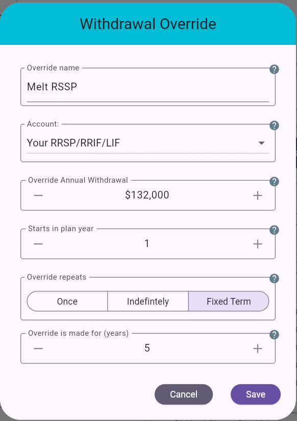

Figure 37: Withdrawal Override dialog with account, amount, start, and duration settings

- **Override name**
Enter a short, descriptive reminder of why the override exists, such as `Early RRSP bridge`, `Preserve TFSA`, or `Corporate dividends`.

- **Account**
Select the account whose automatic withdrawal should be overridden:

  - RRSP/RRIF/LIF is configured separately for each spouse in a couple plan.
  - TFSA and Non-Registered overrides apply to the combined household withdrawal.
  - Corporate Account is available when a corporate account is enabled.

- **Override Annual Withdrawal**
Requested annual withdrawal from the selected account. Zero is allowed and can be used to prevent discretionary withdrawals during the override period, subject to mandatory RRIF/LIF rules.

- **Starts in plan year**
Choose when the override begins. `1` applies in the first year.

- **Override repeats**
Choose the duration:

  - `Once`: applies for one plan year.
  - `Indefinitely`: applies through the remainder of the plan.
  - `Fixed Term`: applies for the specified number of years.

- **Override is made for (years)** *(shown for Fixed Term)*
Number of consecutive plan years for which the override applies.

### 14.3 How Overrides Are Applied

An override is a requested account-withdrawal setting, not a guarantee that the exact amount will appear in the results. MayRetire still coordinates all income sources against the annual after-tax income target and applicable account rules.

The requested amount may not be fully used when:

- The annual income target has already been reached and taking the full override would create unnecessary excess income.
- The selected account does not have enough available funds.
- Other income sources or higher-priority required withdrawals reduce the remaining amount needed from that account.

Conversely, restricting withdrawals can leave annual income below the target even when money remains in an overridden account. This is intentional: once an override limits an account, MayRetire does not automatically exceed that limit merely to eliminate the income deficit.

Account-specific considerations:

- **RRSP/RRIF/LIF:** Overrides apply to the combined RRSP/RRIF and LIF withdrawal for the selected spouse. Mandatory RRIF minimums and LIF minimum or maximum rules still apply, so the actual withdrawal can be higher or lower than requested.
- **TFSA:** Any TFSA override disables planned TFSA funding during the override period, regardless of the override amount. However, excess income from other sources may still be contributed to the TFSA when total income exceeds the annual target.
- **Non-Registered:** The override limits discretionary capital withdrawals, including capital accessed from available investment portfolios. Automatically withdrawn dividends or portfolio distributions are not included in this override amount.
- **Corporate Account:** The override applies to corporate dividend distributions. The actual amount may be limited by available corporate assets and the corporation's tax and notional-account position.

### 14.4 Practical Guidance

- Use overrides sparingly and intentionally. A small number of clearly defined override periods is easier to understand than frequent year-by-year instructions, which can obscure the automatic strategy and make results harder to interpret.
- Give every override a brief, meaningful name that records its purpose. This makes the reason for the override clear when you revisit the plan or compare scenarios later.
- Start with a short period, calculate the plan, and review annual income, taxes, withdrawals, and account balances before extending the override.
- Use a zero override only when you deliberately want to prevent discretionary access to an account during that period.
- Avoid unnecessary overlaps. When overlaps are useful for scenario design, remember that the later list entry controls the overlapping years.
- Enable and disable overrides to compare the custom withdrawal pattern with MayRetire's automatic strategy without rebuilding the entries.

## 15. Investment Portfolios

  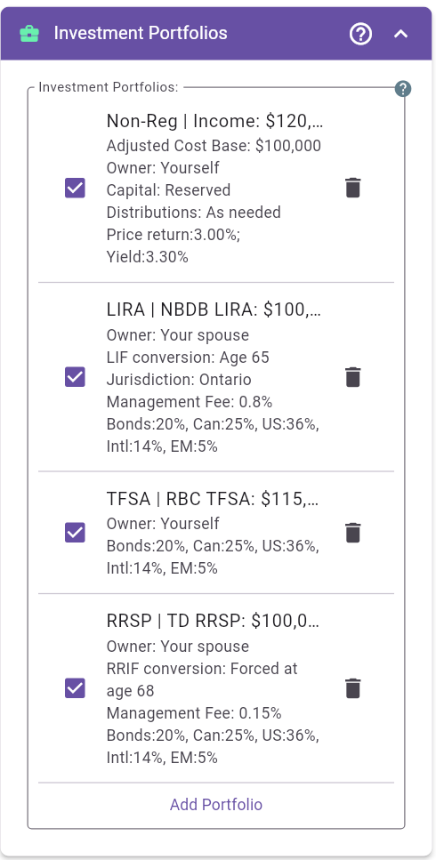

Figure 38: Investment Portfolios panel with different account types

Investment Portfolios let you model additional non-registered, TFSA, RRSP, RRIF, LIRA, and LIF accounts. Each person can have multiple portfolios of the same account type instead of combining those accounts into one balance. The regular accounts entered on the Registered Accounts and Non-Registered Account panels remain available; enter only the separate accounts here to avoid double counting.

Each portfolio can use an asset allocation or manual return assumptions, regardless of the Investment Return Method selected on the main page. Account-specific tax and withdrawal rules still apply.

Common uses:

- Tracking separate RRSPs, TFSAs, or other accounts for one person with different balances, asset mixes, fees, or return assumptions.
- Modeling multiple LIRA and LIF accounts, each under its own federal or provincial pension jurisdiction.
- Giving an RRSP portfolio a flexible conversion rule or a specific age for conversion to RRIF.
- Splitting non-registered assets by owner, access rule, distribution policy, or tax cost base.
- Using manual price appreciation and distribution yield for a specific portfolio while other portfolios use asset allocation.

Panel behavior:

- Each row summarizes the account type, name, balance, owner, and applicable settings such as jurisdiction, conversion age, capital access, fee, and return mode.
- Checkbox toggles include/exclude a portfolio without deleting it.
- Trash icon deletes a portfolio record.
- `Add Portfolio` opens the multi-tab edit dialog.

### 15.1 Portfolio Tab

  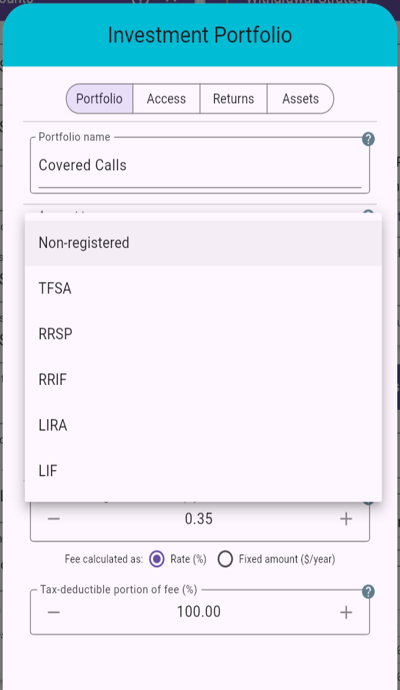

Figure 39: Choosing an Investment Portfolio account type

  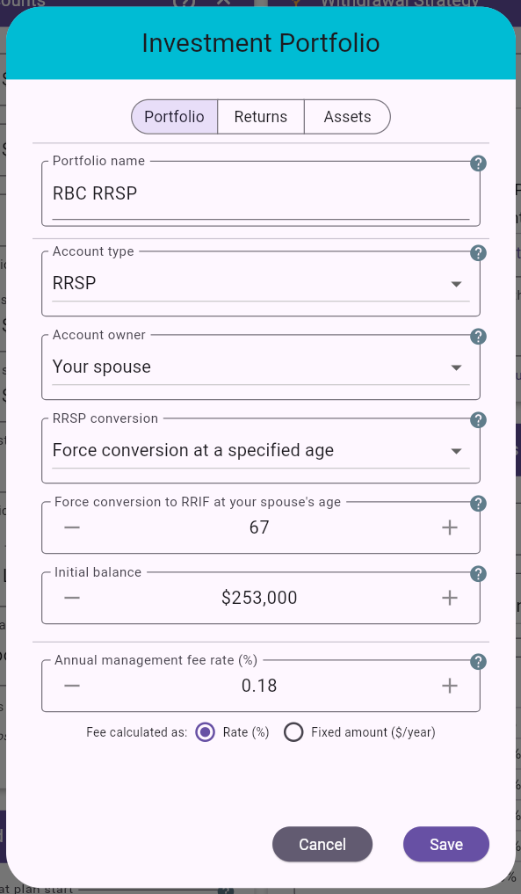

Figure 40: RRSP portfolio settings

  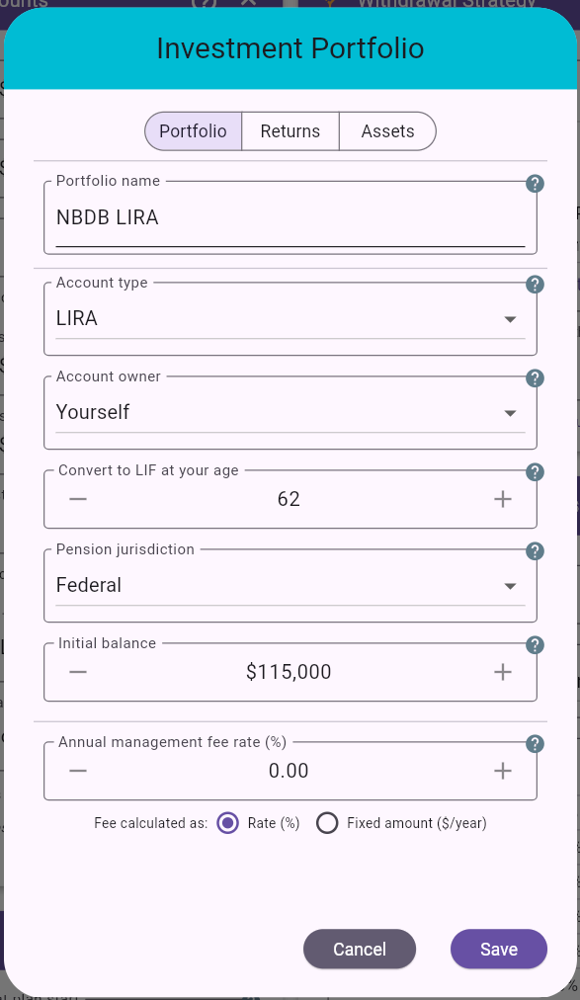

Figure 41: LIRA portfolio settings

- **Portfolio name**
Use a clear label that distinguishes this account from others of the same type, such as the institution name or its purpose.

- **Account type**
Choose `Non-registered`, `TFSA`, `RRSP`, `RRIF`, `LIRA`, or `LIF`. The selected type determines which other settings and withdrawal rules apply.

- **Account owner** *(Couple mode)*
Assign a registered portfolio to yourself or your spouse. Non-registered portfolios can also be jointly owned at 50/50. A legacy non-registered portfolio with a different ownership share retains its percentage field instead of the owner selector.

- **RRSP conversion** *(RRSP only)*
Choose `Flexible conversion` or `Force conversion at a specified age`. Flexible RRSPs can supply eligible pension income from age 65 without a required RRIF minimum before mandatory conversion. A forced conversion changes the portfolio to RRIF at the selected owner's age; the RRIF minimum starts the following year. Any remaining RRSP converts at the end of age 71.

- **Conversion age** *(RRSP with forced conversion, or LIRA)*
For RRSP, select the owner's age for forced conversion to RRIF. For LIRA, select the owner's age for transition to LIF. A LIRA conversion can also move an eligible unlocked portion into that owner's RRSP or RRIF, depending on jurisdiction. The selectable age cannot be earlier than the owner's current age, or age 55 for a LIRA, and cannot be later than 71.

- **Pension jurisdiction** *(LIRA and LIF only)*
Choose `Federal` or `Provincial`. For a provincial account, select its governing province. This can differ from the province of residence selected for the plan. The jurisdiction affects applicable locked-in account rules and LIF withdrawal limits.

- **Initial balance**
Enter the current market value when planning starts now, or the projected value at plan start when planning starts in the future.

- **Adjusted Cost Base** *(Non-registered only)*
Tax cost base of the portfolio. MayRetire uses this to estimate capital gains or losses when capital is withdrawn, the portfolio is liquidated, or the estate is calculated. In real-dollar projections, ACB is adjusted for inflation over time because the nominal tax cost base does not automatically grow with inflation. Management fees reduce portfolio market value without changing ACB or realizing a capital gain or loss.

- **Annual management fee**
Choose `Rate (%)` to apply a percentage of the portfolio's opening annual market value, or `Fixed amount ($/year)` for a separately charged annual dollar fee. A percentage fee can represent an embedded MER, a percentage-based management or advisory fee, or a combination of these costs. Percentage rates can range from `0%` to `10%`. A fixed fee cannot exceed the portfolio's opening balance or reduce it below zero.

- **Tax-deductible portion of fee (%)** *(Non-registered only)*
This field appears when the selected fee is greater than zero. Use `0%` for an embedded ETF or mutual-fund MER. For a separately billed fee, enter only the portion eligible for a personal tax deduction and exclude services such as financial planning when they are not deductible. In couple plans, MayRetire allocates the deductible amount using the portfolio ownership share.

Practical guidance:

- Keep each portfolio's initial balance and, for non-registered accounts, ACB as of the same date.
- Use separate portfolios when accounts have materially different ownership, jurisdiction, fees, or asset allocation.
- For a jointly owned non-registered account, confirm the selected attribution matches actual tax ownership. New joint portfolios use 50/50; legacy portfolios can retain another percentage.
- Apply the same before-fee versus net-return choice described in the Management Fees section. When using FP Canada asset-class assumptions, enter the portfolio fee separately. When a manual return already reflects a particular cost, do not enter that cost again.
- MayRetire charges the portfolio fee at the start of each projection year. For a non-registered portfolio scheduled for liquidation, no fee is charged in the liquidation year because liquidation happens first.

### 15.2 Access Tab

  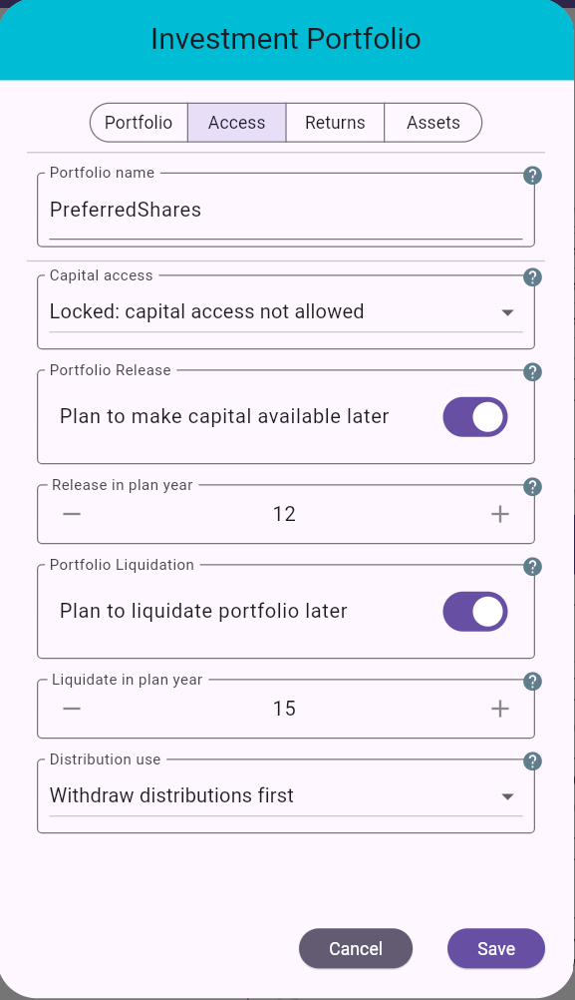

Figure 42: Investment Portfolio dialog - Access tab

The Access tab appears only for non-registered portfolios. It controls whether capital and distributions can be used to fund retirement income. Registered portfolios follow their account-type rules instead.

- **Capital access**
  - `Available`: capital can be used like regular non-registered assets.
  - `Reserved`: capital is used only after regular non-registered capital and available portfolio capital are exhausted.
  - `Locked`: capital is not used for retirement spending unless the portfolio is later released or liquidated.

- **Portfolio Release**
When enabled, a reserved or locked portfolio can become available in a selected plan year. Release changes the access rule but keeps the portfolio intact.

- **Portfolio Liquidation**
When enabled, MayRetire sells the portfolio in the selected plan year, realizes the capital gain/loss, and moves the proceeds into the regular non-registered account.

- **Distributions**
  - `Withdraw first`: taxable distributions are consumed before other income-gap withdrawals.
  - `As needed`: distributions remain available and are used only when needed to meet the income target.
  - `Reinvest only` *(shown for Locked capital)*: distributions are still taxable, but they are not available for retirement spending and remain invested in the portfolio.

Practical guidance:

- Use `Reserved` for assets intended as a last-resort buffer.
- Use `Locked` for assets you do not want the retirement-income engine to spend.
- Use `Reinvest only` when a locked portfolio should stay outside retirement cash flow, including its annual distributions.
- Use liquidation when the portfolio should stop being tracked separately and become part of the regular non-registered account.

### 15.3 Returns Tab

  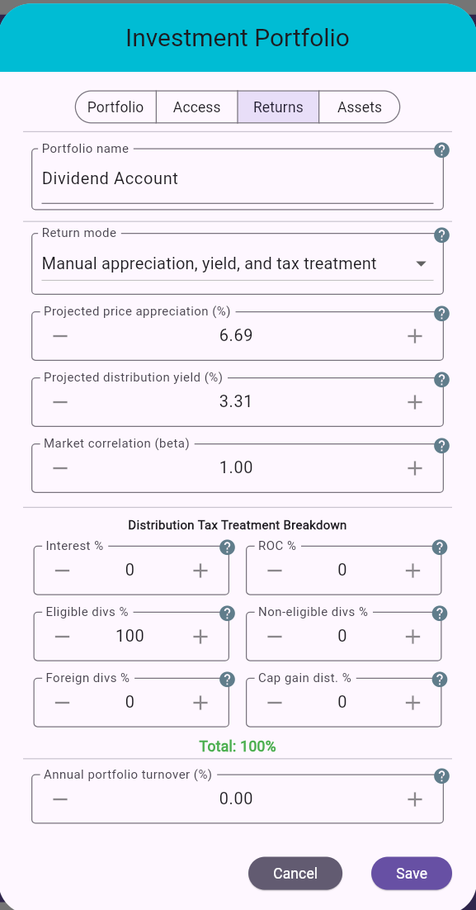

Figure 43: Investment Portfolio dialog - Returns tab

This tab defines how the portfolio produces price growth and distributions. Tax-treatment controls appear only for non-registered portfolios.

- **Return mode**
  - `Asset allocation using FP Canada Assumptions`: return and distribution assumptions come from the portfolio's asset mix.
  - `Manual appreciation, yield, and tax treatment`: you enter projected price appreciation and distribution yield. Non-registered portfolios also let you specify the distribution tax-treatment breakdown.

- **Projected Price Appreciation (%)** *(Manual mode)*
Expected nominal price growth before distributions.

- **Projected Distribution Yield (%)** *(Manual mode)*
Expected annual distribution as a percentage of portfolio value.

- **Market correlation (Beta)** *(Manual mode)*
Controls how strongly the manual portfolio responds to market behavior from the reference allocation in simulations. A higher value makes the portfolio move more with the reference allocation; lower or negative values reduce or invert that relationship.

- **Distribution Tax Treatment Breakdown** *(Non-registered, Manual mode)*
Split the projected cash distribution across interest, return of capital (ROC), eligible dividends, non-eligible dividends, foreign dividends, and capital gain distributions. These six components must total 100% before the dialog can be saved. ROC normally reduces ACB instead of creating current taxable income; ROC beyond the remaining ACB becomes a realized capital gain.

- **Annual Portfolio Turnover (%)** *(Non-registered, both return modes)*
Enter the percentage of the portfolio assumed to be sold and reinvested each year. Turnover realizes the same percentage of the portfolio's embedded gain or loss, produces no spendable cash, and does not change its market value. Reinvesting the proceeds moves ACB proportionally toward market value. For example, 20% turnover realizes 20% of the difference between portfolio value and ACB.

Practical guidance:

- Use asset-allocation mode when the portfolio can be represented using the FP Canada asset-class categories.
- Use manual mode where price appreciation and yield are known or intentionally modeled. Only non-registered portfolios need a distribution tax-treatment mix.
- For non-registered portfolios, use turnover to approximate gains or losses realized through rebalancing, gain or loss harvesting, and similar sales followed by reinvestment. It remains separate from the six-part cash-distribution total.

### 15.4 Assets Tab

  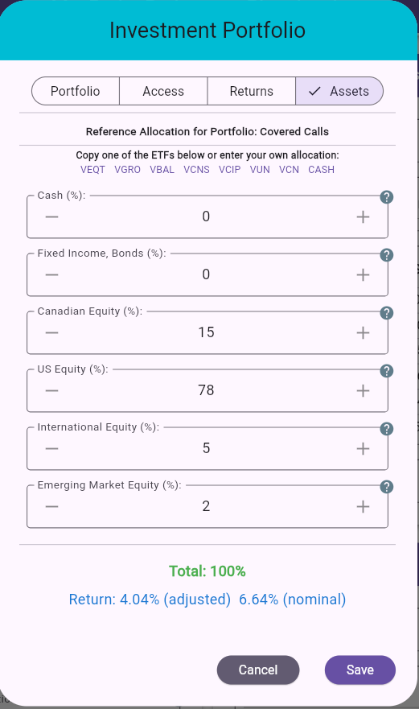

Figure 44: Investment Portfolio dialog - Assets tab

This tab sets the portfolio's asset allocation.

In asset-allocation return mode, this allocation directly drives expected price return and distribution assumptions. In manual return mode, it acts as the reference allocation used for market correlation and simulation behavior.

- **Asset allocation inputs**
Set portfolio mix across `Cash`, `Fixed Income/Bonds`, `Canadian Equity`, `US Equity`, `International Equity`, and `Emerging Market Equity`.

- **ETF shortcuts**
Quick presets for common ETF-style allocations.

- **Total % check**
Allocation must total 100%.

Practical guidance:

- Use the same allocation as the corresponding account entered on the main page when testing whether a separate portfolio behaves equivalently.
- Use a different allocation when the purpose of the portfolio is to represent different risk, income-oriented holdings, or a dedicated reserve.
- In manual mode, choose a reference allocation that best represents the market behavior you want the portfolio to follow.

## 16. Defined Benefit Pensions

  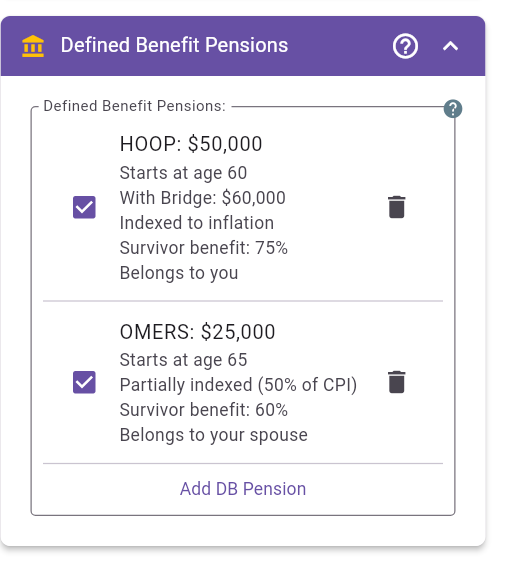

Figure 45: Defined Benefit Pensions panel with multiple pension records

Use this section for employer pensions that provide predictable lifetime income. Properly entering bridge benefits, indexation, and survivor percentage is important because these settings directly affect long-term cash flow and estate outcomes.

Panel behavior:

- Each pension item shows key terms: annual amount, start age, bridge details, indexation mode, survivor benefit, and owner.
- Checkbox toggles include/exclude a pension from the scenario without deleting it.
- Trash icon deletes a pension record.
- `Add DB Pension` opens the pension edit dialog.

### 16.1 Edit Dialog Fields

  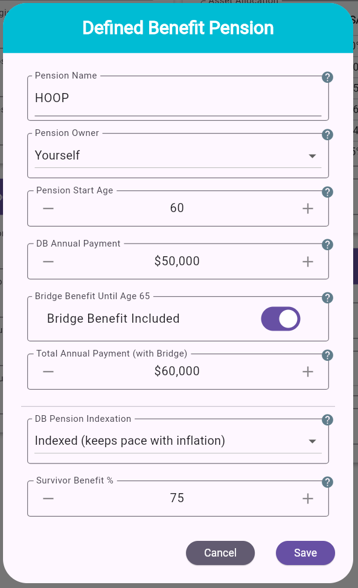

Figure 46: Defined Benefit Pension edit dialog

- **Pension Name**
Use a clear plan name (for example: `HOOPP`, `OMERS`, `Teachers`, `Employer DB Plan`).

- **Pension Owner**
Select who receives this pension (`Yourself` or `Spouse`).
Owner selection affects tax calculation and survivor planning in couple scenarios.

- **Pension Start Age**
Enter the pension owner's age when payments began or will begin. If the pension is already being paid, enter its original start age even if it is earlier than the age at the start of your plan. Pensions can also start after age 71.

- **DB Annual Payment**
Base annual lifetime payment (excluding temporary bridge benefit). If the pension is already in payment, enter its current annual amount when your plan starts now, or its estimated annual amount at plan start when planning for the future. MayRetire does not reconstruct increases from years before the plan starts.

- **Bridge Benefit Until Age 65**
Enable this if the plan pays a temporary top-up before age 65.

- **Total Annual Payment (with Bridge)** *(shown when bridge is enabled)*
Combined annual payment before age 65, including base pension plus bridge amount.

- **DB Pension Indexation**
Defines how pension payments change over time.
Common options include:

  - `Indexed (keeps pace with inflation)`: payment rises with CPI to preserve purchasing power.
  - `Not indexed`: payment is flat in nominal dollars.
  - `Partially indexed`: payment tracks only part of CPI.
  - `Custom fixed rate`: payment rises by a fixed nominal percentage each year.

- **Partial indexing (%)** *(shown when Partially indexed is selected)*
Percent of CPI passed through to pension increases (for example `50% of CPI`).

- **Fixed annual increase (%)** *(shown when Custom fixed rate is selected)*
Nominal annual increase applied each year.

- **Survivor Benefit %**
Portion of pension that continues to the survivor after first death.
Typical values are `0`, `50`, `60`, `66`, `75`, or `100`, depending on plan option.

- **Survivor Bridge Treatment** *(shown when bridge benefit and survivor benefit are both applicable)*
Controls how a temporary bridge benefit is treated if the pension owner dies before age 65. Some plans calculate the survivor benefit from the lifetime pension only, while others include the bridge temporarily or permanently. Use your DB pension statement to choose the matching option.

Practical guidance:

- Enter gross annual pension amounts and let MayRetire handle taxes in projections.
- Verify whether bridge payments stop at age 65 and capture that using bridge fields.
- Confirm indexation terms from your pension statement; this can materially change late-retirement purchasing power.
- Survivor percentage has a large effect on spouse security in couple plans, so match plan documents carefully.
- If your pension has both a bridge benefit and a survivor benefit, check whether the survivor amount is based on the lifetime pension only or includes the bridge. Pension plans differ on this detail.

## 17. Whole Life Insurance

  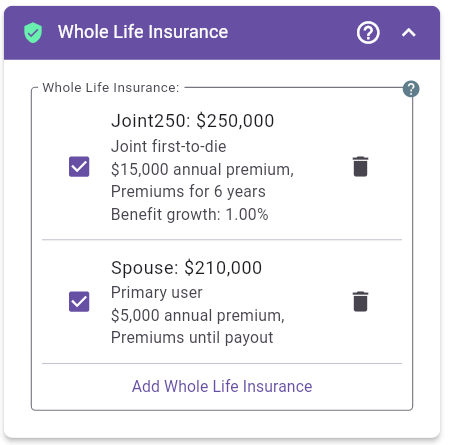

Figure 47: Whole Life Insurance panel with benefit amount summary

Use this section to model whole life insurance policies that have predictable premiums and a predictable death benefit. This includes participating whole life, non-participating whole life, and Term-to-100 style policies. MayRetire does not attempt to model Universal Life mechanics.

Insurance can affect the plan in three ways:

- Premiums are annual cash-flow outflows while they are payable.
- Death benefits can provide a tax-free inflow to the survivor when a payout occurs during the planning horizon.
- The policy's projected benefit amount contributes to estate value before payout.

Panel behavior:

- The panel summarizes the enabled policy benefit amount.
- Checkbox toggles include/exclude a policy from the scenario without deleting it.
- Trash icon deletes an insurance record.
- `Add Insurance` opens the insurance edit dialog.

### 17.1 Edit Dialog Fields

  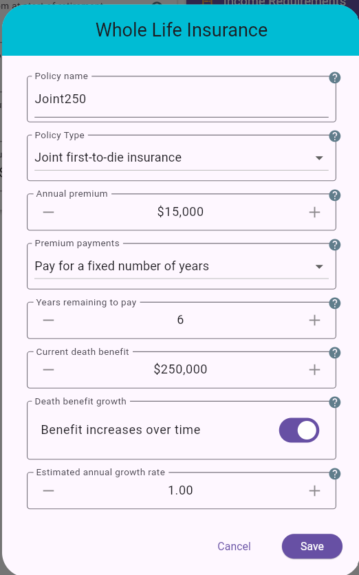

Figure 48: Whole Life Insurance edit dialog

- **Policy name**
Use a clear name for the policy, such as `Whole Life`, `Participating WL`, or the insurer name.

- **Policy Type** *(Couple mode)*
Choose when the policy pays out:

  - `Your life insurance`
  - `Spouse's life insurance`
  - `Joint first-to-die insurance`
  - `Joint last-to-die insurance`

In single plans, MayRetire treats the policy as your own life insurance and does not show the policy-type selector.

- **Annual premium**
Fixed nominal premium paid each year while premiums are still required.
Because this is a nominal amount, its real cost declines over time with inflation.

- **Premium payments**
Choose how long premiums continue:

  - `No more premium payments`: the policy is paid up.
  - `Payments until insurance payout`: premiums continue while the policy is active in the plan.
  - `Pay for a fixed number of years`: premiums continue for a fixed number of remaining years.

- **Years remaining to pay** *(shown when Premium payments is Pay for a fixed number of years)*
Number of years premiums still need to be paid.

- **Death benefit**
When planning starts now, enter the current nominal death benefit. When planning starts in the future, enter the projected nominal death benefit at plan start.

- **Benefit increases over time**
Turn this on when the death benefit is expected to grow, such as from participating dividends or paid-up additions.

- **Estimated annual growth rate %** *(shown when benefit growth is enabled)*
Estimated annual nominal growth rate for the death benefit.
Use `0` or leave growth off for a fixed death benefit.

Practical guidance:

- Use one entry per policy so ownership, premium schedule, and payout timing remain clear.
- Use the entered death benefit as the starting value, then add growth only when you have a reasonable basis for estimating increases.
- Death-benefit payouts are modeled as tax-free cash flow to the survivor when the payout occurs within the plan timeline.
- In couple plans, if both spouses die in the final projection year, there is no surviving planning year to receive the payout as cash flow.
- If a policy is also used as collateral for borrowing, model the borrowing separately in the Debts section. MayRetire does not verify whether the debt limit, interest rate, repayment terms, or timing are permitted by the insurer or lender. Use reasonable debt assumptions based on the actual policy loan, collateral loan, HELOC, or lending arrangement, and review them against your policy and loan documents.

## 18. Donations

  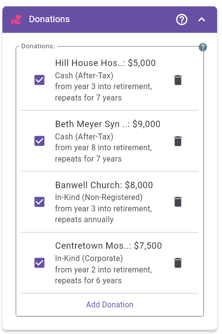

Figure 49: Donations panel with multiple charitable gifts

Use this section to model charitable giving as part of your retirement plan. Donations can be repeated, timed for specific years, and funded in different ways so you can compare both cash-flow impact and tax efficiency.

Panel behavior:

- Each donation item shows amount, funding type, recurrence, and timing.
- Checkbox toggles include/exclude a donation without deleting it.
- Trash icon deletes a donation record.
- `Add Donation` opens the donation edit dialog.

### 18.1 Edit Dialog Fields

  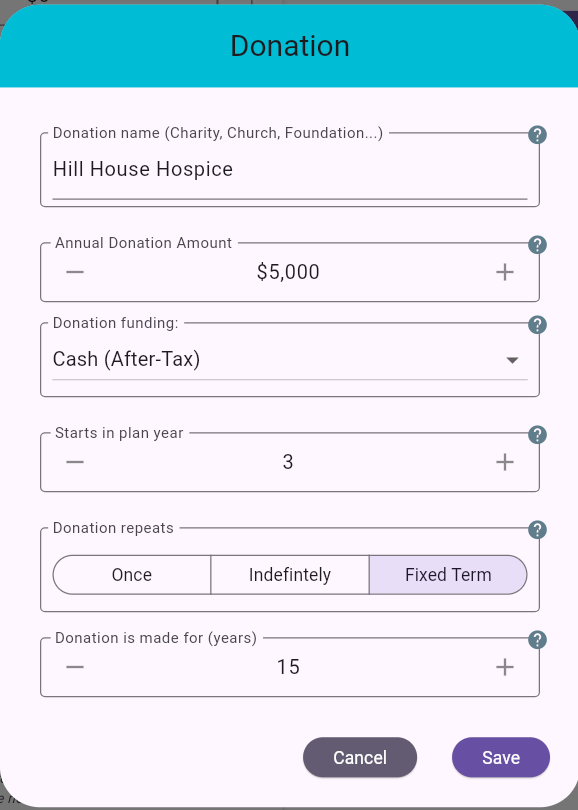

Figure 50: Donation edit dialog

- **Donation name**
Use a clear label for the charity or purpose (for example: `Hospital Foundation`, `Church`, `Food Bank`, `Family Foundation`).

- **Annual Donation Amount**
Target amount donated each year while this donation is active.

- **Donation funding**
Choose how the gift is funded:

  - `Cash (After-Tax)`: donation is funded from personal after-tax cash flow.
  - `In-Kind (Non-Registered)`: donation is made using eligible securities or funds from the personal non-registered account.
  - `In-Kind (Corporate)`: donation is made using eligible securities or funds held inside the corporation.

- **Donation repeats**
Choose recurrence pattern:

  - `Once`: one-time donation event.
  - `Indefinitely`: repeats every year through the remaining plan.
  - `Fixed Term`: repeats for a selected number of years.

- **Donation is made for (years)** *(shown for Fixed Term)*
Number of years the donation repeats.

Practical guidance:

- Use separate entries for recurring giving vs one-time large gifts.
- Use `Cash (After-Tax)` when you want the donation funded directly from annual spending cash flow.
- Use in-kind funding when you want to model tax-efficient giving from appreciated investments.
- Corporate in-kind donations should be used only when a corporate account exists in the plan.

## 19. Rentals

  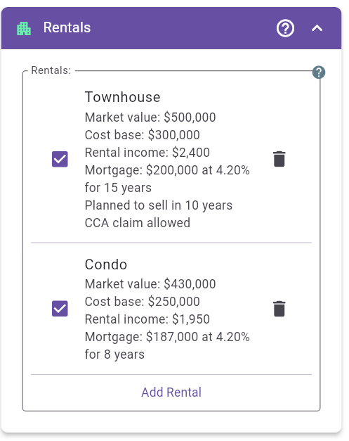

Figure 51: Rentals panel with multiple properties

This section captures rental-property cash flow, financing, planned disposition, and tax treatment so projections include both ongoing rental income and eventual sale/estate outcomes.

Panel behavior:

- Each property card summarizes market value, cost base, rental income, debt terms, sale plan, and CCA usage.
- Checkbox toggles include/exclude a property from the scenario without deleting it.
- Trash icon deletes a property record.
- `Add Rental` opens the multi-tab rental property dialog.

### 19.1 Rental Tab

  

Figure 52: Rental Property dialog - Rental tab

- **Property name**
Descriptive label for the property (for example: `Townhouse`, `Condo`, `Duplex`).

- **Rental owner**
For couple plans, select whether the property is owned jointly, by you, or by your spouse.
Joint ownership is the default. While both spouses are alive, MayRetire attributes rental income, expenses, mortgage interest, sale proceeds, and rental-related tax amounts according to the selected owner. If one spouse passes away, MayRetire assumes the rental property transfers to the survivor.

- **Adjusted cost base (purchase price and associated expenses)**
Your tax cost base, including purchase price and eligible acquisition/capital-improvement costs.
Used to estimate capital gains when the property is sold.

- **Market property price**
Current estimated market value of the property.

- **Price Appreciation Rate % (inflation adjusted)**
Expected long-term real appreciation rate.
`0%` means the property grows with inflation only.

- **Monthly rental income**
Gross monthly rent before expenses.

- **Income Change Rate % (inflation adjusted)**
Real growth rate of rental income.
`0%` means rent keeps pace with inflation.
Negative values mean rent lags inflation; positive values mean it grows faster than inflation.

- **Annual Expense (as % of property price)**
Operating costs as a percentage of property value (for example maintenance, condo fees, insurance, vacancy, property tax, and management).

### 19.2 Sale Tab

  

Figure 53: Rental Property dialog - Sale tab

- **Property name**
Shown on each tab for context.

- **Sale Expense (as % of property price)**
Estimated transaction costs at sale (for example realtor commissions and legal fees).

- **Rental Property Sale**
Toggle whether this property is planned to be sold during the planning horizon.

- **Property sale in plan year** *(shown when sale is enabled)*
Plan year in which the property is sold.
`10` means the property is sold in plan year 10.

### 19.3 Debt Tab

  

Figure 54: Rental Property dialog - Debt tab

- **Property name**
Shown on each tab for context.

- **Does this property have a mortgage**
Toggle mortgage financing on/off for this property.

- **Mortgage balance** *(shown when mortgage is enabled)*
Current outstanding mortgage principal.

- **Mortgage interest** *(shown when mortgage is enabled)*
Annual interest rate on the mortgage.

- **Remaining mortgage payment years** *(shown when mortgage is enabled)*
Years left to repay the mortgage.

### 19.4 CCA Tab

  

Figure 55: Rental Property dialog - CCA tab

- **Property name**
Shown on each tab for context.

- **Have you claimed CCA for this property**
Indicates whether CCA was claimed historically.

- **Are you planning to claim CCA for this property**
Controls whether future CCA claims are modeled.

- **Building cost (initial unused capital cost)**
Original building component used as the starting CCA basis.

- **UCC (unused capital cost)**
When planning starts now, enter the current remaining depreciable balance. When planning starts in the future, enter the projected remaining balance at plan start.

Practical guidance:

- Keep market value and cost base updated; these drive sale proceeds and capital-gain tax.
- Enter realistic expense and rent-growth assumptions, since small rate changes can materially shift long-term net cash flow.
- Use Sale tab timing for planned liquidations; leave sale disabled for hold-to-estate scenarios.
- Model debt terms carefully because interest cost and amortization materially affect early-retirement cash needs.
- Use CCA settings only when they reflect your tax filing strategy; CCA can improve current cash flow but may increase recapture/capital-gain tax on sale.

## 20. Debts

  

Figure 56: Debts panel with multiple debt items

This section lets you model personal or household debt during the plan, such as a mortgage, HELOC, car loan, reverse-mortgage-style borrowing, or other loan. Debt can exist at plan start or begin later as future borrowing. Debt affects required cash flow, taxes when interest is deductible, income-source reporting when borrowing proceeds are advanced, and net estate at death.

Panel behavior:

- Each debt card summarizes attribution, interest setup, payment mode, borrowing setup, and any special handling such as tax-deductible interest or early payoff.
- Checkbox toggles include/exclude a debt from the scenario without deleting it.
- Trash icon deletes a debt entry.
- `Add Debt` opens the debt edit dialog.

### 20.1 Debt Tab

  

Figure 57: Debt dialog - Debt tab

- **Debt (Mortgage, Car loan, HELOC, etc.)**
Use a descriptive name so the debt is easy to identify in the panel and detailed projections.

- **Debt owner** *(Couple mode)*
Choose whether the debt is attributed to you, your spouse, or both jointly.
This affects survivor treatment and tax attribution for deductible interest.

- **Existing debt / Future borrowing**
Use `Existing debt` for a loan that already exists at the start of the plan.
Use `Future borrowing` for a loan that begins in a later plan year.

- **Current debt balance / Projected debt balance at plan start** *(existing debt)*
When planning starts now, enter the current outstanding balance. When planning starts in the future, enter the projected outstanding balance at plan start.

- **Starts in plan year** *(future borrowing)*
Plan year when the future debt begins.
`1` means the first year.

- **Initial borrowing amount** *(future borrowing)*
One-time amount advanced when the future debt begins.
This becomes the starting balance of the debt in that year.

- **Debt interest tax deduction**
Turn this on only when interest on the debt is legitimately deductible.
When enabled, MayRetire applies the deduction according to who the debt is attributed to.

- **If debt owner passes away** *(shown only in couple plans for single-owner debt)*
Choose whether the debt transfers to the surviving spouse or is paid off from estate at first death.

  

Figure 58: Debt dialog - Future borrowing setup

### 20.2 Rate Tab

  

Figure 59: Debt dialog - Rate tab

- **Debt interest**
Choose `Fixed Rate` or `Variable Rate`.

- **Annual interest rate %** *(shown for fixed rate)*
Annual fixed borrowing rate used for the debt projection.

- **Prime spread %** *(shown for variable rate)*
Spread relative to prime.
Example: `0.50` means `Prime + 0.50%`.
Example: `-0.75` means `Prime - 0.75%`.

Practical note:

- In MayRetire, variable debt is modeled using a prime-based approximation rather than a lender-specific mortgage-renewal schedule.

### 20.3 Terms Tab

  

Figure 60: Debt dialog - Terms tab

- **Debt payment mode**
Choose one:

  - `Amortizing`
  - `Interest Only`
  - `Fixed Annual Payment`
  - `Capitalized Interest`

- **Remaining amortization years** *(shown for amortizing mode)*
Years left to repay the debt under standard amortizing payments.

- **Fixed annual payment amount** *(shown for fixed annual payment mode)*
Annual amount paid toward the debt each year.

- **Capitalized interest**
Interest is added to the debt balance instead of being paid as a regular annual debt payment.
Use this for reverse-mortgage-style borrowing or other debt where interest accumulates until payoff, sale, death, or the end of the plan.

- **Pay off on principal residence sale or downsizing**
Turn this on when the debt should be fully paid off in the same plan year that the principal residence is sold or downsized.
When this option is enabled, MayRetire hides and ignores the manual early-payoff year because the payoff timing follows the principal residence plan.

- **Plan to pay off this debt early**
Use this when you expect to repay the debt in full before its normal schedule ends.

- **Pay off in plan year** *(shown when early payoff is enabled)*
Plan year of the extra full payoff.
`1` means the first year.

Practical guidance:

- Use amortizing mode for standard loans and mortgages that are being paid down normally.
- Use interest-only mode for HELOC-style borrowing or temporary financing where principal is not being repaid regularly.
- Use fixed annual payment when you want to model a specific planned annual payment amount.
- Use capitalized interest when interest should increase the debt balance rather than increase annual spending.
- If a debt is expected to remain outstanding to the end of the plan, MayRetire treats the remaining balance as an estate liability.

### 20.4 Borrowing Tab

  

Figure 61: Debt dialog - Borrowing tab

Use this tab when the debt can provide additional scheduled or as-needed borrowing after the initial balance or initial borrowing amount.
Borrowing proceeds are treated as debt advances: they increase the debt balance and appear as a separate income source in charts and projections.

- **Allow annual borrowing**
Turn this on to add recurring annual borrowing to the debt.

- **Borrow only when needed**
Turn this on when the debt is intended as a safety net rather than a planned annual draw.
When enabled, MayRetire does not borrow automatically every year. It uses the debt only if other funding sources are not enough to meet the required income level. If the plan never needs the extra cash, no borrowing occurs.
This can be useful for testing resilience against less likely but important later-life risks, such as expensive health care, long-term care, or other large support needs. For example, a HELOC, reverse-mortgage-style loan, or borrowing against permanent life insurance may provide a backstop without requiring you to reduce lifestyle assumptions in the base plan. The feature lets you model that safety net while still seeing whether, when, and how much borrowing would actually be needed.
This option is available for interest-only and capitalized-interest debts.

- **Annual borrowing amount / Annual borrowing amount limit**
When `Borrow only when needed` is off, this is the amount advanced each year while annual borrowing is active.
When `Borrow only when needed` is on, this is the maximum amount MayRetire can borrow in a year if other funding is not enough.

- **Debt balance limit** *(shown when Borrow only when needed is enabled)*
Turn this on to cap total borrowing for this debt.

- **Maximum debt balance** *(shown when Debt balance limit is enabled)*
Highest total debt balance allowed for flexible borrowing. If borrowing is adjusted with inflation, this limit is adjusted the same way.

- **Annual borrowing period**
Choose whether borrowing continues every year until the end of the plan, or only for a fixed number of years.

- **Number of borrowing years** *(shown when borrowing is not until end)*
Number of years the annual borrowing amount is advanced.

- **Adjust borrowing with inflation**
Turn this on when future annual borrowing amounts should increase with inflation.

Practical guidance:

- For a reverse-mortgage-style scenario, combine future borrowing, capitalized interest, and optional annual borrowing.
- For a HELOC or credit-line scenario, use annual borrowing when you want scheduled draws from the credit line.
- For a safety-net scenario, use `Borrow only when needed` so borrowing happens only if other funding is insufficient.
- Debt advances can reduce withdrawals needed from investment accounts in the same year, but the unpaid debt remains a liability and reduces estate value.

## 21. Principal Residence

  

Figure 62: Principal Residence panel with residence summary

Use this section to model your principal residence separately from investment accounts and rental properties.
The residence can be kept to the end of the plan, sold, or downsized to another property.
MayRetire treats the principal residence as part of estate value while it is owned, and records sale or downsizing proceeds as cash flow in the disposition year.

Panel behavior:

- If no principal residence is configured, the panel shows an add action.
- When configured, the panel summarizes market value, real appreciation, sale/disposition cost, and the planned action.
- `Edit Principal Residence` opens the residence edit dialog.
- `Remove Principal Residence` removes the residence from the plan.

  

Figure 63: Principal Residence edit dialog

- **Market value**
When planning starts now, enter the current market value of the principal residence. When planning starts in the future, enter its projected market value at plan start. Enter both in today's dollars.

- **Real appreciation rate**
Expected annual property appreciation after inflation.
This is consistent with rental-property assumptions, where appreciation is entered in real terms.

- **Disposition cost**
Estimated selling or disposition cost as a percentage of property value.
This reduces estate value and sale/downsize proceeds.

- **What are your plans for the principal residence?**
Choose one:

  - `Keep property`: residence remains part of the estate through the plan.
  - `Sell property`: residence is sold in the configured year and net proceeds become available cash flow.
  - `Downsize to another property`: current residence is sold and replacement home value is deducted from proceeds.

- **Sale / downsizing year**
Plan year when the sale or downsizing occurs.
`1` means the first year.

- **Replacement home value** *(shown when downsizing)*
Cost of the new principal residence.
If replacement value is lower than net sale proceeds, the difference is modeled as residence proceeds.
If replacement value is higher, the difference is modeled as a residence shortfall.

Practical guidance:

- Use `Keep property` when the home is intended to remain part of the final estate.
- Use `Sell property` when the plan relies on fully unlocking home equity.
- Use `Downsize to another property` when only part of the home equity is expected to become available.
- Debts connected to the residence are configured from the debt's **Terms** tab with `Pay off on principal residence sale or downsizing`.
- Residence sale proceeds and shortfalls appear in cash-flow charts, income-source reporting, and the detailed projections table.

## 22. Corporate Accounts

  

Figure 64: Corporate Accounts panel with multiple account summaries and global distribution settings

Use this section for one or more Canadian Controlled Private Corporation (CCPC) investment accounts that support retirement funding through dividends and tax-efficient corporate distributions.

Panel behavior:

- Each corporation displays its name, account balance, Adjusted Cost Base, distribution share, and corporate tax/notional accounts.
- Select or clear the checkbox beside a corporation to include or exclude it from calculations without deleting its settings.
- Select a corporation's summary to open its two-tab edit dialog (`Account` and `Assets`).
- Use the trash icon to remove a corporation from the plan.
- Select `Add Corporation` to configure another corporation.
- Global distribution settings appear below the corporation list when at least one corporation is enabled.
- When the panel is collapsed, balances and Adjusted Cost Base are totalled across enabled corporations. If more than one is enabled, the summary also shows the number of accounts; if none are enabled, it shows `No accounts enabled`.

  

Figure 65: Corporate Accounts panel when no corporations are configured

### 22.1 Account Tab

  

Figure 66: Edit Corporation dialog - Account tab

- **Corporation name**
Name used to identify this corporation throughout the plan.

- **Account balance**
Current market value of the corporation's investment portfolio.

- **Adjusted Cost Base**
Tax cost base of corporate investments (purchase cost plus acquisition costs), used to calculate capital gains when assets are sold.

- **CDA Balance**
Capital Dividend Account balance available for tax-free capital dividends.

- **NERDTOH Balance**
Non-Eligible Refundable Dividend Tax on Hand.
Represents refundable corporate tax generally recovered when non-eligible dividends are paid.

- **ERDTOH Balance**
Eligible Refundable Dividend Tax on Hand.
Represents refundable corporate tax generally recovered when eligible dividends are paid.

- **GRIP Balance**
General Rate Income Pool balance.
Determines how much can be paid as eligible dividends.

- **Your distribution share (%)**
Percentage of this corporation's dividend distributions attributed to you for personal tax calculations.
In couple mode, the remainder is attributed to your spouse. In a single-person plan, all distributions are attributed to you.

- **Change distribution split from age of 65** *(couple plans)*
Choose `No change`, `Change after your 65`, or `Change after spouse 65`.
The option is available when at least one spouse is younger than 65 at the start of the plan. The new split begins in the year the selected person reaches age 65; it is never applied retroactively when that person is already 65 or older at the start of the plan.

- **Your distribution share after 65 (%)**
Shown when a distribution-split change is selected.
Enter the new percentage attributed to you after the selected person's 65th birthday; the remainder is attributed to your spouse.

### 22.2 Assets Tab

  

Figure 67: Edit Corporation dialog - Assets tab

- **Asset allocation inputs**
Set corporate portfolio mix across:
`Cash`, `Fixed Income/Bonds`, `Canadian Equity`, `US Equity`, `International Equity`, and `Emerging Market Equity`.

- **ETF shortcuts**
Quick presets for common ETF-style allocations.

- **Total % check**
Allocation must total 100%.

- **Implied return display**
Dialog shows implied adjusted/nominal return from the selected mix.
In asset-allocation mode, MayRetire derives expected returns from asset-class assumptions (aligned with FP Canada projection guidelines), rather than asking you to enter a single return manually.

### 22.3 Global Distribution Settings

These controls apply across all enabled corporations. MayRetire allocates the required distribution among them in proportion to their account balances.

- **Annual Distribution**
Base annual dividend amount to distribute across the enabled corporations. The amount increases with inflation during the projection.
MayRetire determines a tax-efficient composition of capital, eligible, and non-eligible dividends for each corporation's payout.

- **Adjust Dividends Distribution**
When enabled, MayRetire adjusts total annual corporate dividends to help bridge household income needs instead of using only the fixed annual amount.

- **Enforce Account Depletion**
When enabled, MayRetire targets a payout path that fully depletes the enabled corporate accounts by plan end.

### 22.4 How Corporate Notional Accounts Are Used

MayRetire models corporate notional accounts to estimate how a CCPC investment portfolio may distribute cash during retirement. These balances are planning inputs and projections, not replacements for corporate tax records or professional tax filings.

#### 22.4.1 When Notional Accounts Increase

- **CDA (Capital Dividend Account)**
Increases when the corporation realizes capital gains. The non-taxable half of a realized capital gain is added to CDA and can later be paid as a tax-free capital dividend.

Realized capital losses can reduce CDA and may create a negative CDA balance in the projection. A negative CDA must be offset by future CDA additions before tax-free capital dividends are available again.

- **NERDTOH (Non-Eligible Refundable Dividend Tax on Hand)**
Increases from refundable corporate tax on passive income such as interest-like income, foreign dividends, and taxable capital gains.

NERDTOH is generally recovered when the corporation pays non-eligible dividends.

- **ERDTOH (Eligible Refundable Dividend Tax on Hand)**
Increases from Part IV tax on eligible Canadian dividends received by the corporation.

ERDTOH is generally recovered when the corporation pays eligible dividends. It can also be recovered through non-eligible dividend spillover when there is not enough GRIP to pay eligible dividends.

- **GRIP (General Rate Income Pool)**
Determines how much the corporation can designate as eligible dividends.

In MayRetire's corporate investment-account model, GRIP is increased from eligible Canadian dividends received by the corporation. In real corporate tax planning, GRIP can also arise from other sources, such as active business income taxed at the general corporate rate. MayRetire does not currently model those additional GRIP-generating sources because this feature is intended for retirement planning with a CCPC investment portfolio, not for detailed operating-company tax planning.

#### 22.4.2 Distribution Priority

When MayRetire distributes corporate cash, it uses a tax-aware dividend waterfall:

1. **CDA first**
Positive CDA is paid first as tax-free capital dividends.

2. **Eligible dividends next**
Eligible dividends are paid next, limited by available GRIP. These dividends reduce GRIP and recover ERDTOH where ERDTOH is available.

3. **Non-eligible dividends after that**
Remaining required dividends are paid as non-eligible dividends. These recover NERDTOH first.

4. **ERDTOH spillover**
If non-eligible dividends create more refund capacity than the remaining NERDTOH balance, the excess capacity can recover ERDTOH.

5. **Refund sweep**
When dividend refunds create additional cash that can help meet the target distribution, MayRetire may sweep that refund out as additional non-eligible dividends. This uses the same NERDTOH-first, ERDTOH-spillover ordering.

MayRetire treats dividend refunds as part of the same annual corporate tax/refund settlement. In practice, a cash refund may be received after the corporation files its tax return, so exact cash timing can differ. For retirement projections, MayRetire applies the full refund in the current projection year as an annual net-tax simplification, similar to treating a tax refund as reducing the year's overall tax drag.

#### 22.4.3 Exceptional Cases

- **Excess GRIP with no ERDTOH**
The corporation can still pay eligible dividends if GRIP is available. However, if ERDTOH is already zero, those eligible dividends do not generate an ERDTOH refund.

- **Excess ERDTOH with no or insufficient GRIP**
If GRIP is zero or too small, the corporation cannot pay enough eligible dividends to recover all ERDTOH directly. In that case, remaining ERDTOH may be recovered through non-eligible dividend spillover, after NERDTOH is recovered first.

- **GRIP and ERDTOH do not always move together in real life**
In MayRetire's simplified CCPC investment-account model, eligible Canadian dividends tend to increase both GRIP and ERDTOH-related refundable tax. In real corporate tax planning, GRIP can increase without a matching ERDTOH increase. MayRetire's model is designed to support retirement projections for corporate investment portfolios, not all operating-company tax scenarios.

Practical guidance:

- Pull CDA, RDTOH, and GRIP balances from current corporate tax records (for example T2 schedules) to avoid tax-projection distortion.
- Set each corporation's distribution share to reflect how its dividends should be attributed between spouses for personal tax calculations.
- Use the fixed annual distribution for a stable household-level policy; enable adjustment when you want the corporations to actively fill household income gaps.
- Use depletion mode intentionally; it can improve spending support but may increase near-term taxable distributions.

## 23. Plan Analysis Actions

  

Figure 68: Main planning action buttons - Calculate, Stress Test, Simulate, Backtest

These commands run your plan using different analysis methods. Use them together: start fast with `Calculate`, challenge the plan with `Stress Test`, validate robustness with `Simulate`, then test real history with `Backtest`.

- **Calculate**
Quick deterministic projection using a constant-return assumption.
Best for rapid iteration while adjusting inputs.
It does not model year-to-year market randomness.

- **Simulate**
Monte Carlo analysis (500 scenarios) that introduces return variability and sequence risk.
Use this as the primary realism check after baseline setup.
Confidence level reflects the share of scenarios where your plan remains sustainable for the full horizon.
In many plans, a more flexible withdrawal approach and a less aggressive asset mix can improve simulation success rates.

- **Stress Test**
Runs a curated set of fixed adverse scenarios against your current plan.
Unlike Monte Carlo, these scenarios are not random. Unlike Backtest, they are not tied to one exact historical period.
They are intentionally severe and can be more conservative than many Monte Carlo outcomes.
Stress Test works with either Investment Return Method.

- **Backtest**
Runs your plan through historical market regimes instead of randomized scenarios.
Useful for stress testing against known high-inflation and severe drawdown periods.
A depletion event in a historical path highlights vulnerability to that return sequence.

Note: Each button's `Learn more` link opens focused guidance for interpreting that method's outputs and limitations.

## 24. Top Action Bar Actions

The top-right action bar provides quick access to navigation, file operations, sharing, and account actions.

  

Figure 69: Top Action Bar icon row including Suggested Adjustments

1. **Scroll to the top**
Jumps to the top of the page.

2. **Scroll to the bottom**
Jumps to the bottom of the page.

3. **Open MayRetire GPT**
Opens the MayRetire GPT assistant.

4. **Suggest adjustments**
Opens the Suggested Adjustments workflow for the current plan.
Detailed workflow is covered in **Suggest Adjustments**.

5. **Open plan workspace**
Opens the Workspace panel above the plan inputs. The action is hidden while the Workspace is open.
Detailed workflow is covered in **Plan Workspace**.

6. **Compare retirement plans**
Loads one or more `.json` plan files and opens plan comparison.
Detailed workflow is covered in **Compare Plans**.

7. **Check Survivor Safety**
Visible only when planning for a couple and both start/end ages cross the age-75 safety check window.
Runs survivor safety analysis.
Detailed workflow is covered in **Check Survivor Safety**.

8. **Load retirement parameters from a file**
Loads saved plan parameters from file and resets current results.

9. **Save retirement parameters to a file**
Prompts for a file name, then saves current plan parameters as JSON.

10. **Save calculator screenshot to a file**
Prompts for a file name, then captures and saves a full-page screenshot.

11. **Create PDF report**
Prompts for a file name, then generates and saves a PDF report.

12. **Send feedback**
Opens feedback flow to contact support.

13. **Open Facebook page**
Opens the MayRetire Facebook page.

14. **Open subreddit**
Opens the MayRetire subreddit.

15. **Open home page**
Redirects to the MayRetire home page.

16. **Sign Out**
Shows a confirmation dialog. On confirm, clears current saved plan state and signs out.

## 25. Plan Workspace

  

Figure 70: Plan Workspace with saved variants, outcome cards, and Workspace actions

The Workspace keeps related versions of a retirement plan together so you can explore alternatives without managing a separate file for every change. It is optional: you can continue using MayRetire as a single-plan calculator when the Workspace is closed. A Workspace can contain up to eight plans.

### 25.1 Opening And Closing The Workspace

- Select **Open plan workspace** in the top action bar to show the Workspace above the plan-input panels.
- The Workspace stays fixed at the top of the screen while the plan-input area below it scrolls.
- The header counter shows the number of saved plans and the limit, for example `4/8`.
- Select the `X` in the Workspace header to hide the panel. Closing the panel does not remove its plans.
- While the Workspace is open, its top-action-bar button is hidden. Closing the Workspace makes that button available again.

### 25.2 Adding And Importing Plans

There are two ways to add a plan:

- **Add current plan to workspace** (bookmark-plus icon)
  - Captures the current plan inputs and calculates their outcome.
  - Prompts for a name, initially using the next available name such as `Variant 1`.
  - Does not add the plan when it is identical to one already in the Workspace.

- **Import plan variant** (left-arrow icon)
  - Opens a file selector for one `.json` plan file.
  - Imports only the plan inputs. If the selected file contains its own Workspace, that embedded Workspace is ignored.
  - Checks for an identical saved plan before asking for a name.
  - Prepopulates the name from the file name without the `.json` extension.
  - Adds and calculates the imported plan without switching away from the current plan.

Both actions are disabled when the Workspace reaches eight plans. Plan names must be non-empty and unique within the Workspace.

### 25.3 Understanding Plan Cards

Each card summarizes one plan and its calculated outcome:

- The plan name appears at the top. The `X` on the card removes that plan from the Workspace.
- For a regular income-target plan, the main value is the projected **after-tax estate**, and the lower-left value is average after-tax income.
- For a target-after-tax-estate plan whose spending is funded, the main value is **average after-tax income**, and the lower-left value is the projected estate.
- If spending cannot be sustained for the full planning horizon, the main value becomes the percentage of spending funded and the card shows the funded-until age.
- Green indicates that the applicable spending and estate objective is met. Amber indicates a spending or estate shortfall.
- The small chart traces projected after-tax estate over time. All visible cards use a shared vertical scale so their paths can be compared. Target-estate plans also show the estate target as a dashed line.
- On narrower screens, the card row scrolls horizontally.

### 25.4 Current Plan And Switching Plans

The card with a blue border matches the plan currently shown in the input panels. If current inputs are edited so they no longer match a saved Workspace plan, no card is marked as current.

- Select another card to switch the current plan to that saved plan.
- Switching replaces the current plan inputs and presents the calculation result already available for the selected card.
- If the edited current plan does not match any saved Workspace plan, MayRetire asks for confirmation before replacing it.
- When the current plan was selected from a Workspace card and is then edited, that source card receives a thicker grey border. **Update** or **Replace** appears in each card's menu while the current plan does not match any saved variant.
- Use **Update** on the source card to save the current plan back to it immediately. Use **Replace** on another card to overwrite that variant after confirmation. Afterward, an **Undo** action can restore the previous saved version while leaving the current plan unchanged.
- If editing makes the current plan identical to another saved variant, that matching card becomes current and no update is offered.
- Importing a plan does not switch to it; select its card when you are ready to make it current.

### 25.5 Renaming And Removing Workspace Plans

- Open a card's menu and select **Rename** to change its name without changing its saved plan or calculation result.
- Open the same menu and select **Remove** to remove that saved plan.
- Renaming and removing both provide an **Undo** action.
- Removing the card that matches the current plan does not change the current plan inputs; it only removes the saved Workspace copy.

### 25.6 Comparing Workspace Plans

Select the balance icon in the Workspace header to open **Compare Plans** using the plans already in the Workspace.

- Comparison becomes available when there are at least two distinct plans.
- If the current plan is different from every saved Workspace plan, it can be included alongside the saved plans. This also allows comparison between one saved plan and a different current plan.
- If the current plan already matches a Workspace card, it is not added as a duplicate.
- Workspace comparison uses the same metrics, chart controls, and interpretation as the regular **Compare Plans** dialog.
- Compare Plans is a MayRetire Plus feature.

### 25.7 Saving And Restoring A Workspace

- Saving retirement parameters to a JSON file stores the current plan together with Workspace visibility and its saved plans.
- Loading that file restores both the current plan and the Workspace. Calculation results are recalculated with the current engine rather than stored in the file.
- The same combined plan-and-Workspace state is maintained in local browser storage for normal session restoration.
- Hiding the Workspace preserves its plans and saves it as hidden; it can be opened again from the top action bar.

## 26. Compare Plans

  

Figure 71: Compare Retirement Plans dialog with metric chips and multi-plan chart

Use this dialog to compare multiple saved plan scenarios against each other and optionally against your currently loaded plan.

### 26.1 File Selection And Plan Set

- Start from **Top Action Bar -> Compare retirement plans**.
- A file picker opens for `.json` plan files. You can select **1 to 8 files**.
- If **1 file** is selected:
  - Comparison is between the selected file and the **Current Plan**.
- If **2 to 8 files** are selected:
  - Selected plans are compared together.
  - You can still enable **Include Current Plan** to add your active plan to the chart.
- Plan labels are taken from file names (without extension).
- Each selected plan is recalculated with the current engine logic before plotting.

### 26.2 Metrics And Controls

For definitions and a worked example, see [29.1 Understanding Value Metrics](#291-understanding-value-metrics).

- **Metric chips** (top row(s)) switch the charted outcome:
  - `After Tax Estate`
  - `Liquid Assets`
  - `Net Income`
  - `CPP Collected`
  - `OAS Collected`
  - `DB Collected`
  - `Add. Income Collected`
  - `Corp. Div. Collected`
  - `RRSP/RRIF/LIF Balance`
  - `TFSA Balance`
  - `Unreg. Acc. Balance`
  - `Corporate Balance`
  - `Total Tax Paid`
  - `Estate Tax`
  - `Lifetime Value by Age` (yearly line)
  - `Total Lifetime Value` (one column per plan)
  - `Age-Weighted Net Estate` (one column per plan)
  - `Age-Weighted Lifetime Value` (one column per plan)

- **Include Current Plan**
  - Available when multiple external plans are loaded.
  - Lets you overlay the currently active plan on the same chart.

- **Zoom Y-Axis**
  - Tightens Y-axis scaling to highlight differences between plans.
  - Turn off for broader absolute-scale context.

- **Learn more**
  - Opens chart guidance describing that this view compares projected values across selected plans to visualize outcome differences over time.

- **Legend and line markers**
  - Each line represents one plan.
  - Hover/trackball shows point values by age/year.

- **Close**
  - Closes the comparison dialog.

Practical guidance:

- Use clear file names (`CPP60`, `CPP65`, `CPP70`, etc.) so legend labels are immediately meaningful.
- Start with `After Tax Estate`, then review `Net Income` and `Total Tax Paid` to understand trade-offs.
- Keep `Zoom Y-Axis` on for fine differences; turn it off to evaluate absolute magnitude.

## 27. Suggest Adjustments

  

Figure 72: Suggested Adjustments dialog with category chips and adjustment cards

Suggested Adjustments helps surface a small set of potentially useful plan changes without running a full exhaustive optimization.
This feature does **not** use AI to generate ideas. Instead, MayRetire evaluates targeted variations of your current plan and shows adjustments that appear promising enough to review.

### 27.1 What This Feature Does

- Suggestion cards stay relatively local to your current plan rather than exploring every possible combination.
- Adjustments may involve:
  - benefit timing
  - RRSP withdrawal settings
  - TFSA behavior
  - corporate withdrawals *(only when a corporate account is present)*
  - asset allocation *(when using Asset allocation per account)*
  - target income changes
- Each card shows both:
  - the plan changes being proposed
  - the resulting projected plan metrics, such as average income, after-tax estate, stress-test funding, and funded-until age when applicable

### 27.2 Select Categories

  

Figure 73: Select Categories dialog shown before generating suggestions

MayRetire opens **Select Categories** before generating suggestions so you can focus the search on the adjustment types you care about most.

- All available categories are enabled by default.
- The **Asset Allocation** category is hidden and treated as off when the plan uses `Manual price appreciation and yield`.
- Fewer selected categories can make the search faster.
- Use this when you want to focus only on a few adjustment areas instead of reviewing every available type.
- **Corp** is shown only when the current plan includes a corporate account.
- When multiple withdrawal-strategy ranges are configured and you select **RRSP** or **TFSA**, choose the withdrawal-strategy period to analyze. Any accepted suggestion updates the settings for that selected period.

### 27.3 How To Use It

- Start the feature from the app's **Suggested Adjustments** action.
- MayRetire first opens **Select Categories** so you can choose which adjustment types to analyze.
- After categories are chosen, MayRetire reviews the current plan and shows a progress dialog while generating possible adjustments.
- If no suggestions are found for a narrowed category selection, MayRetire lets you reopen **Select Categories** and broaden the search.
- If no suggestions are found even with all categories selected, MayRetire shows a simple no-adjustments message.
- If suggestions are found, they are shown as cards inside the dialog.
- Category chips at the top let you filter the list by suggestion type when multiple kinds of suggestions are present.
- If not all categories were included in the search, the dialog also offers **Select Categories** so you can rerun with a different scope.

- **Compare**
  - Opens a side-by-side plan comparison between your current plan and the selected suggested plan.
  - Use this before applying a change when you want more detail.

- **Apply**
  - Replaces the current plan with the selected suggestion.
  - MayRetire recalculates immediately.
  - After applying, the app asks whether you want to look for more suggested adjustments for the updated plan.
  - If you choose `Yes`, MayRetire opens **Select Categories** again before rerunning the search.

### 27.4 Important Interpretation Notes

- These are **suggestions**, not recommendations to apply blindly.
- Some suggestions are tradeoffs. For example, a change may reduce average income in exchange for better durability, better stress-test funding, or improved estate outcomes.
- Income Adjustment suggestions appear when changing the target income seems to be the most practical way to improve viability.
- The feature should be treated as a useful starting point, not a full optimization engine.
- MayRetire will likely keep refining this feature over time by improving suggestion quality, explanation clarity, and the kinds of adjustments it can explore.

## 28. Check Survivor Safety

  

Figure 74: Check Survivor Safety dialog (Compare Plans framework with survivor scenarios)

This action reuses the Compare Plans charting framework, but instead of loading external files it auto-generates survivor scenarios to test household resilience.

### 28.1 Availability And Scenario Setup

- Available from **Top Action Bar -> Check Survivor Safety**.
- This action is shown only for a **Couple** plan and only when timeline settings allow a meaningful age-75 survivor check.
- No file picker is used.
- MayRetire automatically creates and compares three scenarios:
  - `Both Alive` (base plan).
  - `Survivor (Spouse)` (you pass away at age 75).
  - `Survivor (You)` (spouse passes away at age 75).

### 28.2 Metrics And Interpretation

- Uses the same metric chips as Compare Plans:
  - `After Tax Estate`, `Liquid Assets`, `Net Income`, `CPP Collected`, `OAS Collected`, `DB Collected`, `Add. Income Collected`, `Corp. Div. Collected`, `RRSP/RRIF/LIF Balance`, `TFSA Balance`, `Unreg. Acc. Balance`, `Corporate Balance`, `Total Tax Paid`, `Estate Tax`.
- **Include Current Plan** toggle is not shown here because the generated set already includes the base scenario (`Both Alive`).
- **Zoom Y-Axis** works the same way as in Compare Plans to focus on differences.
- **Learn more** explains the survivor-specific interpretation.

Interpretation guidance:

- Higher survivor lines can occur because household spending usually drops after one spouse passes.
- If any survivor trajectory drops to zero, the survivor safety check has failed and the plan should be adjusted.

Practical guidance:

- Start with `After Tax Estate` and `Net Income` to confirm survivor sufficiency.
- If survivor paths weaken, test adjustments to spending flexibility, drawdown strategy, and asset mix.
- Re-run this check after major plan changes (income targets, pensions, CPP/OAS timing, or withdrawal strategy).

## 29. Calculate Results

This section documents the results area shown after running **Calculate**.
The same results UI pattern is also reused in **Stress Test**, **Simulate**, and **Backtest** when you focus on a specific sequence or selected scenario.

### 29.1 Understanding Value Metrics

All four metrics below use **plan-start purchasing power**: future amounts are adjusted for inflation. **After-Tax Estate** means net estate after taxes.

| Metric | What it measures | Presentation | When to prefer it |
|---|---|---|---|
| **After-Tax Estate** | Net estate at the end of the plan, after taxes. | One end-of-plan amount. | Required spending is already met and leaving more to heirs matters more than additional income. |
| **Total Lifetime Value** | Cumulative net income and actual donations over the full plan, plus final net estate. | One full-plan amount. | You want to balance income received during life, giving, and what remains at the end of the plan. |
| **Age-Weighted Net Estate** | Annual net estate averaged using probabilities of passing within the planning period. | One amount reflecting estate at possible passing ages. | Required spending is already met and inheritance is your priority, including what heirs might receive if passing occurs earlier than plan end. |
| **Age-Weighted Lifetime Value** | Cumulative net income and actual donations through each age, plus net estate at that age, averaged using those same probabilities. | One amount combining income, donations, and estate at possible passing ages. | Income, giving, and inheritance all matter, and you want the comparison to account for possible earlier passing as well as later years. |

Choose a metric based on your priorities:

| Your priority | Focus on plan end | Account for possible earlier passing |
|---|---|---|
| **Prioritize net estate once required spending is met** | **After-Tax Estate** | **Age-Weighted Net Estate** |
| **Balance lifetime income and net estate** | **Total Lifetime Value** | **Age-Weighted Lifetime Value** |

**Lifetime Value by Age** is a supporting line chart in Compare Plans. It shows cumulative net income and actual donations through each age, plus net estate at that age. Future income and donations are excluded from earlier ages. Use it to see how combined value evolves and when one plan overtakes another, including tradeoffs that a single end-of-plan amount can hide.

**Worked example:** consider a simplified two-year plan. Income and donations below are cumulative through each year. The weights are illustrative.

| Plan year | Net income to date | Actual donations to date | Net estate | Lifetime Value by Age | Normalized weight |
|---|---:|---:|---:|---:|---:|
| First | $40,000 | $10,000 | $200,000 | $250,000 | 30% |
| Final | $80,000 | $20,000 | $200,000 | $300,000 | 70% |

- **After-Tax Estate:** **$200,000** at plan end.
- **Total Lifetime Value:** $80,000 + $20,000 + $200,000 = **$300,000**, equal to the final point on the Lifetime Value by Age line.
- **Lifetime Value by Age:** **$250,000**, then **$300,000**.
- **Age-Weighted Net Estate:** 30% of $200,000 + 70% of $200,000 = **$200,000**.
- **Age-Weighted Lifetime Value:** 30% of $250,000 + 70% of $300,000 = **$285,000**.

Actual weights are normalized over the entered planning period; they do not extend the plan beyond its end ages. See [29.2.3 Age-Weighted Net Estate](#2923-age-weighted-net-estate) for probability sources, normalization, and couple assumptions, and [29.2.4 Age-Weighted Lifetime Value](#2924-age-weighted-lifetime-value) for further explanation.

Use these metrics alongside whether the plan meets its spending target. A higher combined value does not by itself mean spending is adequately funded.

### 29.2 Funded Outcome And Main Stats

  

Figure 75: Fully funded outcome with projected net estate and summary cards

  

Figure 76: Partially funded outcome (funded until a specific age) with the same summary-card layout

#### 29.2.1 Outcome Banner (Top Line)

- **Fully funded outcome**
  - Banner text indicates full plan sustainability across the full planning horizon.
  - It also shows projected **Net Estate** (after-tax estate value at plan end).

- **Partially funded outcome**
  - Banner reports the age until which the plan remains funded (for you, or spouse context in couple plans).
  - This is an early warning that spending, withdrawals, risk assumptions, or timeline may need adjustment.

#### 29.2.2 Main Stats Cards (Two-Column Summary)

The summary block provides a quick top-level diagnostic before you dive into charts or detailed yearly rows.

Left-side card (income/assets/benefits focus) includes:

- Annual after-tax income range (max, min, average).
- Remaining balances near plan end (TFSA, non-registered, RRSP/RRIF/LIF).
- Distributions/dividends collected.
- Total government benefits collected (CPP/QPP, OAS; GIS when applicable).
- Total additional income collected (and DB pension totals when applicable).

Right-side card (tax/estate/returns focus) includes:

- Total tax paid (you/spouse in couple mode).
- Maximum observed combined average and marginal tax rates.
- Total OAS clawback (you/spouse).
- Capital loss carryover at plan end.
- Compound price return and compound total return (inflation-adjusted, fixed-return context for Calculate).
- Estate totals: gross estate, after-tax estate, estate tax, and estate tax-rate measures.
- `Age-Weighted Net Estate`: projected net estate averaged across possible passing ages, weighted by their probabilities.
- `Age-Weighted Lifetime Value`: cumulative net income and actual donations through each possible passing age, plus net estate at that age, averaged with the same probability weights.

How to use this section effectively:

- Read the banner first for pass/fail framing.
- Then check `Min annual after tax income` and `After Tax Estate Amount` together to judge income stability vs legacy outcome.
- If funded only to a certain age, inspect tax burden and remaining registered balances before tuning strategy.

#### 29.2.3 Age-Weighted Net Estate

`Age-Weighted Net Estate` combines projected after-tax estate at different ages into one amount, giving more weight to years in which passing is more likely.
Like the other summary amounts, it is expressed in today's dollars.
Use it alongside `After Tax Estate Amount`, which shows the projected estate at the end of the plan.

How it is calculated:

1. Take the projected net estate for each plan year, after modeled estate taxes and outstanding debts.
2. Calculate a probability weight for each year, accounting for survival to that year.
3. Normalize the weights within the entered planning ages so they total **100%**.
4. Multiply each year's net estate by its normalized weight and add the amounts together.

For example, if two years have net estates of $200,000 and $100,000, with normalized weights of 30% and 70%, the age-weighted amount is $130,000.

The calculation uses only the entered planning period; it does not extend the financial projection beyond your end planning age.
For a single plan, the weights are conditional on passing within that period.
Changing the end planning age changes both the years included and their normalized weights.

For couple plans, the weights represent the year of the **second death**, assuming independent lifetimes.
Each spouse's death distribution stops at their own entered end planning age, and the weights are conditional on both deaths occurring within their respective periods.
The estate amounts reuse the existing household projection and its modeled survivor path.
This makes the metric an approximation: it does not recalculate every combination of first and second passing ages or separately value inheritances paid at the first death.

MayRetire does not collect gender for this calculation.
For each person, it gives equal weight to male and female survival curves, rather than averaging their annual death probabilities.

Probability sources:

- The embedded mortality data comes from the [Canadian Institute of Actuaries' Canadian Pensioners' Mortality 2014 tables (CPM2014)](https://www.cia-ica.ca/publications/214013t1e/), using the composite public/private table and CPM-B mortality improvements. Rates are projected to a fixed 2026 reference year, with further improvements applied for later plan years. The [CPM2014 final report](https://www.cia-ica.ca/publications/214013e/) explains the methodology.
- The [FP Canada 2026 Projection Assumption Guidelines](https://www.fpcanada.ca/docs/professionalsitelibraries/standards/projection-assumption-guidelines.pdf), in the life-expectancy guidance, use the same mortality basis as a planning reference.

The equal male/female survival blend and normalization within the entered planning ages are MayRetire assumptions, rather than a metric prescribed by FP Canada.

#### 29.2.4 Age-Weighted Lifetime Value

For each plan year, **Total Lifetime Value through that year** is cumulative net income received plus cumulative actual donations made, including that year, plus that year's net estate. Income and donations from later years are excluded. All amounts use plan-start purchasing power.

**Age-Weighted Lifetime Value** multiplies each of those annual values by the same normalized mortality weight used for Age-Weighted Net Estate and sums the results. It therefore combines income, donations, and estate at possible passing ages, rather than adding full-plan income to a weighted estate. The probability sources, entered-horizon normalization, and couple approximations are the same as in section 29.2.3. Missing annual entries contribute zero without shortening the weighting period.

For example, annual lifetime values of $250,000 and $300,000 with weights of 30% and 70% produce an Age-Weighted Lifetime Value of $285,000. This metric is available in the summary, withdrawal exploration, and Compare Plans. Compare Plans displays one result column per plan.

### 29.3 Charts

This subsection will cover all results charts that appear below the summary cards.
Each chart will be documented in its own **sub-subsection** (`22.2.x`) with:

- What the chart shows.
- How to read the axes and series.
- What to watch for when interpreting plan quality.
- Key `Learn more` guidance (when available).

#### 29.3.1 Common Chart Interaction Tips

- **Charts show only relevant series**
MayRetire hides series that are not applicable to the current plan/scenario.
Example: if no GIS is received in the plan, a GIS series will not be shown.

- **Toggle series from legend**
Click a legend item to show/hide that series. Use this to isolate one account, one spouse, or one metric line.

- **Hover for exact values**
Move the cursor over chart points to see detailed values for that specific year/age.

- **Collapse/expand chart sections**
Use the chart section chevron to collapse charts you are not using and expand them again when needed.

- **Use chart-specific `Learn more` links**
Most charts include a `Learn more` action that explains intent and interpretation nuances.

- **Read trends, not only endpoints**
Two plans can finish similarly but differ substantially in mid-retirement stress years.

- **Use complementary views**
Charts, summary cards, and the detailed projections table present the same plan through different lenses: trend view, headline metrics, and year-by-year detail.

#### 29.3.2 Gross Income Breakdown: Spending, Taxes, Savings

  

Figure 77: Gross income breakdown chart (spending, taxes, OAS clawback, savings)

What this chart shows:

- A **Gross Income** line across plan years.
- A stacked annual breakdown showing where gross income is used:
  - Spending
  - Tax
  - OAS clawback
  - Savings flows (TFSA contribution / Unregistered deposit)
- A **Target** line for after-tax income comparison.

How to read it:

- Use the line trend to spot periods where gross income rises/falls materially.
- Use bar composition to understand whether changes are driven by taxes, clawback, or savings redirection.
- Hover tooltips provide year-specific values for each component.

#### 29.3.3 Income Sources

  

Figure 78: Income Sources chart (stacked annual income by source plus target line)

What this chart shows:

- Annual stacked bars by income source, such as:
  - CPP/QPP and OAS
  - RRSP/RRIF withdrawals
  - TFSA and non-registered flows
  - DB pension, additional incomes, and corporate dividends (when applicable)
- A **Target** line for income-goal context.

How to read it:

- Track how income composition transitions over time (for example, from registered withdrawals to government benefits).
- Compare stack height to target line to see when income mix is tight or comfortably above target.
- Hide/show specific sources from the legend to isolate dependency on one source.

#### 29.3.4 Projected Account Balances Over Time

  

Figure 79: Projected account balances over time (stacked by account type)

What this chart shows:

- Stacked annual portfolio balances by account type (for example RRSP/RRIF/LIF, TFSA, non-registered, corporate).
- Total stack height reflects total investable balance in each year.

How to read it:

- Focus first on overall stack trajectory (depleting, stable, or rising).
- Then inspect account mix shifts (e.g., registered balances depleting while TFSA/non-reg/corporate remain).
- Use legend toggles to isolate individual account paths.

#### 29.3.5 Non-Registered Balance Breakdown

This chart appears when the plan includes investment portfolios. It provides a more detailed view of taxable non-registered assets than the overall account-balance chart.

  

Figure 80: Non-registered balance breakdown by account and portfolio capital access

What this chart shows:

- Regular `Non-Reg Account` balance.
- Investment portfolio balances grouped by capital access:
  - `Available Capital`
  - `Reserved Capital`
  - `Locked Capital`
- In couple plans, segmented controls let you switch between `Combined`, `Yours`, and `Spouse`.

How to read it:

- Use `Combined` to understand total taxable non-registered wealth.
- Use `Yours` and `Spouse` to inspect attribution and survivor-sensitive ownership patterns.
- Watch for portfolio balances moving into the regular non-registered account after liquidation.
- Reserved and locked capital help distinguish assets that are not part of normal spending capacity.

Interpretation guidance:

- The regular non-registered account is shown separately from investment portfolios because portfolios can have different access rules, ownership shares, and return assumptions.
- Values follow the same real/future-dollar display setting used by the result view.

#### 29.3.6 RRSP/RRIF Withdrawals, DB Pensions, And Taxable Attribution (Annual + Total)

This chart block is available for couple plans, where cross-spouse taxable attribution and splitting effects can be shown.

  

Figure 81: Annual attribution chart (top) and total-withdrawal/taxation summary pies (bottom)

What this chart block shows:

- **Top chart (annual view)**:
  - Year-by-year RRSP/RRIF withdrawals and DB pension amounts for each spouse.
  - Year-by-year taxable attribution split between spouses.
- **Bottom charts (total-period summary)**:
  - Left pie: total RRSP/RRIF withdrawals by spouse.
  - Right pie: how that income was ultimately taxed between spouses.

How to read it:

- Use the top annual chart to see when attribution changes over time (especially around age 65+ pension-splitting years).
- Use the bottom pies to evaluate cumulative balance between who withdrew and who was taxed.
- It is normal to see one spouse withdraw more while taxable attribution is closer to balanced due to pension-income splitting optimization.

Interpretation note for this example:

- Taxable attribution is nearly equal between spouses, which indicates tax-sharing logic is actively balancing household tax burden.

#### 29.3.7 Donations Over Time

This chart appears only when at least one donation is configured in the plan.

  

Figure 82: Donations chart with stacked funding types and total tax credit

What this chart shows:

- Annual charitable giving by funding type:
  - `Cash`
  - `In-Kind (Non-Registered)`
  - `In-Kind (Corporate)` when applicable
- `Total Tax Credit` series when the plan includes personal donations that generate donation tax credits.

How to read it:

- Use the stacked columns to see how giving is funded over time.
- Compare cash vs in-kind years to understand whether donations are being funded from annual cash flow or appreciated investments.
- Use the tax-credit series to see when personal giving generates meaningful tax relief.

Interpretation guidance:

- Corporate in-kind donations may appear without a personal tax-credit series because they are not modeled as a personal donation tax credit.
- A shorter chart horizon is normal here because the chart ends at the last year with a non-zero donation.

#### 29.3.8 Corporate Dividends Breakdown

  

Figure 83: Corporate dividends composition and refundable-tax flow over time

What this chart shows:

- Annual corporate dividend mix by type:
  - `CDA (Tax Free)`
  - `Eligible Dividends`
  - `Non-Eligible Dividends`
- `Dividends Refund` series showing refundable-tax recovery flow (RDTOH refund effect).

How to read it:

- Track how the dividend mix changes as notional accounts are used through retirement.
- Watch whether payouts shift from eligible/non-eligible toward CDA or vice versa.
- Use the refund series to understand how distribution choices influence corporate tax recovery.

#### 29.3.9 Projected Estate Over Time

  

Figure 84: Projected estate over time (total, after-tax, and estate-tax components)

What this chart shows:

- Estate trajectory over retirement with separation of:
  - `After Tax Estate`
  - `Estate Tax`
  - `Total Estate`
- Optional overlays may appear when relevant (for example taxable-estate or unrealized-gain components).

How to read it:

- Use the gap between total and after-tax estate to gauge estate-tax drag over time.
- Observe whether estate tax pressure grows or stabilizes late in retirement.
- Compare this chart with summary-card estate metrics for headline end-state context.

#### 29.3.10 Investment Return (Annual And Compound Views)

  

Figure 85: Investment return chart in Annual + Real-return view

  

Figure 86: Investment return chart in Compound + Real-return view

What this chart shows:

- Portfolio return behavior over time, with controls for:
  - **Return family**: `Total` or `Price`
  - **Time lens**: `Annual` or `Compound`
  - **Value basis**: `Real return` (inflation-adjusted) or `Nominal return`

How to read the two views shown:

- **Annual view** (Figure 85):
  - Highlights year-by-year return variability.
  - Useful for identifying volatility and sequence-of-returns pressure years.
- **Compound view** (Figure 86):
  - Shows cumulative growth path over time.
  - Useful for understanding long-horizon growth outcomes and divergence between price-only and total-return accumulation.

Interpretation guidance:

- Real-return mode is best for purchasing-power planning.
- Nominal mode is useful when comparing to statement-style or market-quoted return figures.
- Compare `Price` vs `Total` to understand the role of distributions/dividends in overall growth.

#### 29.3.11 Tax Rates

  

Figure 87: Tax rates chart (cash-flow, average, effective marginal, and bracket rates)

What this chart shows:

- Four tax lenses over time:
  - `Cash Flow Tax Rate (%)`
  - `Average Tax Rate (%)`
  - `Effective Marginal Tax Rate (%)`
  - `Marginal Tax Bracket (%)`

How to read it:

- Compare **Average** vs **Marginal** lines to understand incremental-tax pressure relative to blended-tax burden.
- Use **Effective Marginal Tax Rate** to evaluate withdrawal-attribution and income-composition impact.
- Use **Cash Flow Tax Rate** to see practical year-level tax drag against available spending cash flow.

Interpretation guidance:

- Large divergence between average and marginal rates can indicate sensitivity to additional withdrawals in that period.
- Step changes often reflect transitions in income mix (for example, changing RRIF/DB attribution, pension splitting effects, or account depletion patterns).

#### 29.3.12 Rental Equity Over Time

This chart appears only when at least one rental property is configured in the plan.

  

Figure 88: Rental equity chart (market value, mortgage balance, and resulting equity)

What this chart shows:

- Rental-property value structure over time:
  - `Market Value`
  - `Mortgage Balance`
  - `Equity`

How to read it:

- Equity reflects the difference between market value and mortgage balance.
- Sharp shifts may reflect a planned sale year, mortgage payoff milestones, or major financing transitions.
- Use this chart to see whether rental wealth is being built through appreciation, debt paydown, or both.

Interpretation guidance:

- Rising equity with a stable/declining mortgage usually indicates deleveraging and/or property appreciation.
- If a property is planned for sale, the post-sale profile should align with the rental cash-flow and estate charts.

#### 29.3.13 Rental Cash Flow Over Time

This chart appears only when at least one rental property is configured in the plan.

  

Figure 89: Rental cash-flow chart (income, expenses, mortgage interest, and mortgage principal)

What this chart shows:

- Annual rental cash-flow components:
  - `Rental Income`
  - `Rental Expenses`
  - `Mortgage Interest`
  - `Mortgage Principal`

How to read it:

- Compare income vs combined costs to see net contribution pressure from rentals each year.
- Watch the interest/principal mix change over time as mortgages amortize.
- Step changes can occur when a mortgage ends, a property is sold, or rent/expense growth assumptions shift.

Interpretation guidance:

- Improving net rental cash flow over time often comes from declining financing costs and ongoing rent growth.
- Use together with the Rental Equity chart to evaluate both liquidity impact and balance-sheet growth.

### 29.4 Detailed Projections Table

The detailed table is the year-by-year numeric companion to the summary cards and charts. It lets you inspect exact values for each age and each major planning component.

#### 29.4.1 Table Layout And Controls

  

Figure 90: Detailed annual retirement financial projections table with grouped columns and top actions

What this section shows:

- A yearly projection grid with grouped column families (for example benefits, withdrawals, balances, taxes, estate, rentals, and corporate-account metrics).
- Ages for you and spouse in the left-most columns.
- One row per projection year, so you can track transitions and milestones precisely.

Top actions above the table:

- `Columns...`: open the column-group picker to simplify the view.
- `Export to Excel`: download the projections for spreadsheet analysis and sharing.
- `Export to JSON`: download structured projection data for integrations or custom analysis.
- `Today's dollars` / `Future dollars`: switch display basis to inflation-adjusted or nominal-dollar views.

Usage tips:

- Use the table when you need exact annual values instead of trend-level chart patterns.
- Use this view to verify timing details (for example start ages, withdrawal transitions, sale years, and depletion points).

#### 29.4.2 Show/Hide Columns Dialog

  

Figure 91: Show/Hide Columns dialog for selecting table column groups

What this dialog does:

- Lets you include only the column groups relevant to your review task.
- Helps reduce horizontal scrolling by hiding unrelated groups.

Typical workflow:

- Enable the groups you want to focus on.
- Save the selection to refresh the table layout.
- Export to Excel or JSON if you need to share or analyze that view outside MayRetire.

### 29.5 Annual Tax Report

The Annual Tax Report is a worksheet-style companion to the detailed projections table. It focuses on tax computation rather than account balances or withdrawal mechanics, making it easier to review deductions, credits, surtax, health premium, and total tax payable across the plan timeline.

  

Figure 92: Annual tax report with year-grouped columns, per-person values, and detailed or compact tax views

What this section shows:

- A horizontally scrollable annual tax worksheet with one grouped column per plan year.
- In couple plans, a separate subcolumn for `You` and `Spouse` while both are alive.
- In survivor years, only the remaining person's column is shown for that year.
- In single plans, the year subcolumn header shows `Age: N`.

Controls above the table:

- `Learn more`: opens contextual help for interpreting the report.
- `Today's dollars` / `Future dollars`: changes only the tax report display basis, independently from the detailed projections table.
- `Detailed` / `Compact`: switches between a fuller tax audit view and a shorter summary view.
- `Export to Excel`: downloads the currently selected tax report view for spreadsheet review, using the chosen `Today's dollars` / `Future dollars` basis and `Compact`, `Standard`, or `Detailed` mode. 

What the rows cover:

- Taxable-income inputs such as regular income, taxable capital gains, and dividend gross-up.
- Deductions such as RRSP contributions and OAS clawback when they apply.
- Federal tax components: gross federal tax, credits, and net federal tax.
- Provincial tax components: gross provincial tax, credits, surtax, health premium, and net provincial tax.
- Final annual `Total Tax Payable`.

Usage tips:

- Use `Detailed` when validating how credits and add-ons affect tax.
- Use `Compact` when scanning many years side by side.
- Compare this report with the Detailed Projections Table when you want both tax detail and cash-flow/account detail for the same year.

### 29.6 RRSP Withdrawal Strategy Evaluation

MayRetire can evaluate multiple RRSP/RRIF withdrawal strategies for the currently selected return sequence and show the outcome tradeoffs side by side.

  

Figure 93: Entry link to evaluate RRSP withdrawal strategies for the active sequence

  

Figure 94: Withdrawal strategy evaluation table with strategy settings and key outcome metrics

How it works:

- Click `Evaluate different withdrawal strategies for this sequence of returns`.
- MayRetire generates a comparison table of strategy variants.
- Use `View/Apply` on any row to load that strategy and immediately inspect its full output in charts and the detailed annual projections table for the same sequence.

What the evaluation table includes:

- Strategy controls (for example `RRSP Meltdown`, `Gradual RRIF Depletion`, target average tax rate, withdrawal rate, OAS-clawback handling, and CPP/OAS bridge options).
- Outcome metrics such as average net income, after-tax estate values, gap vs best result, remaining RRSP/LIF balance, and depletion age.

When to use it:

- After initial Calculate/Stress Test/Backtest/sequence review, to optimize withdrawal design without manually testing each variant one by one.
- To balance spending stability, tax efficiency, and estate goals based on your priorities.

## 30. Stress Test Results

Stress Test runs a small curated set of fixed adverse market regimes and shows how your plan behaves under each one. The goal is not to estimate probability. The goal is to pressure-test the plan against a handful of deliberately difficult environments that are easy to interpret and compare.

  

Figure 95: Stress Test outcomes with scenario tiles, baseline reference, and selected scenario focus

### 30.1 Summary And Scenario Tiles

What this view shows:

- A top-level headline with the **Average funding across stress scenarios**.
- A secondary line showing how many scenarios were **fully funded**.
- A row of clickable scenario tiles, plus a `Baseline` tile for normal assumptions.
- After selecting a tile, the full result area below updates using the same charts and detailed table structure as **Calculate**.

How the summary is calculated:

- Each stress scenario is assigned a funding score based on the share of plan years that remained funded.
- Example: if a plan stays funded for 24 of 32 planned years in one scenario, that scenario contributes `75%`.
- The main headline is the average of those scenario funding percentages.
- The `Baseline` tile is shown for reference but is **not** included in the average stress score.

How to read the tiles:

- **Green tiles** indicate fully funded outcomes.
- Darker green means the ending net estate is closer to the baseline result.
- **Amber tiles** indicate partial funding.
- Darker amber means the plan remained funded through a larger share of the retirement horizon.
- Tile text shows either:
  - `Fully funded` plus `Net Estate`, or
  - `Funded: xx%` plus the age reached.

How to use it:

- Start with the average-funding headline to gauge overall resilience across the full stress set.
- Then review which named scenarios are weakest.
- Click the weakest tile to inspect the exact path using the normal detailed charts and yearly table.
- Compare a weak scenario against the `Baseline` tile to see how much deterioration the stress path causes.

Interpretation guidance:

- A strong average score with one weak tile usually means the plan is robust, but sensitive to one specific market regime.
- A weak average score means the plan depends heavily on favorable market conditions.
- If multiple scenarios fail early, first review spending, retirement timing, and asset mix before fine-tuning withdrawal strategy.

### 30.2 Why These Scenarios Were Selected

These scenarios are **stylized planning tests**, not forecasts. They were chosen to represent adverse regimes that retirement-income research repeatedly identifies as dangerous:

- early negative returns and sequence risk,
- early inflation shocks,
- prolonged low real returns,
- weak diversification between stocks and bonds,
- and long periods of structurally disappointing market performance.

The scenario set is informed by retirement-income research and practitioner commentary from sources such as:

- Michael Kitces on sequence risk and bad early decades:
  - <https://www.kitces.com/blog/understanding-sequence-of-return-risk-safe-withdrawal-rates-bear-market-crashes-and-bad-decades/>
- Wade Pfau / Michael Kitces on safe withdrawal sensitivity to market conditions:
  - <https://papers.ssrn.com/sol3/papers.cfm?abstract_id=2497053>
- Morningstar on the combined danger of early losses and inflation:
  - <https://www.morningstar.com/retirement/how-worried-should-new-retirees-be-about-market-losses-high-inflation>
- Vanguard on inflation shocks and periods where stocks and bonds both struggle:
  - <https://corporate.vanguard.com/content/corporatesite/us/en/corp/articles/higher-inflation-not-end-60-40-portfolio.html>
- Finke, Pfau, and Blanchett on low-yield / low-return retirement conditions:
  - <https://papers.ssrn.com/sol3/papers.cfm?abstract_id=2201323>

### 30.3 Scenario Reference

#### 30.3.1 Crash At Start

What it represents:

- A major equity drawdown right at the start of the plan, followed by several weak years.

Why it matters:

- This is the classic **sequence-of-returns risk** problem: losses early in retirement are especially damaging because withdrawals continue while the portfolio is down.

Why it was selected:

- This is one of the most frequently discussed retirement failure patterns in practitioner and academic work.
- It is strongly aligned with Kitces and Pfau discussions of poor first-decade outcomes and safe-withdrawal fragility.

#### 30.3.2 Crash Plus Inflation

What it represents:

- An early market decline combined with an inflation spike.

Why it matters:

- Retirees are harmed twice: portfolio values fall while required spending rises in nominal terms.
- This is especially dangerous early in retirement, when the portfolio is largest and most exposed to sequence damage.

Why it was selected:

- Morningstar has highlighted that early-retirement inflation shocks combined with market weakness can be materially worse than either problem on its own.

#### 30.3.3 Prolonged Stagflation

What it represents:

- Several years of elevated inflation, weak real equity returns, and muted bond support.

Why it matters:

- Retirement plans can survive a one-year shock and still fail under a long period of weak real returns.
- This scenario tests purchasing-power pressure rather than just a one-time crash.

Why it was selected:

- The 1970s-style stagflation regime remains one of the most relevant retirement stress analogies.
- Morningstar and Vanguard both discuss the importance of stress testing inflation-heavy environments where diversification is less helpful than expected.

#### 30.3.4 Lost Decade

What it represents:

- A long first decade with persistently disappointing equity returns, without requiring one dramatic crash.

Why it matters:

- Some plans do not fail because of one catastrophic year. They fail because the first decade is simply too weak to recover from withdrawals.

Why it was selected:

- Sequence-risk research often emphasizes the damage from bad early decades, not just bad single years.
- This scenario captures that broader structural weakness.

#### 30.3.5 60/40 Breakdown

What it represents:

- A period where both equities and bonds perform poorly at the same time.

Why it matters:

- Many retirement plans assume bonds will cushion equity losses.
- When both sides of the portfolio struggle together, diversification delivers less protection than expected.

Why it was selected:

- Vanguard and many recent market commentaries have focused on the need to test environments where traditional stock-bond diversification temporarily fails.

#### 30.3.6 Low-Return Regime

What it represents:

- No dramatic crash, just persistently lower returns across the full retirement horizon.

Why it matters:

- This tests whether the plan still works when long-run market conditions are simply worse than historical averages.
- It is a useful check against relying too heavily on optimistic return assumptions.

Why it was selected:

- Retirement-income research often warns that lower expected returns and lower yield environments reduce safe withdrawal capacity.
- This scenario captures that forward-looking risk in a simple, intuitive way.

Practical guidance across all scenarios:

- Treat these scenarios as **decision tools**, not predictions.
- Use them to identify the kinds of environments that would force plan changes.
- If one scenario is weak but others are strong, review whether your plan has a specific vulnerability rather than a general one.
- If the average funding score is weak, start with spending flexibility and asset allocation before making smaller technical adjustments.

## 31. Simulate Results

The Simulate run summarizes retirement sustainability across 500 randomized return scenarios, then surfaces key risk/opportunity patterns.

### 31.1 Confidence Level (Success Rate)

  

Figure 96: Simulation confidence-level gauge (success-rate summary)

What this view shows:

- A confidence-level headline (for example, `89%`) indicating the share of simulation paths where retirement income remained sustainable through the plan horizon.
- A visual gauge from weaker to stronger outcome bands.

How to read it:

- Treat this as the top-level success-rate indicator for the current plan assumptions.
- Use it together with scenario highlights and charts to understand why paths failed or succeeded.

### 31.2 Simulation Highlights

  

Figure 97: Simulation highlights cards (frequency of important risk and outcome patterns)

What this view shows:

- A set of cards that quantify how often specific conditions occurred across 500 simulations.
- Examples include:
  - `Large End Portfolio Value`
  - `Small End Portfolio Value`
  - `Substantial OAS Clawback`
  - `High Estate Tax`
  - `TFSA Depleted Early`
  - `RRSP Dominant End Portfolio`

How to use it:

- Use the percentages to identify dominant plan risks and tail outcomes, not just median behavior.
- Prioritize adjustments based on cards with material frequencies (for example meaningful OAS clawback or small-end-portfolio rates).
- Re-run Simulate after changes and compare card shifts to validate improvement direction.

### 31.3 Charts

These charts provide distribution-aware views of simulation outcomes across age, instead of a single deterministic path.

#### 31.3.1 Retirement Portfolio Success

  

Figure 98: Retirement portfolio success curve by age under Monte Carlo simulation

What this chart shows:

- Success probability trajectory by age for the simulated retirement horizon.
- The y-axis expresses success percentage (0%-100%).

How to read it:

- A flatter, high line indicates stronger robustness across most of retirement.
- A late-life decline indicates higher probability of depletion in advanced ages.
- Use this with the confidence-level gauge: the gauge summarizes overall success, while this chart shows where success pressure appears over time.

#### 31.3.2 Monte Carlo Portfolio Outcomes (Percentile Paths)

  

Figure 99: Monte Carlo portfolio outcomes with percentile paths (10th, 25th, 50th, 75th, 90th)

What this chart shows:

- Portfolio-value paths across key percentiles:
  - `10th percentile` (stress path)
  - `25th percentile`
  - `50th percentile` (median)
  - `75th percentile`
  - `90th percentile` (strong path)

What "percentile" means (plain language):

- A percentile tells you where a result sits relative to all simulation outcomes.
- At any age point:
  - `10th percentile` means 10% of simulations were at or below that value (and 90% were above it).
  - `50th percentile` means the median outcome: half of simulations were below and half were above.
  - `90th percentile` means only 10% of simulations were above that value.
- With 500 simulations, this is roughly:
  - 10th percentile: around the 50th weakest outcome.
  - 50th percentile: around the middle (250th) outcome.
  - 90th percentile: around the 50th strongest outcome.
- MayRetire smooths percentile curves by averaging nearby ranked outcomes around each percentile point, so lines are easier to read and less noisy year to year.
- These percentile lines are summary envelopes by age, not single real-world predictions.

How to read it:

- The spread between percentile lines reflects uncertainty/dispersion over time.
- The 10th/25th paths indicate downside vulnerability and sequencing pressure.
- The 75th/90th paths indicate upside potential and legacy/estate headroom.

#### 31.3.3 Income And Asset Projections By Confidence Level (Tabbed Chart)

This is one chart component with multiple tabs. The two views below are different tabs of the same chart:

- `Closing balance` tab
- `Estate` tab

  

Figure 100: Confidence-level chart in Closing balance tab

  

Figure 101: Confidence-level chart in Estate tab

What this chart shows:

- Outcomes organized by confidence level bands (for example 10% through 90%).
- Different composition breakdowns depending on selected tab:
  - `Closing balance`: closing asset mix by account/category.
  - `Estate`: after-tax estate and estate-tax composition.

How to read it:

- Lower confidence levels represent stronger/optimistic portions of the distribution.
- Higher confidence levels represent more conservative/lower-bound portions of the distribution.
- Use tab switching to compare how end-state composition changes across confidence levels without leaving the same chart context.

#### 31.3.4 Real Investment Returns Distribution And Inflation (Tabbed Chart)

This chart is also tabbed. The examples below show:

- `Inflation` tab
- An equity tab (`US Equity`) showing return distributions for that asset class

  

Figure 102: Real investment returns distribution chart - Inflation tab

  

Figure 103: Real investment returns distribution chart - Asset class tab example (US Equity)

What this chart shows:

- Simulated annual return distributions used by the engine.
- Inflation distribution in the inflation tab.
- Asset-level return distributions in asset tabs (with price and total return views where applicable).

Advanced modeling note (technical/internal):

- In the current version of MayRetire, each year's vector of simulated returns is drawn independently from the same multivariate distribution (Normal or Student-T).
- This preserves cross-asset correlations within each year, but assumes independence from one year to the next (no Markov or temporal inter-year correlation).
- This design aligns with FP Canada long-term projection assumptions, which treat annual returns as identically and independently distributed to represent long-run averages rather than short-term momentum or mean-reversion dynamics.

Why this matters for interpretation:

- Simulation results are best read as long-run planning ranges and reliability estimates, not as forecasts of short-term market regimes or multi-year streak behavior.

### 31.4 Confidence-Level Slider (Calculate-Style View)

The confidence slider lets you pick a specific confidence level and immediately view one corresponding retirement outcome in the same style as **Calculate** (funded banner, charts, and detailed table for that selected level).

  

Figure 104: Confidence slider example at 20%

  

Figure 105: Confidence slider example at 80%

  

Figure 106: Confidence slider example at 96%

What "confidence level" means in this context:

- The selected confidence level is a reliability target for the shown outcome.
- Example interpretation:
  - **80% confidence** means the displayed result is expected to be met or exceeded in about 80% of simulation scenarios.
  - **96% confidence** is more conservative: it reflects a tougher, lower-bound style outcome that most scenarios still meet.
  - **20% confidence** is less conservative: it reflects a stronger/optimistic slice of outcomes that fewer scenarios achieve.

How to use it:

- Drag the slider to the confidence level you want to plan against.
- After selection, MayRetire updates the result view for that level, using the same structure as Calculate outputs.
- Use higher confidence when prioritizing robustness; use lower confidence to inspect upside potential.

## 32. Backtesting Results

Backtesting runs your plan through many historical return windows. The backtesting screen shows all tested periods together, highlights strongest and weakest outcomes, and lets you drill into any specific period.

  

Figure 107: Backtesting outcomes with historical-period tiles and selected-sequence focus

What this view shows:

- A multi-line chart of asset paths across historical periods.
- Summary success/failure count across tested periods.
- Clickable period tiles (green/red) for each historical start-end window.

How to use it:

- Start with the overall success line to understand robustness across history.
- Click any specific historical period tile to focus that exact sequence.
- After selecting a period, MayRetire opens the full results view for that sequence, including all charts and the detailed projections table, so you can inspect year-by-year mechanics.

Interpretation guidance:

- Use strong/weak outlier periods to test plan sensitivity to sequence risk.
- Compare selected backtest sequences using the same chart/table workflow you use for Calculate results.

## 33. Income Source Priority And Fallback Logic

MayRetire uses a flexible withdrawal engine to meet your required retirement income while respecting your strategy settings and tax-efficiency rules.

  

Figure 108: Income source priority and fallback sequence

Default priority sequence:

1. Core income sources
   - CPP, OAS, GIS (when eligible), DB Pension, plus Employment and Other Income and Rental Income.
2. Corporate distributions
   - Start with tax-efficient corporate pools (for example CDA/RDTOH-style optimization), then continue if more cash is needed up to configured and safe tax-efficiency limits.
3. Strategic RRSP/RRIF/LIF withdrawals
   - Follow your selected RRSP Withdrawal Strategy (for example target tax bracket, bridge behavior, or clawback control settings).
4. Unregistered and conditional TFSA mix
   - Draw from personal non-registered savings; MayRetire may mix TFSA withdrawals when configured to manage taxable income and, in some cases, preserve GIS eligibility.
5. TFSA remainder
   - If non-registered assets are depleted, continue withdrawals from remaining TFSA balances.
6. Shortfall fallback (last resort)
   - If required income is still not met, MayRetire escalates by fully draining corporate assets (overriding tax-efficiency limits) and then taking additional registered/corporate withdrawals as needed.

Important interpretation note:

- This is the default decision order, but final yearly behavior is conditional on account availability, legal minimums, selected strategy toggles, and tax/clawback constraints.
- Some steps only apply when the relevant source exists (for example, corporate-distribution logic appears only when a Corporate Account is configured).
- GIS eligibility is determined using GIS-eligibility taxable income from the prior year.

## 34. Final Note

Thank you for reading the MayRetire tutorial.

If you have feedback, ideas, or feature suggestions, please contact us at `support@mayretire.com`.

We wish you successful retirement planning with MayRetire: [https://mayretire.com](https://mayretire.com)

Follow MayRetire for updates and tips:
<ul>
  <li>X: <a href="https://x.com/mayretire">@mayretire</a></li>
  <li>Facebook: <a href="https://www.facebook.com/profile.php?id=61566714432537">MayRetire on Facebook</a></li>
  <li>Reddit: <a href="https://www.reddit.com/r/MayRetire/">r/MayRetire</a></li>
</ul>

