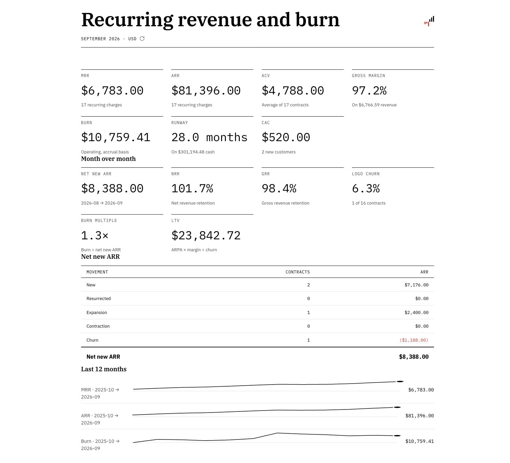
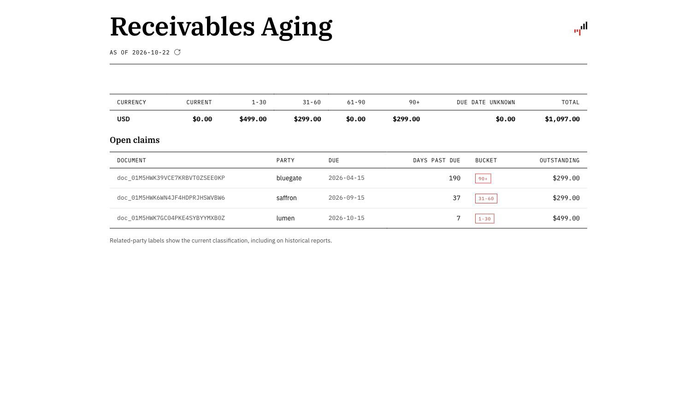
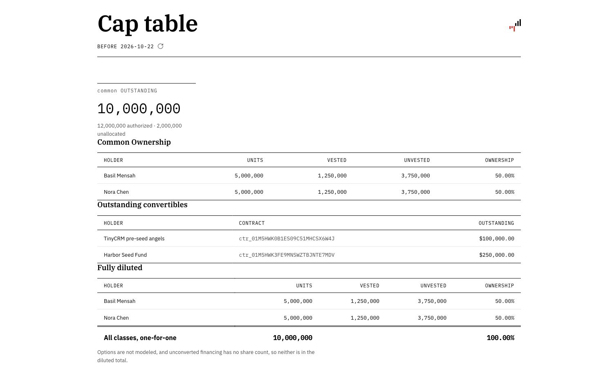

# Economico for ChatGPT

Economico is the agentic finance function for ambitious founders who want the financial rigor of a company with a finance department, without hiring one.

Economico isn’t another copilot or dashboard to learn. Your own agent connects over MCP and does the work, recording each business’s history in a hash-chained, append-only ledger. The agreement is recorded first, so most reconciliation never has to happen.

The result is one connected history of what you charge, what each customer agreed to, what they used and what it costs to serve them. Financial statements, cash, runway and revenue all come from that history. Ask what your burn is, then ask which customer, agreement or assumption changed it.

**Connect Economico and open TinyCRM Studio** from the connection screen. Explore a fictional
SaaS company's populated books before bringing your own. You can also connect an existing
business or create one on the free Solo plan. You choose the business and permissions.

Try: “Show recurring revenue, burn and runway for September 2026.”

Try: “What do customers still owe us as of October 22, 2026?”

Try: “Show the cap table before October 22, 2026.”

These are genuine Economico MCP App views from a disposable demo, captured in a local protocol
host. They illustrate the app response, rather than a verified ChatGPT installation.

Economico records evidence you provide. It does not automatically read your bank, Stripe or
email, move money, send invoices, sign agreements or file taxes. Burn and runway depend on the
records and assumptions supplied.

The plugin uses OAuth and https://economi.co/mcp/chatgpt. Each command has its own tool and
input schema. Reports are individually exposed as `report_income_statement`,
`report_balance_sheet` and the other report tools, each with its own parameters; each read operation has its own tool. The included skill describes this interface.
Existing paid entitlements work here; feature restrictions can link to informational pricing.
Paid plan purchases take place outside this plugin.
