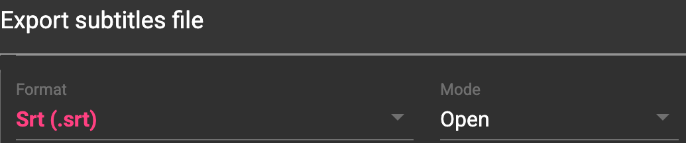
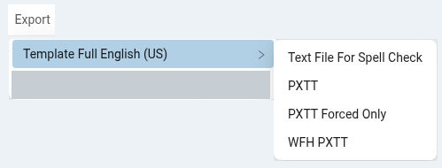
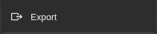
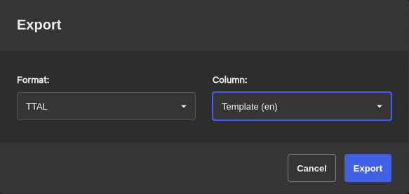
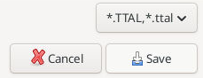
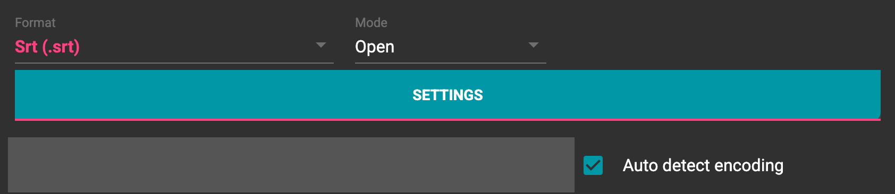
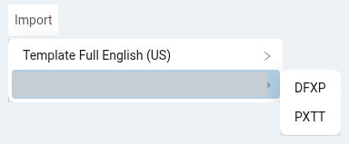

# Export your source-language subtitles

Adapted from the publisher's “Subtitle export and import guide.docx”. Keep the original file. Check the project and language before each transfer. The images show example source-language labels; select the actual source language for your project.

## OOONA — SRT

1. Open the source-language subtitle file. Choose **Import/Export → Export file**.
2. Set **Format: Srt (.srt)** and **Mode: Open**.
3. Enable **Export horizontal and vertical alignment**, then choose **EXPORT**.
4. Confirm that the export contains the source-language text.

## PXTT workflow

1. Choose **Export → the full source-language template → PXTT**. The screenshot's language is an example, not a required source language.
2. Save the file and keep an untouched copy. Check that it contains the source-language template.

## TTAL workflow

1. Open the task in its editor. Choose **Actions → Export**.
2. Set **Format: TTAL** and **Column: Template (source language)**, rather than Current.
3. Choose **Export**, then select a filename and location and save. Check the saved source-language text.

# Import the translated file

Keep cue IDs, order, timing and other file data intact. Check the saved target text. Do not automate online replacement without the user's authorization.

## OOONA

Choose **Import/Export → Import text from file (keep timecodes)**. Select the translated file and review the settings. Clear existing target text only when intended.

### Templates with omitted cues

First list the template's omitted cue numbers and supply them with the file. Where the platform requires placeholders, prepare a separate import copy after confirming the exact omissions: insert a copy of the preceding subtitle text at each omitted position, preserving the omitted cue's own timecodes. Never copy the preceding timestamps. Match the template's cue count and order. After import, manually mark the placeholders as omitted. Review the first cue and consecutive omissions manually; if there is no valid preceding cue, do not guess. This is conditional import preparation, not an instruction to change all exports or the original subtitle.

## PXTT

Choose **Import → the intended target-language asset → PXTT**. Select the translated file, verify the asset and intended replacement, and wait for saving to finish. Confirm the saved target text.

## TTAL

The supplied guide documents export only. Consult the actual platform's import interface or its documented workflow; do not assume its import controls match another platform.
