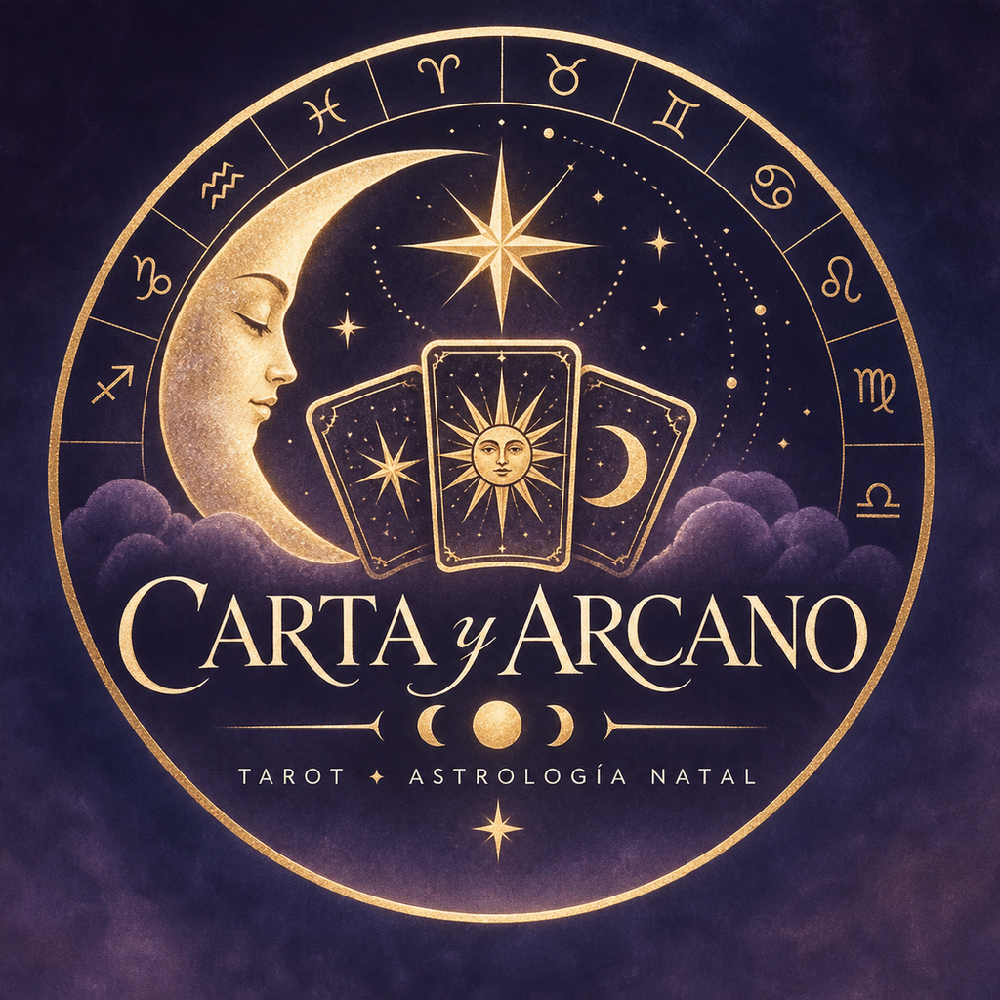

<div align="center">



# Carta y Arcano 🌙

**Tu cielo natal, tus cartas y un espacio para reflexionar.**

Plugin de tarot y astrología natal en español, creado por **Victor Silva · Smart Studio**.


[Novedades](#-últimas-modificaciones) · [De un vistazo](#-de-un-vistazo) · [Primeros pasos](#-primeros-pasos) · [Compilación](#-compilar-el-plugin) · [El proyecto](#-el-proyecto)

</div>

---

## 🆕 Últimas modificaciones

**Versión actual: 0.5.3 · Actualizado el 5 de noviembre de 2026.**

| Cambio | Qué incorpora |
| :--- | :--- |
| **Servidor propio** | Conexión a Smart Studio Astrology MCP en `https://mcp.smartstudio.dev/mcp`, con configuración portable y de compatibilidad sincronizada. |
| **Preparación de revisión** | Cinco casos positivos, tres negativos, prompts de ejemplo y notas de versión en ambos manifiestos. |
| **Consultas específicas** | Flujos de efemérides, tránsitos y aspectos sin solicitar datos natales innecesarios; explicación explícita de la convención de hora literal. |
| **Metadatos del plugin** | URLs de web, soporte, privacidad y términos; declaración confirmada de que no incluye compras ni pagos. |
| **Compilación automatizada** | `scripts/build.sh` ejecuta el compilador Python y transmite sus argumentos. Genera un ZIP reproducible en el mismo entorno, con SHA-256 y validaciones locales. |
| **Control previo a revisión** | `--submission` exige los casos, las notas y una URL HTTPS de demo; los resultados finales y los pasos pendientes están en `docs/REVISION.md`. |

**Estado de preparación:** ocho casos con resultado correcto y ocho grabaciones referenciadas. P2 y P3 muestran las llamadas MCP esperadas y resultados correctos en la verificación visual final del 5 de noviembre de 2026. Ambos manifiestos incluyen la [demo principal P1](https://smartstudio.lon1.digitaloceanspaces.com/Caso%20P1.mov) y el vídeo de cada caso en `expected_output_url`. Las cuatro páginas españolas del microsite se verificaron sin autenticación. Quedan por completar o confirmar la identidad del editor, el dominio, la conexión, los escaneos, los datos de publicación y las pruebas de la versión guardada en el portal, antes de enviar a revisión. Consulta `docs/REVISION.md` para los resultados y pasos pendientes.

## ✨ De un vistazo

| | Qué puedes hacer |
| :--- | :--- |
| 🪐 **Explorar tu carta natal** | Consultar planetas, signos, grados, casas y aspectos con una herramienta de cálculo disponible. |
| 🃏 **Interpretar una tirada** | Compartir tus cartas por texto o imagen, con su orden, posiciones y pregunta. |
| 🌗 **Unir carta y tarot** | Incorporar elementos de una ficha natal verificada a la lectura de tus arcanos. |
| 📋 **Llevarte tu ficha** | Copiar una ficha natal para reutilizarla en futuras conversaciones. |
| 🕯️ **Crear un ritual diario** | Leer tres cartas como energía del día, experiencia corporal y arcano acompañante. |

La voz de Carta y Arcano es cálida, serena y cercana. Las lecturas ofrecen una interpretación simbólica y un punto de partida para la reflexión.

## 🌙 Primeros pasos

Con el plugin instalado, selecciónalo como **@Carta y Arcano** y escribe:

> Quiero comenzar una lectura con Carta y Arcano.

Para preparar tu carta natal, comparte:

| Dato | Ejemplo |
| :--- | :--- |
| **Cómo quieres que te llame** | Alex; los apellidos son opcionales |
| **Fecha de nacimiento** | 2 de julio de 1985 |
| **Lugar de nacimiento** | Porto, Portugal |
| **Hora local** | 08:05; indica si es exacta, aproximada o desconocida |

También puedes empezar directamente con una tirada:

> Mi pregunta es qué necesito comprender de esta etapa. Pasado: El Ermitaño. Presente: La Torre. Camino posible: La Estrella.

<details>
<summary><strong>🕯️ Un ritual de tres cartas</strong></summary>

1. **¿Qué energía debo tener en consideración hoy?** Una imagen a la que prestar atención.
2. **¿Qué energía emanó este cuerpo hoy?** Una invitación a reconocer tu experiencia corporal.
3. **Mi arcano amigo, gracias por acompañarme.** Una cualidad que puedes llevar contigo.

Comparte las cartas en ese orden e indica si utilizas cartas invertidas.

</details>

## ⚙️ Cómo se calcula la carta

| Vía | Función | Disponibilidad |
| :--- | :--- | :--- |
| **MCP de Smart Studio** | Servidor propio con Swiss Ephemeris y cálculo de hora literal. | Requiere conexión y una respuesta válida del servicio. |
| **Calculador Python local** | Alternativa con Moshier y conversión de hora local a UTC. | Requiere un ejecutor Python y las dependencias instaladas. |
| **Lectura de tarot** | Interpretación de las cartas compartidas. | Puede realizarse sin conexión al MCP. |

El servidor es [Smart Studio Astrology MCP](https://mcp.smartstudio.dev/), mantenido en el proyecto independiente `smartstudio-astrology-mcp`. La conexión `smartstudio-astrology` utiliza **Streamable HTTP** en `https://mcp.smartstudio.dev/mcp`, configurada en [`mcp.json`](mcp.json) y [`.mcp.json`](.mcp.json).

El MCP usa zodiaco **tropical**, casas **Placidus** y **nodos medios** por defecto; también admite WholeSign, Equal y nodos verdaderos. Sus herramientas son `resolve_birthplace`, `calculate_natal_chart`, `calculate_transits`, `calculate_aspects` y `get_ephemeris`.

**Convención temporal:** el MCP conserva la hora recibida y la usa como UT convencional, sin conversión de zona horaria (`literal_no_timezone`). Devuelve `civil_time_not_utc_verified`: incluso una hora declarada exacta no representa un instante natal UTC verificado. Sin hora, devuelve muestras del día y omite casas, ángulos y aspectos natales.

<details>
<summary><strong>Ejemplo de argumentos para calculate_natal_chart</strong></summary>

```json
{
  "request": {
    "birth_date": "1985-07-02",
    "birth_time": "08:05",
    "time_precision": "exact",
    "city": "Porto",
    "country": "Portugal",
    "latitude": 41.1579,
    "longitude": -8.6291,
    "zodiac": "tropical",
    "house_system": "Placidus",
    "node_type": "mean"
  }
}
```

Todas las herramientas reciben un objeto `request`. Para hora desconocida, omite `birth_time` y usa `time_precision: "unknown"`. No se admiten campos IANA ni offsets. Comprueba `success`, `errors` y `warnings` antes de interpretar una respuesta.

</details>

## 🛠️ Calculador local

El script incluido usa **Moshier**, casas **Placidus** y **nodos verdaderos**, con conversión de hora local a UTC. Sus convenciones difieren de las del MCP; los resultados deben identificarse por su fuente.

Desde la raíz del repositorio, con Python 3.9 o posterior y una versión compatible de las dependencias:

```bash
python3 -m venv .venv
source .venv/bin/activate
python -m pip install -r skills/carta-y-arcano/scripts/requirements.txt
```

Calcula una carta indicando la **hora local del lugar de nacimiento**:

```bash
python skills/carta-y-arcano/scripts/natal_chart.py \
  --date 1985-07-02 \
  --time 08:05 \
  --city Porto \
  --country Portugal
```

El resultado se imprime en **JSON** e incluye posiciones planetarias, retrogradaciones, ángulos, cúspides y aspectos. El script convierte la hora local a UTC mediante la zona IANA correspondiente; la búsqueda por ciudad utiliza Nominatim de OpenStreetMap.

<details>
<summary><strong>Coordenadas, ejecución sin red y hora desconocida</strong></summary>

Con las dependencias y los datos de zonas horarias disponibles, puedes evitar la búsqueda de ubicación y ejecutar el cálculo sin red:

```bash
python skills/carta-y-arcano/scripts/natal_chart.py \
  --date 1985-07-02 \
  --time 08:05 \
  --city Porto \
  --country Portugal \
  --lat 41.1579 \
  --lon -8.6291 \
  --timezone Europe/Lisbon
```

`--lat` y `--lon` deben proporcionarse juntos. `--timezone` permite indicar una zona IANA conocida; si se omite, se resuelve con `timezonefinder`.

**Hora desconocida:** `--unknown-time` omite casas, Ascendente y Medio Cielo, pero el script sigue requiriendo `--time` y calcula las posiciones para esa hora. No evalúa automáticamente la variación lunar del día; ese resultado no debe presentarse como una posición natal exacta.

Si Placidus no está disponible para las coordenadas indicadas, el resultado incluye un aviso y conserva las posiciones planetarias sin casas.

</details>

## 📦 Compilar el plugin

Con Python 3.9 o posterior, sin instalar dependencias adicionales:

```bash
./scripts/build.sh
```

También puedes ejecutar `python3 scripts/build.py` directamente. El wrapper funciona desde cualquier directorio si lo invocas mediante su ruta y transmite todos los argumentos al compilador.

Genera `dist/carta-y-arcano-v0.5.3.zip` para la versión actual; el nombre se obtiene de los manifiestos y se muestra su SHA-256. Valida la sincronización de los manifiestos, las configuraciones MCP y los metadatos de revisión, los recursos gráficos referenciados, la sintaxis Python y la integridad del ZIP. La compilación no consulta el servidor MCP.

Para una nueva versión, actualiza `version` en ambos manifiestos y la insignia del README. Volver a compilar reemplaza el ZIP de esa versión solo después de validarlo. Puedes elegir otro destino con `--output-dir /ruta/de/salida`; los mismos archivos generan el mismo paquete en el mismo entorno.

`./scripts/build.sh --submission` exige además cinco casos positivos, tres negativos, notas de versión y una URL HTTPS de demostración. Es una comprobación local: no acredita la reproducción del vídeo, las pruebas en ChatGPT ni la verificación del dominio. Consulta `docs/REVISION.md` en el repositorio para completar esos pasos. El ZIP normal puede generarse mientras falte la grabación.

## 🖥️ Distribución local y reinstalación

La fuente del repositorio y el ZIP `carta-y-arcano-v0.5.3.zip` conservan `extensions.com.openai.auth.type=none` para el portal. El runtime local instalado rechaza ese campo dentro de las declaraciones MCP (`unknown field extensions, expected url or headers`). Para ese runtime se genera una variante independiente:

```bash
./scripts/build.sh --local
```

Produce `dist/carta-y-arcano-v0.5.3+local.1.zip` y la carpeta instalable `dist/local/carta-y-arcano`. Solo en esa copia se omiten las extensiones MCP; el endpoint y el resto del plugin se conservan. No subir la variante local al portal. `--local` y `--submission` son excluyentes.

El marketplace `smartstudio-local`, definido en `.agents/plugins/marketplace.json`, apunta a `./dist/local/carta-y-arcano`. Compila antes de instalar. Para recargar la instalación existente desde la raíz de este repositorio:

```bash
./scripts/build.sh --local
codex plugin remove carta-y-arcano@smartstudio-local
codex plugin add carta-y-arcano@smartstudio-local
codex plugin list --marketplace smartstudio-local --json
```

Comprueba la versión `0.5.3+local.1`. Cierra y vuelve a abrir la aplicación de escritorio; si utilizas VS Code, ejecuta `Developer: Reload Window`. Abre una conversación nueva y selecciona la copia de `smartstudio-local`. Comprueba las llamadas reales a `calculate_natal_chart` y `calculate_aspects` antes de repetir las grabaciones P2/P3. No es necesario editar la caché manualmente.

Para otra máquina, registra primero este repositorio como marketplace con `codex plugin marketplace add /ruta/al/repositorio/carta-y-arcano`, después de generar la carpeta local. En una primera instalación omite el comando `remove`.

## 🗂️ El proyecto

```text
.
├── README.md                       # Presentación y uso
├── plugin.json                     # Manifiesto del plugin
├── .codex-plugin/plugin.json       # Manifiesto empaquetado
├── mcp.json / .mcp.json             # Configuración MCP
├── assets/                         # Logotipos e iconos
├── docs/REVISION.md                 # Estado de revisión y guion de demo
├── scripts/
│   ├── build.sh                     # Entrada de compilación desde shell
│   └── build.py                     # Compilación y validación del ZIP
├── dist/                           # Paquetes ZIP generados
└── skills/carta-y-arcano/
    ├── SKILL.md                    # Guía de lecturas y cálculo natal
    ├── agents/openai.yaml          # Metadatos de la skill
    ├── assets/                     # Recursos visuales de la skill
    └── scripts/
        ├── natal_chart.py          # Calculador natal
        └── requirements.txt        # Dependencias Python
```

## 🤍 Datos y continuidad

- Carta y Arcano no incluye compras, pagos ni venta de productos o servicios.
- El nombre sirve para dirigirse a ti; **no interviene en el cálculo natal**.
- La guía limita el envío a Smart Studio a los datos necesarios para calcular la carta; excluye nombres, preguntas de tarot y contenido de la conversación. Si el MCP consulta un geocodificador externo, envía solo ciudad, país y región.
- La ficha reutilizable se entrega sin apellidos ni datos de nacimiento. Guárdala y compártela en otra conversación cuando quieras retomarla; no se promete memoria entre chats.
- Tarot y astrología se presentan como herramientas simbólicas, sin garantías de predicción ni sustitución de orientación profesional.

---

<div align="center">

**Carta y Arcano · Un cielo para explorar. Una carta para reflexionar.**

[Web](https://smartstudio.dev/carta-y-arcano) · [Soporte](https://smartstudio.dev/carta-y-arcano/soporte) · [Privacidad](https://smartstudio.dev/carta-y-arcano/privacidad) · [Términos](https://smartstudio.dev/carta-y-arcano/terminos) · [Guía del plugin](skills/carta-y-arcano/SKILL.md)

</div>
