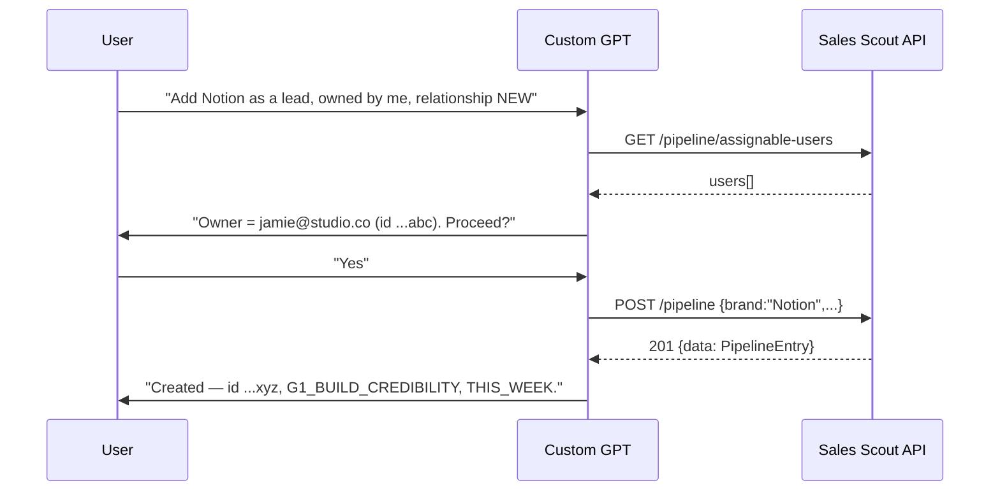

# GPT Action Flows — intent → API sequence map

Companion to:

- `docs/SALES_SCOUT_OPENAPI_APP.yaml` (contract the GPT imports)
- `docs/SALES_SCOUT_INSTRUCTIONS_APP.md` (behavior rules the GPT follows)

Use this page to onboard a new Custom GPT (or debug a broken flow) without re-reading the full system instructions. Each section maps a user utterance to the minimal tool sequence, with the required fields and canonical enums inline.

All API calls are prefixed `https://beta-api.joelpilger.com/api/v1`. Auth is the OAuth2 Bearer token ChatGPT attaches to every tool call after Sign-in (initiated at `https://beta.joelpilger.com/oauth/gpt`).

Conventions used below:

- **resolve** = call a list endpoint first, pick an id by matching name/email, echo the match to the user.
- **preview** = emit the exact JSON body Scout is about to send and ask one yes/no.

---

## 0. Session bootstrap (first response only)

Output the rename tip + diagnostic message as text FIRST, THEN call `whoami` to upgrade — an unauthenticated action call makes ChatGPT show only its Sign In card and your text never appears. Runs once per chat; do not re-bootstrap on later turns unless the user asks to switch Centerfile.

```
GET /integrations/whoami              → authorized: true, email, roles
GET /auth/me                          (optional — only when you need the local user id)
GET /me/centerfiles                   → pick default/named Centerfile (only if authorized)
GET /me/centerfiles/{id}              → load identity
```

If `whoami` fails or `authorized !== true` → stay in DIAGNOSTIC MODE (keep the diagnostic message; coaching-only, no Radar/Centerfile/Lead Flow). Only enter FULL POWER MODE + Centerfile load on `authorized: true`.

---

## 1. Create Lead

User says: *“Add Notion as a lead”*, *“Log this brand”*, *“Create pipeline entry for …”*.

```
GET  /pipeline/assignable-users               → resolve ownedByUserId by name/email
# (optional) GET /pipeline?search=<brand>     → dedupe; warn if brand already exists
# preview body → one yes/no confirm
POST /pipeline                                → 201 with {data: PipelineEntry}
```

Minimum body:

```json
{
  "brand": "Notion",
  "contact": "Ivan Zhao",
  "contactTitle": "Verified published title",        // required when available
  "contactLinkedinUrl": "Verified LinkedIn URL only",// conditional — omit if not verified
  "ownedByUserId": "<from assignable-users>",
  "relationshipGoal": "NEW",                 // NEW | EXPANSION | REGENERATION
  "currentTrustGate": "G1_BUILD_CREDIBILITY",// G1..G5
  "responsivenessStatus": "ADVANCING",       // ADVANCING | STALLED | DORMANT
  "nextActionWindow": "THIS_WEEK"            // NOW | THIS_WEEK | THIS_MONTH
}
```

`contactTitle` is default-populated whenever a published title is verified — omit only if none exists; never invent one. `contactLinkedinUrl` is conditional — include only a real, verified profile URL; never guess or infer, omit it otherwise.

Optional: `contactEmail`, `recommendedNextAction`, `actionType`, `lastTouchAt`, `notes`, `organizationId`.

`lastTouchAt` is auto-stamped to `now()` server-side on create — only pass it explicitly to backfill historical leads.

Errors: `400 invalid owner` → re-resolve. `400 invalid organization` → omit `organizationId`.

---

## 2. Update Lead

User says: *“Move Notion to G3”*, *“Mark as stalled”*, *“Change the owner to Jamie”*.

```
GET  /pipeline?search=<brand>                  → pick id (ask if >1 match)
GET  /pipeline/{id}                            → show current values for diff
# (if owner change) GET /pipeline/assignable-users
# preview diff → one yes/no confirm
PATCH /pipeline/{id}                           → 200 OR 409 GATE_SKIP_REQUIRES_CONFIRM
# on 409: show from/to/diff → user confirms → retry with "skipWarningAcknowledged": true
```

Auto-touch: any patch with at least one mutating field auto-stamps `lastTouchAt = now()` server-side. For cosmetic edits (typo fixes, archive cleanup, etc.) pass `"skipTouch": true` to bypass. To override the timestamp, pass `lastTouchAt` explicitly (ISO-8601, or `null` to clear).

Notes field is append-only framing — Scout reads current notes, concatenates (with a timestamp prefix), then PATCHes the full string.

---

## 2b. Log Touch (no other field changing)

User says: *“I emailed her”*, *“They replied on LinkedIn”*, *“Had the call this morning”* — and there's nothing else to update.

```
GET   /pipeline?search=<brand>                 → pick id
# preview body → one yes/no confirm
PATCH /pipeline/{id}                           → 200
```

Body:

```json
{ "lastTouchAt": "2026-05-06T00:00:00Z" }
```

Use this only when no other patch is happening — routine create/update calls already auto-stamp the touch server-side.

---

## 3. Upload Centerfile (first-time)

User says: *“Upload my Centerfile”*, *“Create a Centerfile for Studio X”*.

```
# walk sections: companyBasics → proof → expertise → fit → process → tone → constraints
# validate every enum array (teamSize, primaryServices, strongIndustries, workingStyle)
# preview full payload → one yes/no confirm
POST /me/centerfiles                           → 201 {data: Centerfile}
# optional follow-up:
PATCH /me/centerfiles/{id}/set-default         → mark as default
```

Required enum arrays:

- `companyBasics.teamSize` ∈ `ONE | TWO_TO_FIVE | SIX_TO_FIFTEEN | SIXTEEN_TO_FIFTY | FIFTY_PLUS`
- `companyBasics.primaryServices[]` ⊂ `MOTION, DESIGN, PRODUCTION, BRANDING, ANIMATION, STRATEGY, DEVELOPMENT, EDITORIAL, PHOTOGRAPHY, OTHER`
- `fit.strongIndustries[]` ⊂ `TECHNOLOGY, CONSUMER, HEALTHCARE, FINANCE, MEDIA_ENTERTAINMENT, RETAIL, B2B, NONPROFIT, EDUCATION, OTHER`
- `tone.workingStyle[]` ⊂ `DIRECT, COLLABORATIVE, FAST_MOVING, STRATEGIC, STRUCTURED, EXPERIMENTAL`

Each project row (PAO) requires `projectName, client, problem, approach, outcome` (non-empty) and `measurableResults` (may be empty string).

---

## 4. Refine Centerfile (edit existing)

User says: *“Update my Centerfile bestClients section”*, *“Rename my Centerfile”*.

```
GET   /me/centerfiles                          → pick id by name
GET   /me/centerfiles/{id}                     → full current content
# merge user deltas into the FULL content object client-side (content is replace-all)
# preview → one yes/no confirm
PATCH /me/centerfiles/{id}                     → {name?, content?}
```

`content` is a replace-all field — always send the ENTIRE object.

---

## 5. Create Lead Room

User says: *“Create a lead room for Notion, Linear, and Framer”*.

```
# resolve each brand:
GET  /pipeline?search=Notion                   → pick id
GET  /pipeline?search=Linear                   → pick id
GET  /pipeline?search=Framer                   → pick id
# optional linked chats → GET /me/gpts for gptId if specified
# preview body → one yes/no confirm
POST /lead-rooms                               → 201 {data: LeadRoom}
```

Minimum body:

```json
{
  "title": "Q2 Productivity Brands",
  "pipelineEntryIds": ["<id1>", "<id2>", "<id3>"]
}
```

Optional: `description`, `linkedChats: [{title, chatUrl, gptId?, lastInteractionAt?}]`.

---

## 6. Edit Lead Room


| User intent                      | Call                                                                                      |
| -------------------------------- | ----------------------------------------------------------------------------------------- |
| Rename / re-describe             | `PATCH /lead-rooms/{id}` `{title?, description?}`                                         |
| Replace notes                    | `GET /lead-rooms/{id}` → concat client-side → `PATCH /lead-rooms/{id}/notes` `{notes}`    |
| Attach more leads                | resolve ids → `POST /lead-rooms/{id}/pipeline-entries` `{pipelineEntryIds: [...]}`        |
| Log a GPT chat                   | optional `GET /me/gpts` → `POST /lead-rooms/{id}/linked-chats` `{title, chatUrl, gptId?}` |
| Update a chat entry              | `PATCH /lead-rooms/{id}/linked-chats/{chatId}`                                            |
| Add task                         | `POST /lead-rooms/{id}/tasks` `{title}`                                                   |
| Complete / rename / reorder task | `PATCH /lead-rooms/{id}/tasks/{taskId}` `{completed?, title?, sortOrder?}`                |


All edits still follow Preview-then-Confirm.

---

## 7. Not available from the GPT (direct to web app)

These endpoints exist server-side but are intentionally excluded from the Action spec (additive-only):

- `DELETE /pipeline/{id}` (archive lead)
- `POST /pipeline/{id}/restore`
- `DELETE /me/centerfiles/{id}`
- `DELETE /lead-rooms/{id}`
- `DELETE /lead-rooms/{id}/pipeline-entries`
- `DELETE /lead-rooms/{id}/linked-chats/{chatId}`
- `DELETE /lead-rooms/{id}/tasks/{taskId}`

If the user asks for any of these, respond:

> “Archive/delete happens in the Sales Scout web app — I can’t perform destructive actions from here.”

---

## 8. Error contract cheat sheet


| Status                           | Meaning                                                       | GPT response                                                                    |
| -------------------------------- | ------------------------------------------------------------- | ------------------------------------------------------------------------------- |
| 400                              | Body validation, invalid enum, invalid owner/organization/GPT | Re-check field against OpenAPI schema; never retry blindly                      |
| 401                              | Token missing / expired                                       | Stay in DIAGNOSTIC MODE (diagnostic message); ChatGPT also shows its Sign In card |
| 403                              | User not provisioned / inactive                               | Stay in DIAGNOSTIC MODE (diagnostic message); coaching-only, no gated actions   |
| 404                              | Resource not found                                            | Ask user to re-confirm id / name                                                |
| 409 `GATE_SKIP_REQUIRES_CONFIRM` | Pipeline gate jump ≥ 2                                        | Surface `from`/`to`/`diff`, confirm, retry with `skipWarningAcknowledged: true` |
| 409 (centerfile)                 | Duplicate name                                                | Propose a differentiated name                                                   |


---

## 9. Diagram




