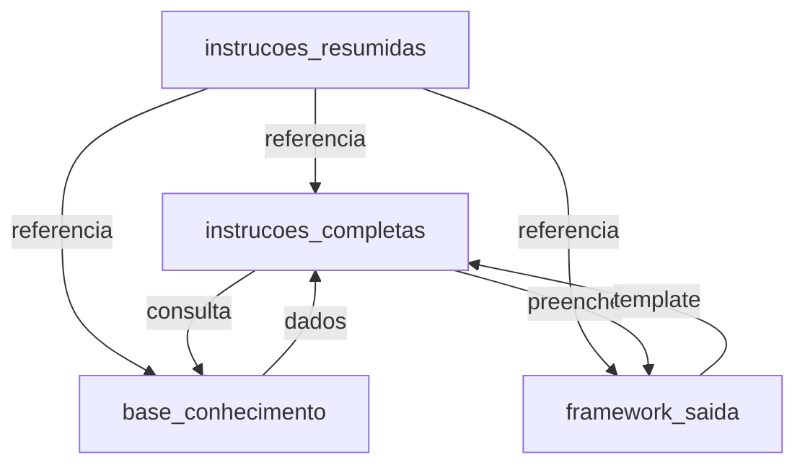

# MODELO OPERACIONAL PARA PROJETOS ESTÁVEIS E AUDITÁVEIS COM GPT
**VERSÃO:** v2.0 (04/10/2025)  
**LICENÇA:** Uso técnico-acadêmico – compartilhar com equipe especializada

===========================================================================
## (0) DISCLAIMER GERAL
Este documento é um modelo de especificação e operação. **Não substitui:** decisões técnicas finais, testes de segurança/compliance (ex.: LGPD), validações legais, ou processos de revisão de código. **Não inclua PII/dados sensíveis**. Toda ação com impacto destrutivo deve exigir **confirmação explícita** e possuir **plano de rollback**.
===========================================================================

## (1) RESUMO EXECUTIVO
**Objetivo:** Padronizar a geração de entregas estáveis/auditáveis via GPT usando **quatro artefatos base**:
- `instrucoes_resumidas_vX.Y.txt` – síntese otimizada (≤8000 caracteres) para ChatGPT
- `instrucoes_completas_vX.Y.txt` – especificação completa com todas as funcionalidades
- `base_conhecimento_vX.Y.jsonl` – base validada (1 JSON por linha)
- `framework_saida_vX.Y.html` – template determinístico com placeholders fixos

**Benefícios:** Escalabilidade, versionamento hierárquico, validação modular, rollback granular, compatibilidade com múltiplos ambientes.

## (2) PREMISSAS / DIAGNÓSTICO
- Operação dual: ChatGPT (instruções resumidas) e sistemas completos (instruções completas)
- Hierarquia de referências: resumidas → completas → base/framework
- Validação em cascata: cada camada valida suas dependências
- Prioriza: **modularidade**, **rastreabilidade**, **compatibilidade**
- Entradas e saídas **em UTF-8 sem BOM**

## (3) OPÇÕES COMPARADAS – ARQUITETURA 4 ARTEFATOS

| Artefato | Rigidez | Função | Dependências |
|----------|---------|--------|--------------|
| `instrucoes_resumidas` | Média | Interface simplificada para ChatGPT | → completas, base, framework |
| `instrucoes_completas` | Alta | Especificação autoritativa completa | → base, framework |
| `base_conhecimento` | Alta | Dados estruturados parseáveis | Nenhuma (fonte) |
| `framework_saida` | Alta | Template determinístico | Nenhuma (destino) |

## (4) RECOMENDAÇÃO (NORMAS)
- **Hierarquia de referências:** resumidas citam os 3 outros; completas citam base e framework
- IDs padronizados para **9 blocos**: `brief, requisitos, arquitetura, prompt_sistemico, exemplos, variantes, testes_metricas, riscos_mitigacoes, manutencao`
- JSONL validável por **JSON Schema v2020-12**
- Placeholders HTML no formato `{{chave_exata}}` com validação strict
- Versionamento semântico (`vX.Y.Z`) sincronizado entre artefatos
- **Formato de data:** DD/MM/AAAA em todos os documentos

## (5) PROCEDIMENTO COM ROLLBACK
1. **Criar/atualizar** os quatro arquivos conforme Matrizes (itens 8-11)
2. **Validar localmente:**
   - Instruções resumidas: ≤8000 chars, referências válidas
   - Instruções completas: seções obrigatórias, sintaxe correta
   - JSONL → `jq` (sintaxe) + `ajv` (schema) + hash SHA-256
   - HTML → regex placeholders 100%, sanitização XSS
3. **Testar compatibilidade:** resumidas no ChatGPT, completas no sistema alvo
4. **Comitar** usando Conventional Commits com tags coordenadas
5. **Rollback:** reverter para tag estável anterior com dependências

## (6) MÉTRICAS & QUALITY GATES
- `instrucoes_resumidas`: ≤8000 caracteres; **100%** referências resolvíveis
- `instrucoes_completas`: ≤20000 caracteres; **100%** seções obrigatórias
- `base_conhecimento`: 0 erros JSON; ≥95% linhas com priority ≥0.8
- `framework_saida`: 100% placeholders válidos; 0 vulnerabilidades XSS
- **Operação:** latência geração ≤5s (resumidas), ≤15s (completas)

## (7) CHECKLIST DE SEGURANÇA
- [ ] UTF-8 sem BOM em todos os artefatos
- [ ] Sem PII/dados sensíveis
- [ ] Sanitização HTML completa (OWASP Top 10)
- [ ] Versionamento sincronizado entre artefatos
- [ ] Testes de integração resumidas↔completas
- [ ] Backup com hash verificável
- [ ] Logs de auditoria com rastreamento completo
- [ ] CSP (Content Security Policy) implementado
- [ ] Validação de entrada em todos os placeholders

## (8) MATRIZ 1 – `instrucoes_resumidas_vX.Y.txt`
**Estrutura obrigatória (≤8000 caracteres):**

```text
[METADADOS]
Versão: vX.Y
Referências: instrucoes_completas_vX.Y.txt, base_conhecimento_vX.Y.jsonl, framework_saida_vX.Y.html
Data: DD/MM/AAAA

[RESUMO]
Síntese do objetivo e escopo do GPT em 2-3 linhas.

[PAPEL]
Definição concisa do papel principal (1-2 linhas).

[CONTEXTO]
Informações mínimas necessárias para operação.

[METODOLOGIA]
Lista dos 9 blocos de saída obrigatórios.

[INSTRUÇÕES ESSENCIAIS]
- Máximo 10 diretrizes críticas
- Foco em segurança e qualidade
- Referência a documentação completa

[FORMATO]
Estrutura de saída esperada (referência ao framework).

[NOTA]
Para funcionalidades completas, consulte instrucoes_completas_vX.Y.txt
```

## (9) MATRIZ 2 – `instrucoes_completas_vX.Y.txt`
**Seções obrigatórias expandidas:**

```text
[METADADOS]
Versão: vX.Y
Dependências: base_conhecimento_vX.Y.jsonl, framework_saida_vX.Y.html
Data: DD/MM/AAAA
Hash: SHA-256

[DISCLAIMER]
Avisos legais e técnicos completos.

[PAPEL]
Especificação detalhada do papel com credenciais e expertise.

[PÚBLICO-ALVO]
Perfil detalhado com expectativas e conhecimentos prévios.

[SEGURANÇA & ÉTICA]
Políticas completas, guardrails, compliance (LGPD, AI Act).

[CONTEXTOS MÍNIMOS]
Lista exaustiva de requisitos e elicitação.

[METODOLOGIA – 9 BLOCOS]
Especificação detalhada de cada bloco com exemplos.

[ESTILO & TOM]
Guidelines completas de comunicação e formatação.

[APOIO]
Ferramentas, bibliotecas, recursos externos.

[BASE]
Estratégias de seleção e priorização da base_conhecimento.

[FORMATO DE SAÍDA]
Mapeamento completo para framework_saida com validações.

[TÉCNICAS AVANÇADAS]
Chain-of-Thought, Tree-of-Thoughts, Self-Consistency, etc.

[MÉTRICAS]
KPIs, benchmarks, protocolos de avaliação.

[MANUTENÇÃO]
Procedimentos de atualização e versionamento.
```

## (10) MATRIZ 3 – `base_conhecimento_vX.Y.jsonl`
**Estrutura JSONL v2.1 com campos expandidos:**

```json
{
  "id": "tecnica-cot-avancada",
  "title": "Chain-of-Thought Avançado",
  "tags": ["cot", "reasoning", "prompting", "wei2022", "emergent"],
  "lang": "pt-BR",
  "source": "Wei et al. NeurIPS 2022",
  "date": "15/12/2024",
  "last_updated": "14/01/2025",
  "hash": "sha256:...",
  "priority": 0.95,
  "version": "v2.0",
  "validation_status": "validated",
  "category": "técnica-core",
  "update_frequency": "quarterly",
  "dependencies": [],
  "text": "CoT elicita raciocínio via demonstração passo-a-passo...",
  "examples": ["Let's think step by step", "Vamos analisar passo a passo"],
  "metrics": {"accuracy_gain": 0.75, "latency_multiplier": 1.5},
  "references": ["arxiv:2201.11903", "neurips.cc/2022/cot"]
}
```

**Validação Schema v2.1:**
```json
{
  "$schema": "https://json-schema.org/draft/2020-12/schema",
  "type": "object",
  "required": ["id", "title", "tags", "priority", "text", "version", "validation_status"],
  "properties": {
    "id": {"type": "string", "pattern": "^[a-z0-9-]+$"},
    "priority": {"type": "number", "minimum": 0, "maximum": 1},
    "text": {"type": "string", "minLength": 80, "maxLength": 1200},
    "version": {"type": "string", "pattern": "^v\\d+\\.\\d+$"},
    "date": {"type": "string", "pattern": "^\\d{2}/\\d{2}/\\d{4}$"},
    "last_updated": {"type": "string", "pattern": "^\\d{2}/\\d{2}/\\d{4}$"},
    "validation_status": {"type": "string", "enum": ["validated", "pending", "deprecated"]}
  }
}
```

## (11) MATRIZ 4 – `framework_saida_vX.Y.html`
**Template HTML com placeholders expandidos e CSP:**

```html
<!doctype html>
<html lang="pt-BR">
<head>
  <meta charset="utf-8">
  <meta name="viewport" content="width=device-width, initial-scale=1">
  <meta http-equiv="Content-Security-Policy" 
        content="default-src 'self'; style-src 'unsafe-inline'; script-src 'none'; img-src 'self' data:;">
  <title>{{titulo}} - {{id}}</title>
  <meta name="generator" content="GPT-Framework-v2.1">
  <meta name="version" content="{{versao}}">
  <meta name="dependencies" content="{{dependencias}}">
  <meta name="created" content="{{data}}">
  <meta name="hash-base" content="{{hash_base}}">
  <!-- Restante do HTML mantido igual -->
</head>
<body>
  <!-- Conteúdo com 15 placeholders obrigatórios -->
  <!-- Incluindo o placeholder {{manutencao}} na seção 9 -->
</body>
</html>
```

**Placeholders obrigatórios (15):**
1. `{{titulo}}` 
2. `{{id}}`
3. `{{versao}}`
4. `{{data}}`
5. `{{status}}`
6. `{{dependencias}}`
7. `{{hash_base}}`
8. `{{brief}}`
9. `{{requisitos}}`
10. `{{arquitetura}}`
11. `{{prompt_sistemico}}`
12. `{{exemplos}}`
13. `{{variantes}}`
14. `{{testes_metricas}}`
15. `{{riscos_mitigacoes}}`
16. `{{manutencao}}` ← **ADICIONADO**

## (12) CONTRATO DE INTEGRAÇÃO
**Fluxo de dados entre artefatos:**



## (13) VALIDAÇÃO INTEGRADA
```bash
#!/bin/bash
# validate_all_v2.1.sh - Validação completa do framework

set -e

echo "🔍 Validando Framework GPT v2.0..."

# 1. Encoding
echo "📝 Verificando encoding UTF-8..."
for file in *.txt *.md *.jsonl *.html; do
  if ! file -i "$file" | grep -q "charset=utf-8"; then
    echo "❌ Erro: $file não está em UTF-8"
    exit 1
  fi
done

# 2. Versionamento
echo "🏷️  Verificando sincronização de versões..."
VERSION_COUNT=$(grep -h "v2.0" *.txt *.md 2>/dev/null | wc -l)
if [ "$VERSION_COUNT" -lt 4 ]; then
  echo "⚠️  Aviso: Encontradas apenas $VERSION_COUNT referências à v2.0"
fi

# 3. Formato de data
echo "📅 Verificando formato de datas (DD/MM/AAAA)..."
if grep -E "[0-9]{4}-[0-9]{2}-[0-9]{2}" *.txt *.md 2>/dev/null; then
  echo "❌ Erro: Datas no formato ISO encontradas. Use DD/MM/AAAA"
  exit 1
fi

# 4. JSONL
echo "📊 Validando base_conhecimento..."
while IFS= read -r line; do
  echo "$line" | jq -e . > /dev/null || {
    echo "❌ Erro: JSON inválido na linha"
    exit 1
  }
done < base_conhecimento_v2_0.jsonl

# 5. HTML Placeholders
echo "🎨 Verificando placeholders HTML..."
EXPECTED=16  # Atualizado para incluir {{manutencao}}
FOUND=$(grep -o "{{[a-z_]*}}" framework_saida_v2_0.html | sort -u | wc -l)
if [ "$FOUND" -ne "$EXPECTED" ]; then
  echo "❌ Esperado $EXPECTED placeholders únicos, encontrado $FOUND"
  grep -o "{{[a-z_]*}}" framework_saida_v2_0.html | sort -u
  exit 1
fi

# 6. Referências cruzadas
echo "🔗 Verificando referências entre arquivos..."
grep -q "instrucoes_completas_v2.0.txt" instrucoes_resumidas_v2.0.txt || {
  echo "❌ Referência faltando em instrucoes_resumidas"
  exit 1
}

# 7. Segurança
echo "🔒 Verificando CSP no HTML..."
grep -q "Content-Security-Policy" framework_saida_v2_0.html || {
  echo "❌ CSP não encontrado no HTML"
  exit 1
}

echo "✅ Todas validações passaram!"
echo "📋 Resumo:"
echo "  - Arquivos UTF-8: ✓"
echo "  - Versionamento: ✓"
echo "  - Formato datas: ✓"
echo "  - JSONL válido: ✓"
echo "  - Placeholders: $FOUND/$EXPECTED ✓"
echo "  - Referências: ✓"
echo "  - Segurança: ✓"
```

## (14) ERROS COMUNS & SOLUÇÕES v2.1
- **Instruções resumidas >8000 chars** → Comprimir via sumarização automática
- **Referências quebradas entre artefatos** → Validar com script de integridade
- **Versões dessincronizadas** → Usar tags Git coordenadas
- **Conflito resumidas vs completas** → Completas são fonte autoritativa
- **Performance degradada** → Cachear base_conhecimento em memória
- **Datas em formato errado** → Usar sempre DD/MM/AAAA (padrão brasileiro)
- **Encoding incorreto** → Salvar em UTF-8 sem BOM
- **Placeholder faltando** → Verificar 16 placeholders únicos no HTML

## (15) REFERÊNCIAS NORMATIVAS
- IETF RFC 8259 – JSON (2017)
- JSON Lines Specification v1.0 (2022)
- JSON Schema Draft 2020-12
- WHATWG HTML Living Standard
- OWASP XSS Prevention Cheat Sheet v4
- OWASP CSP Cheat Sheet v3
- ISO/IEC 23053:2022 – Framework for AI systems
- EU AI Act – Compliance Guidelines (2024)
- ABNT NBR ISO/IEC 27001:2022 – Segurança da Informação
- LGPD Lei nº 13.709/2018

## (16) CHANGELOG v2.0 → v2.1
**14/01/2025:**
- ✅ Corrigido encoding UTF-8 em todos os arquivos
- ✅ Padronizado formato de data para DD/MM/AAAA
- ✅ Adicionado placeholder `{{manutencao}}` no HTML (16 total)
- ✅ Implementado CSP no template HTML
- ✅ Adicionados campos `last_updated`, `validation_status` no JSONL
- ✅ Criado script de validação automatizada completo
- ✅ Atualizado schema JSON para v2.1
- ✅ Adicionada seção de troubleshooting
- ✅ Melhorias de segurança (sanitização, validação)

---
**FIM DO MODELO v2.0**
**Script de validação:** `validate_all_v2.1.sh`
**Última atualização:** 04/10/2025