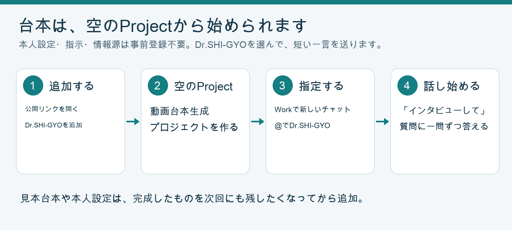
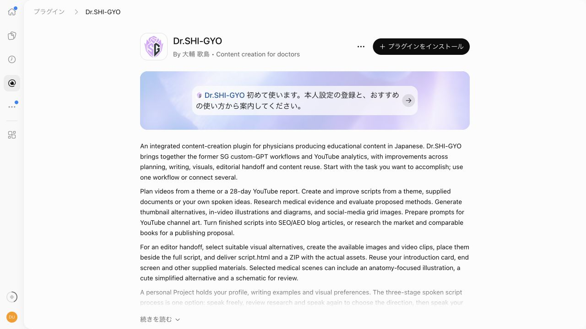
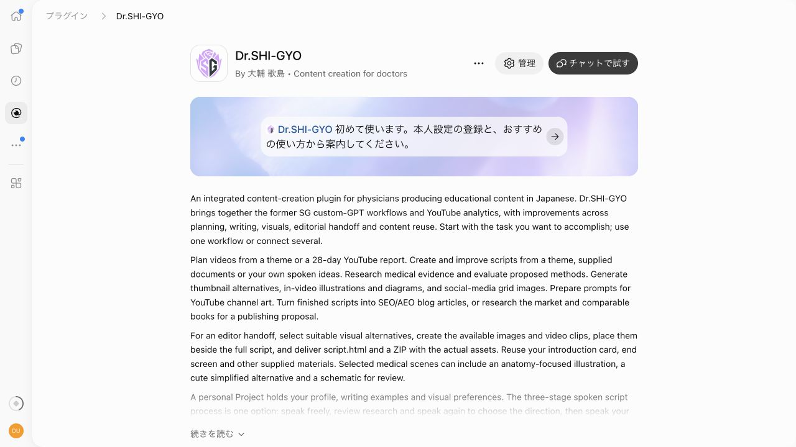
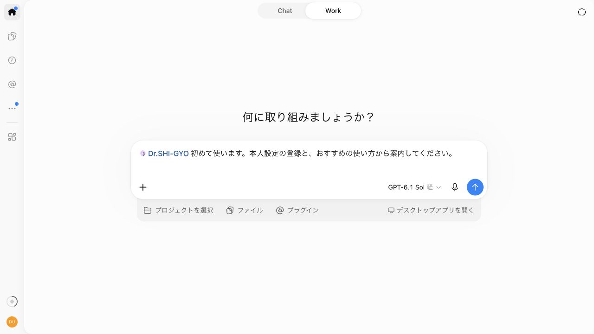
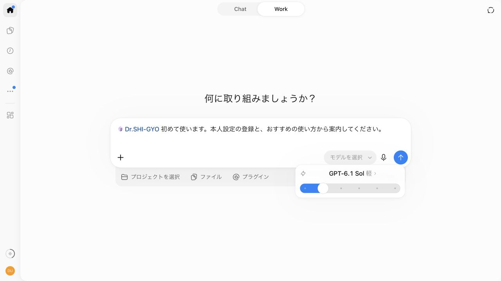
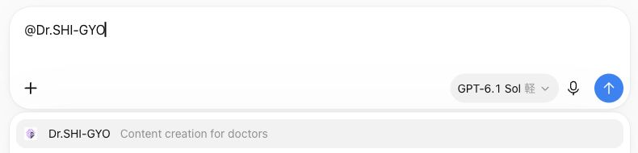
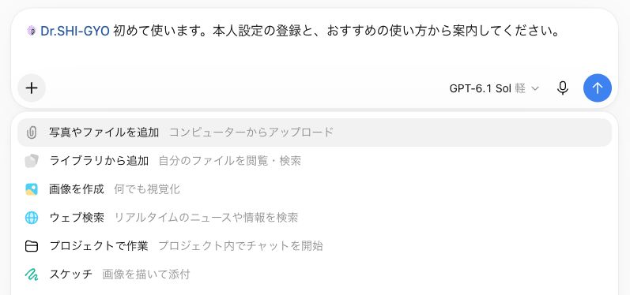
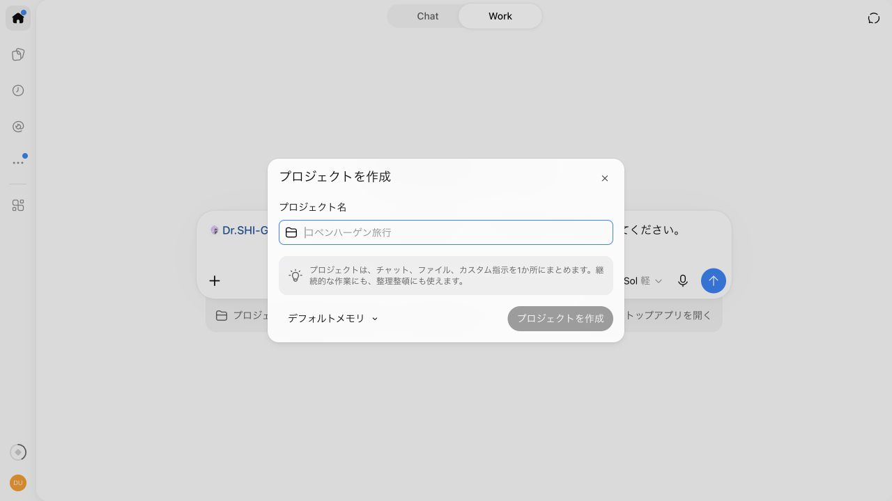
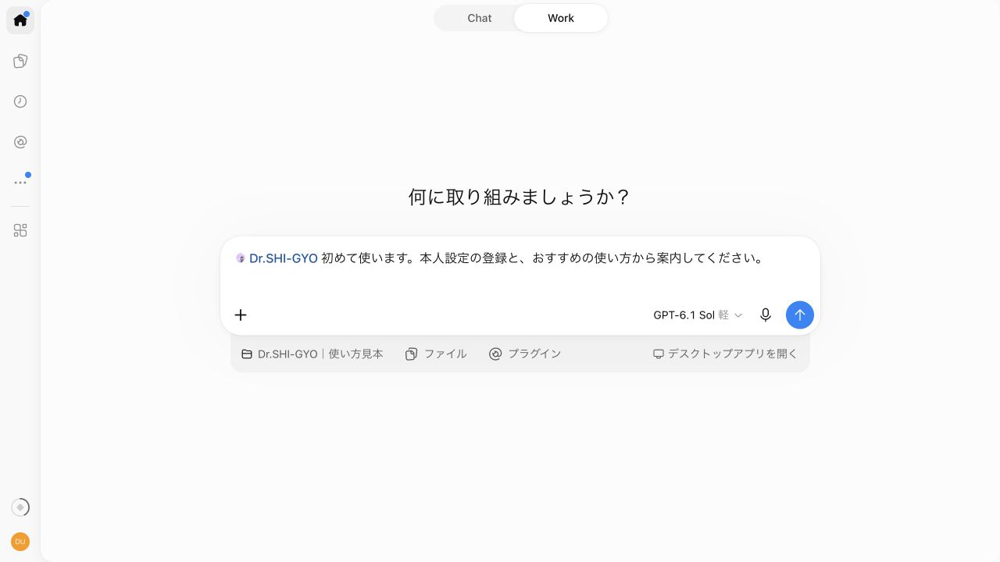
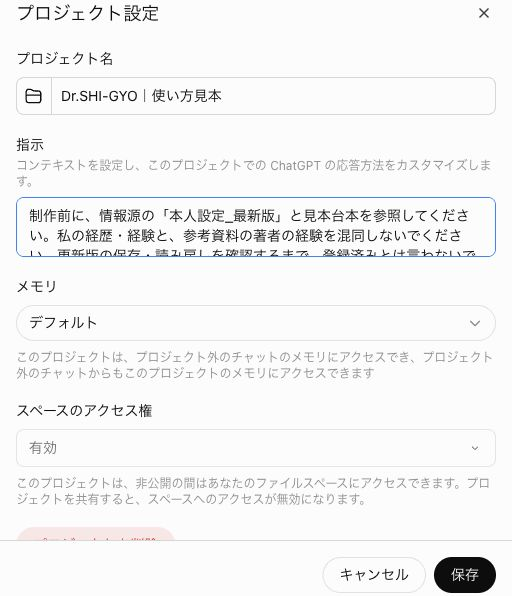

# 01｜最初に読む：Dr.SHI-GYOの導入と始め方

**いつも使っている自分のChatGPTに、Dr.SHI-GYOを一度追加します。あとは「これを作りたい」と伝えれば始められます。** スキル名を全部覚えたり、プログラミングをしたりする必要はありません。

導入画面のスクリーンショットは、2026年10月27日に公開された **Dr.SHI-GYO 1.0.0** を、歌島の個人アカウントのWeb版画面で確認して作成しました。画像は操作例であり、全受講生の環境で同じ機能をテストしたものではありません。画面の配置・使える機能は、端末・プラン・更新によって変わります。まずはパソコンのブラウザで進めると分かりやすくなります。

## まず、導入の流れをつかむ

1. 下の「Dr.SHI-GYOを開く」を押し、自分のChatGPTアカウントでログインする。
2. 「プラグインをインストール」を押す。
3. **Work** で、自分専用の **「動画台本生成プロジェクト」** を作る。本人設定や見本は、まだなくて大丈夫です。
4. このガイドの「6」にある文をProjectの指示に保存する。すでに指示がある人は、消さずに追記・統合する。
5. 同じProjectの新しいチャットで、まずは@で選ばずに「インタビューして」と送る。プラグインを利用できないと案内されたら、@の候補からDr.SHI-GYOを選ぶ。

**[Dr.SHI-GYOを開く](https://chatgpt.com/plugins/plugins_6adf63a4279881919d36044a3c03d793)**

台本なら、これで最初の質問が始まります。テーマをまだ伝えていなければ「今回は、どんなテーマの動画台本を作りたいですか？」の一問からです。プロフィール、見本台本、長い開始プロンプトの事前登録は不要です。Project指示は一度保存し、次のチャットでも使うための設定です。サムネイルなど別の作業も、作りたいものを普通の言葉で伝えます。

**設定より先に試したい場合**は、指示・情報源が空のまま、@の候補からDr.SHI-GYOを選んで「インタビューして」と送っても始められます。下の流れ図は、この最短ルートです。



## 1｜公開リンクを開いて、追加する

開いたページで、名前が **Dr.SHI-GYO**、開発者が **大輔 歌島** であることを確認します。ページ上部の「プラグインをインストール」をクリックします。



登録が終わると、同じ場所に **「管理」「チャットで試す」** が表示されます。すでにこの表示なら追加済みです。インストールし直す必要はありません。



検索する場合は、ChatGPTの「プラグイン」から「Dr.SHI-GYO」を探せます。ただし最初は上の直接リンクが確実です。開発用の **TEST** や、単独版の「YouTube 28日レポート」を選ぶ必要はありません。

## 2｜「Work」で、最初の依頼を送る

「チャットで試す」を押すと、入力欄にDr.SHI-GYOの名前と開始文が入ります。**画面上部のWorkを選んでから**、内容を今回の依頼にして送信します。



最初の依頼は、例えばこれだけでも始められます。

```text
Dr.SHI-GYOを使って、YouTubeのサムネイルを作りたいです。
テーマは［今回のテーマ］です。必要な材料から案内してください。
```

```text
動画台本を作りたいので初回音声インタビューして。
テーマは［今回のテーマ］です。
```

```text
Dr.SHI-GYOで、この完成台本を素材込みの編集用台本にしてください。
台本全文と実素材を入れたscript.htmlと、編集者用ZIPが欲しいです。
```

**Chatでもプラグインを使える場面はあります。** この教材では、音声や資料を読み、画像・HTML・ZIPまで作る作業を揃えるため、Workを基本にします。「デスクトップアプリを開く」と表示されても、このWeb版の手順を進めるためにCodexを別途導入する必要はありません。

入力欄右下のモデル名を押すと、モデルや思考設定を選ぶ画面が開きます。画面で選べる現行の標準〜上位モデルを使い、思考設定・パワーを **中程度以上** にするのを目安にします。医学リサーチや長い台本は高めの設定も候補です。撮影時の画面にはGPT-6.1 Solと「軽」が表示されていますが、画像に写った「軽」を推奨しているわけではありません。利用できるモデルと上限は各自の契約によります。



## 3｜普通に頼む／明示して呼ぶ、どちらでもよい

基本は「こんなものを作りたい」と普通の言葉で伝えます。必要なスキルを選ぶのはAI側の仕事です。

確実にDr.SHI-GYOを指定したい時は、入力欄に **@Dr.SHI** と入力し、候補の **Dr.SHI-GYO** をクリックしてから依頼を書きます。名前を文字として書く方法と、候補をクリックして選択する方法は異なります。最初は候補をクリックする方法が分かりやすいです。



個別のスキルを選びたい時は、プラグインの詳細ページの「スキル」から目的のものを探せます。サムネイルなら「サムネイル作成」、台本なら「3回喋る動画台本」、素材一式なら「台本から編集者用の素材一式」が目印です。画面で別の表記になっていても、依頼文で用途を伝えれば進められます。

## 4｜音声・画像・台本を添付する

入力欄の左下にある **＋ → 写真やファイルを追加** を押し、パソコンにあるファイルを選びます。添付が入力欄に表示されたら、用途を一言添えて送信してください。



| 渡すもの | 添える一言の例 |
| --- | --- |
| サムネイルの参考画像・本人写真 | 「参考はこの画像。本人の顔はこの写真を使って」 |
| 1回目のボイスメモ | 「自由に話した1回目の音声です。調査後に2回目を待って」 |
| 完成台本のMarkdownや文書 | 「この全文から、素材入りの編集用台本を作って」 |
| 修正音声・スクリーンショット | 「この箇所を、添付音声で話した内容に直して」 |

本文をそのまま貼り付けても構いません。GoogleドキュメントのURLを使う場合は、接続と閲覧権限が必要になることがあります。読めなければ、本文をコピーするかファイルをダウンロードして添付すれば進められます。教材で使うためだけに、私的な資料を一般公開する必要はありません。

## 5｜自分専用の「動画台本生成プロジェクト」を作る

**プラグインは共通の制作手順、プロジェクトは自分の資料を置く場所です。** プロジェクトを作っただけでプラグインがインストールされるわけではなく、プラグインを追加しただけで本人設定が登録されるわけでもありません。

1. Workの入力欄の下にある「プロジェクトを選択」を押す。
2. 「新規プロジェクト」を選ぶ。ホームのプロジェクト欄から「新しいプロジェクトを追加」でも作れます。
3. **「動画台本生成プロジェクト」** と名前をつけて「プロジェクトを作成」を押す。
4. 共有操作はせず、自分用として使う。初回導入では、次の「6」にあるProject指示を保存する。本人設定・見本などの情報源は、まだ空でも構いません。



作成後は、入力欄の下に選んだプロジェクト名が表示されます。自分のプロジェクト名になっていることを確認してから依頼を送ります。



ここでいう「共有しない」は、他の人にこのプロジェクトを共有しないという意味です。同じアカウント内の別チャットを参照する「メモリ」の範囲とは別の設定です。教材の設定画面ではメモリは「デフォルト」になっています。

**Projectを作ったら、次の「6」の指示を保存して、呼び出しを確認してください。** 設定せず今すぐ試したい場合は、@の候補からDr.SHI-GYOを選んで「インタビューして」で始められます。このProject名がAIから読めない場合も、最初のテーマ質問から始めます。

最初は1つのProjectに台本・サムネイル・素材をまとめれば十分です。本人設定や見本は、完成したものを次回に生かしたくなってから追加できます。プラグインを使わない方法で配った「台本制作ガイド」を、改めて情報源に入れる必要もありません。

完成後の保存と育て方は[06｜自分専用の作り方を育てる](06_personal_growth.md)へ。用途ごとにProjectを分ける場合、別Projectにも自動で資料が引き継がれるとは考えないでください。

## 6｜「必ずDr.SHI-GYOを使う」をProject指示に保存する

初回導入で、この設定をおすすめします。プロジェクトの **「…」→「プロジェクト設定」→「指示」** を開き、次の文を入れて「保存」を押します。すでに指示がある場合は消さずに追記・統合し、同じ内容を二重に入れないでください。

```text
このProject内の情報発信に関する作業では、必ずDr.SHI-GYOプラグインの該当スキルを使ってください。
各チャットで私がプラグイン名やスキル名を指定しなくても、依頼内容に合うスキルを確認して進めてください。
利用できない場合は、その旨を伝え、プラグインを選択する方法を案内してください。
使っていないのに使ったと報告しないでください。

情報源に登録済みの本人設定と、用途に合う最新版の台本マニュアル・デザイン設定・見本を、実際に読める範囲で参照してください。
未登録の資料を求めて制作を止めず、今回の会話から進めてください。
私の経歴・経験と、参考資料の著者の経験を混同しないでください。
今回だけの指示と、今後も使う方針を分けてください。
更新版の保存・読み戻しを確認するまで、登録済みとは言わないでください。
初回インタビューの最初の一問や「はい」だけ返す開始待機には、見本登録・本人設定・Project指示の案内を挟まないでください。
```



保存後は設定画面を開き直して、文が残っていることを確認します。「指示文を作ってもらった」だけでは保存は完了していません。自分の画面に反映されているところまで確認してください。

次に、**同じProjectの新しいチャットで、@では選ばず「インタビューして」** と送ってみます。テーマを聞かれ、Dr.SHI-GYOの該当スキルが実際に使われたことを、利用表示や作業内容で確認します。分からなければ「どのDr.SHI-GYOのスキルを実際に読んで使っていますか？」と聞けます。回答文だけを利用の証拠にはしません。

この設定は、毎回の明示指定を省くための指示です。プラグインを自動でインストールしたり、すべての環境で必ず読み込ませたりする設定ではありません。利用できないと案内された場合や、利用を確認できない場合は、そのチャットで **@の候補からDr.SHI-GYOを選択** します。別Projectにも同じ指示を使いたい場合は、そちらにも保存してください。

「初めて使います。設定から案内して」と依頼した場合にも、この指示の案が提示されます。一方、「インタビューして」と始めた時は、設定手順を先に挟まず、そのまま質問から進めます。

## 毎回の始め方は、これだけ

- **新しい動画**：自分のプロジェクトを開いて、新しいチャットで始める。
- **同じ動画の修正**：その動画を作ったチャットに戻って、続きを頼む。
- **引き継ぎが必要な時**：最新の台本・制作メモを添え、「この版をもとに続けて」と伝える。

Project指示を保存した後は、次のどれか一つで始められます。全部送る必要はありません。Dr.SHI-GYOを利用できない場合は、そのチャットで@の候補から選んでください。

```text
インタビューして
```

```text
初回音声インタビューをして
```

```text
動画台本を作りたいので初回音声インタビューして
```

登録済みの本人設定や見本があれば参照します。まだ何も登録していなくても、その場で話した内容から制作できます。

## うまく進まない時の早見表

| 起きたこと | まず試すこと |
| --- | --- |
| インストールボタンが見えない | 「管理」「チャットで試す」なら追加済み。別画面なら直接リンクを開き直し、自分のアカウントでログインする |
| プラグインが使われていない気がする | 追加後に新しいチャットを開き、@の候補からDr.SHI-GYOを選ぶ |
| 初回なのに設定登録を求められる | 更新版を確認し、Dr.SHI-GYOを指定して「設定は後で。初回音声インタビューをして」と伝える |
| 登録済みの本人設定を毎回聞かれる | 自分のプロジェクト内かを確認し、ソースの本人設定を読めるか聞く |
| 音声を添付したが内容を読めない | 1.1.4以降の利用を確認。AIが必要な準備と文字起こしを行います。ファイルが見えないと案内された場合だけ、同じ録音を再添付。詳しくは04へ |
| 画像や動画ではなく説明文だけが返る | 「実際の画像・動画ファイルが必要」と伝え、生成機能・外部接続・利用枠を確認する |
| 利用上限や管理者制限が表示される | 画面の案内に従って利用可能な時刻・プラン・ワークスペースの許可を確認する |

プラグインの配布は無料です。ChatGPTや動画生成など、外部サービスの料金・利用枠は各自の契約に従います。プラグインを追加しても、すべての有料生成サービスが使い放題になるわけではありません。

## 次に開くガイド

- **02｜スキルと情報源**：できることと、自分らしさを育てる設定。
- **03｜サムネイル**：材料を渡し、3案から選び、修正する。
- **04｜3回喋る台本**：自分の考えを台本にする。
- **05｜動画素材と修正**：台本を、編集者に渡せる一式にする。
- **[06｜自分専用の作り方を育てる](06_personal_growth.md)**：完成後の修正を本人用ルールに残し、次の制作で使う。

[案内・サポート](https://dr-shigyo-plugin.daisukeutashima.chatgpt.site/support.html) ／ [OpenAI公式：プラグイン](https://learn.chatgpt.com/docs/plugins) ／ [OpenAI公式：プロジェクト](https://help.openai.com/en/articles/10169521-projects-in-chatgpt)

## 更新版を使うとき

このマニュアル一式は1.1.5更新準備版です。完成見本と独自スキルの登録、手持ち素材の追加、ダイジェストの選び方を更新しています。添付音声の準備から文字起こしまでを自動で進める1.1.4の手順も引き継ぎます。初回導入の「必ずDr.SHI-GYOを使う」Project指示は引き続き利用します。空のProjectからの即時インタビューも引き続き使えます。既存のDr.SHI-GYOと同じ公開リンクを使います。公開ページ・管理画面に表示される版を確認し、更新が提供されていれば画面の案内に従ってください。古いチャットで新機能が見つからないときは、更新後のプラグインを選んだ新しいチャットで試します。本人専用Projectの資料を消したり、同名の別プラグインを入れたりする必要はありません。
