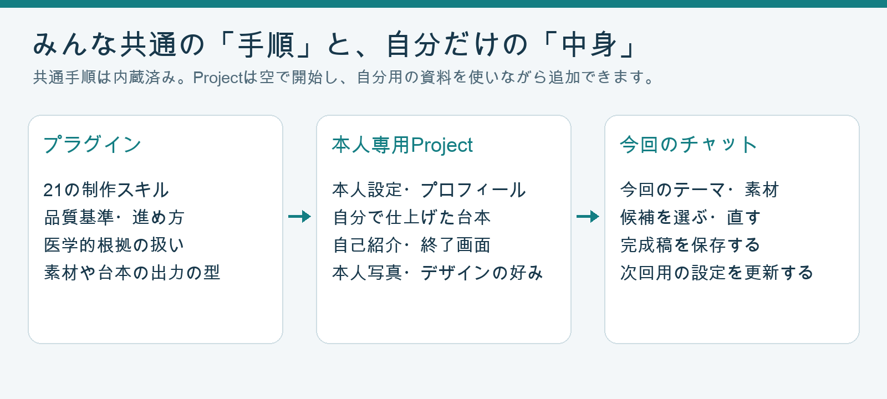
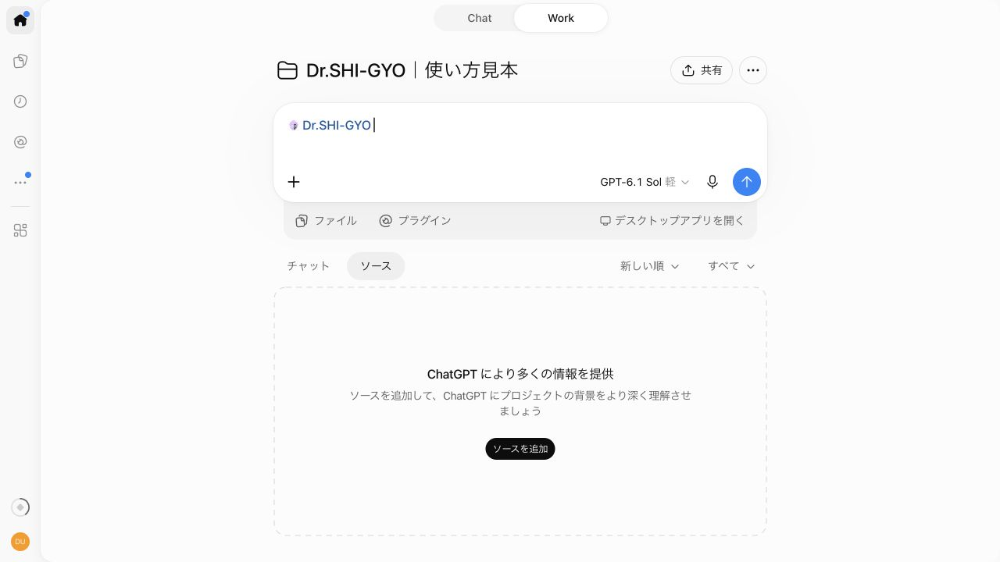
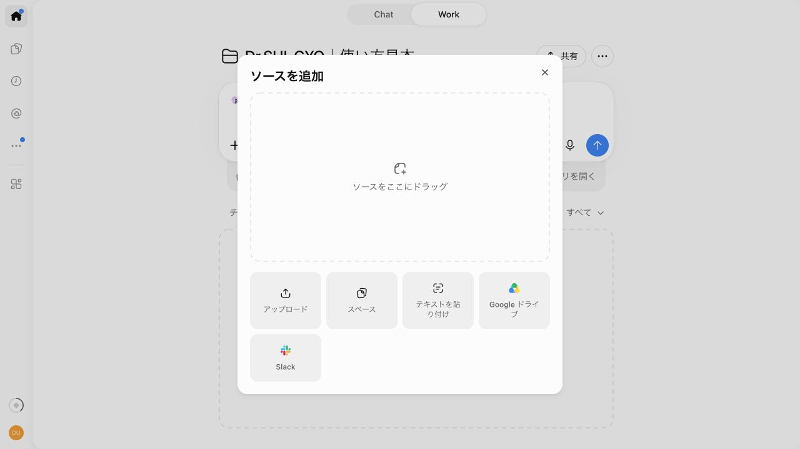
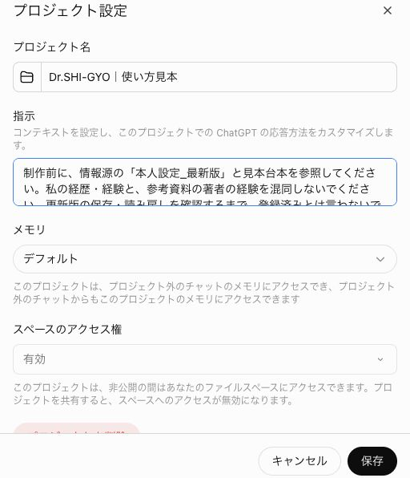

# 02｜Dr.SHI-GYOでできること

**使いたい機能名を覚える必要はありません。「これを作りたい」と伝えるところから始められます。**

Dr.SHI-GYOは、医師の情報発信を支援するプラグインです。動画の企画、医学文献の調査、台本、サムネイル、動画内の素材、記事化、出版企画、YouTube分析を、一つの入口から依頼できます。

「3回喋る」は、台本を作る方法の一つです。論文から台本を作る、参考画像からサムネイルを作る、完成した台本から素材を作る、といった使い方もできます。



## 1｜プラグイン・スキル・本人設定の違い

| 名前 | ひと言でいうと | たとえば |
|---|---|---|
| プラグイン | まとめて追加する道具箱 | Dr.SHI-GYO |
| スキル | 目的に合わせた仕事の進め方 | サムネイル作成、台本の改善 |
| 内蔵の情報源 | 仕事を進めるための共通の基準や型 | 台本の品質ガイド、素材制作の手順 |
| 本人専用Projectの情報源 | あなた自身の資料を置く場所 | プロフィール、見本台本、本人写真 |

**共通の作り方はプラグインに入っています。初回導入では「必ずDr.SHI-GYOを使う」Project指示を保存し、できた本人用の資料を後から育てます。** 設定前でも、空のProjectでプラグインを選べば話し始められます。 プロフィールや見本を揃えるまで待つ必要はありません。

以前の【SG】GPTs 14件の記録と既存のYouTube分析を基礎に、重複する手順を整理し、新しい工程を加えています。今回の1.1.5更新準備版には21スキルを収録しています。更新版の公開状況はプラグインの表示バージョンを確認してください。「GPTsが14個だから、同じ名前のスキルが14個ある」という対応ではありません。

## 2｜まず使う、3つの入口

| やりたいこと | そのまま伝える言葉 | 詳しい手順 |
|---|---|---|
| 動画の顔になる画像を作る | 「この参考画像で、サムネイルを3案作って」 | 03 サムネイル |
| 自分の考えから台本を作る | 「インタビューして」または「初回音声インタビューをして」 | 04 3回喋る台本 |
| 編集者へ渡す素材を揃える | 「この台本を、素材込みで編集者に渡せる形にして」 | 05 動画素材 |

初回にProject指示を保存しておけば、まずはプラグイン名を毎回書かずに依頼できます。同じ案件の続きは同じチャットで進めます。プラグインを利用できない場合は@の候補から選び、うまく担当が選ばれない場合は、「Dr.SHI-GYOのサムネイル作成を使って」のように、プラグイン名と用途を添えてください。

## 3｜全21スキルの早見表

英語名はスキルの識別名です。覚えなくても使えます。

### 始める・自分に合わせる

| スキル | できること・依頼の例 |
|---|---|
| START・制作進行 `start-production` | 初回の案内と、複数工程をつなぐ進行。「初めて使います。設定から案内して」 |
| 本人設定 `doctor-profile` | プロフィール、本人素材、作風、見本台本を整理。修正の傾向を本人用マニュアルにする。「この完成稿を次回の見本にして」 |
| 公開プロフィール `public-profile` | 経験と考えを対話で引き出し、3形式の公開文を作る。「自分らしい紹介文を作りたい」→07 |
| 発信キーワード `brand-keywords` | 専門性3つ＋人柄3つの軸を決める。「発信の軸を掘り下げたい」→08 |
| 撮影セットと配色 `brand-color` | 背景、小物、服装とブランドカラーを整える。「この撮影セットの色を相談したい」→09 |

### 調べる・企画する

| スキル | できること・依頼の例 |
|---|---|
| YouTube 28日分析 `youtube-28day-report` | Excel・CSV等のデータから分析レポートと次の企画候補を作る。「直近28日を分析して」 |
| 動画企画 `video-planning` | テーマから視聴者の問い、切り口、タイトル、構成を絞る。「〇〇をテーマに企画を考えて」 |
| 医学的根拠の調査 `medical-evidence` | 論文を調べ、主張と根拠、使える表現を整理する。「この主張の根拠を調べて」 |
| メソッド検証 `method-design` | 提案した方法を科学的根拠で評価し、妥当な提案と一般向け記事へまとめる。「この方法を検証して」 |

### 台本を作る・直す

| スキル | できること・依頼の例 |
|---|---|
| 調査から台本 `research-script` | テーマと方向性を決め、医学文献を調べて新規台本を作る。「テーマから調べて台本にして」 |
| 資料から台本 `source-script` | 渡した論文・PDF・講義資料等を主軸に台本化する。「この資料を動画台本にして」 |
| 3回喋る台本 `voice-script` | 空のProjectから一問ずつ聞き取り。最初の語り→調査→方向性の語り→初稿→修正の語り。「動画台本を作りたいので初回音声インタビューして」 |
| 台本改善 `script-improvement` | 既存台本を評価・改稿。本人らしさ、ダイジェスト、タイトル、概要欄も扱う。「この台本を直して」 |

### 画像・動画素材を作る

| スキル | できること・依頼の例 |
|---|---|
| サムネイル `thumbnail-design` | 通常はA・B・Cの実画像3枚。外部ツール用と指定すればプロンプト。「参考画像をもとに3案作って」 |
| 素材の提案 `asset-planning` | 台本に合う差し込み箇所と、イラスト・図解・動画等の候補を示す。「まず素材の候補を見たい」 |
| 素材入り編集台本 `editor-handoff` | 実素材を作り、全文台本の該当位置に配置。確認用ページ、`script.html`、編集者用ZIPへまとめる。「編集者へ渡せる一式にして」 |
| 正方形画像・SNS画像 `visual-materials` | 台本用の正方形挿入画像10点、または1枚の画像内に3×3の9マスを配置するSNS画像。「SNS用の9マス画像を作って」 |
| チャンネルアート `channel-art` | YouTubeチャンネルの中央に見せる画像の、英語生成プロンプト3案。「チャンネルアート用のプロンプトを作って」 |

### 公開準備・動画の先へ展開する

| スキル | できること・依頼の例 |
|---|---|
| 記事化 `article-adaptation` | 台本の語り口と出典を保ち、検索で見つけてもらいやすい長文ブログ記事とFAQを作る。「この台本を記事にして」 |
| 出版企画 `publishing-plan` | 市場・類書調査、企画選定から、提出用企画書と添え状まで。「決めた企画を提出文へ仕上げて」→11 |
| 動画公開用SEO `youtube-metadata` | 完成動画のタイトル1案、概要欄、実時刻のチャプター。「この動画の公開準備をして」→10 |

チャンネルアートは標準では画像そのものではなく生成用の文章、出版企画は市場調査から企画書・添え状までです。SNSへの投稿、ブログの公開、本の全文執筆までが自動で完了する、という意味ではありません。

## 4｜中に入っている「情報源」は何か

GEM統合で追加した機能には、公開プロフィールの聞き取り、6キーワードの発掘、配色相談、提出用出版企画書、動画の公開準備の手順と空のひな形を収録しました。元GEMに付属していた個人の書籍原稿や、第三者教材の全文を共通配布する構成にはしていません。

内蔵資料は、AIが必要な場面で参照する共通資料です。受講生が一つずつ開いたり、毎回添付し直したりする必要はありません。

| 内蔵資料 | 使われる場面 |
|---|---|
| 移行元GPTの指示原文と、その適用規則 | 以前の作り方、入力条件、出力形式を引き継ぐ |
| 台本の品質ガイド・改善の評価軸 | 繰り返す構文、説明不足、本人らしさ、ダイジェストを見直す |
| 医学的主張・出典の共通ルール | 実在確認、数値、研究の対象、言い切れる範囲を整理する |
| 出版の評価ルール・タイトル構造・分析例・データ整理の型 | 類書の比較や出版企画の調査に使う |
| 素材の種類、医学イラストの候補設計、編集納品の基準 | 画像・動画を選び、台本に配置する |
| 本人設定・素材登録・制作メモの空のひな形 | あなたの情報と案件ごとの決定事項を整理する |
| HTMLの表示テンプレート、作成・確認用のプログラム | 読みやすい台本・レポート・素材入りZIPを作る |
| サムネイルの枠見本画像 | 希望がある場合に枠の構造を参考にする |

論文の全データベース、最新の売れ筋書籍データ、各医師のYouTube分析結果が最初から収録されているわけではありません。必要な調査はその都度行い、チャンネルの数値は本人が提供したデータを使います。分析例に登場する数値や引用も、今回の事実としてそのまま使う資料ではありません。

## 5｜本人用の資料は、使い始めてから追加できる

**初回導入では、01の手順で「必ずDr.SHI-GYOを使う」Project指示を保存することをおすすめします。** 本人設定や見本は未登録でも始められます。先に試すなら、指示・情報源が空の「動画台本生成プロジェクト」でDr.SHI-GYOを選び、「インタビューして」と伝えても十分です。共通の「台本制作ガイド」をProjectへ別途登録する必要はありません。

以下は、自分らしい作り方を次回にも残したくなったときの任意の追加手順です。本人専用Projectには、次のような資料を少しずつ置けます。

| 再利用したい本人情報 | 完成後に追加できる見本・素材 |
|---|---|
| 診療科・専門分野・対象視聴者 | 自分で仕上げた台本を1〜5本 |
| 公開してよい経歴・話し方の希望 | 本人写真、自己紹介カード |
| チャンネル情報 | 終了画面、プレゼントの画像 |
| 今回作りたいテーマ・目的 | 好きな配色、参考動画・画像 |

そのまま送れる依頼文：

```text
Dr.SHI-GYOで、私の本人設定を作ってください。
添付したプロフィールと資料から分かることを先に読み、足りない点だけ聞いてください。
私の専門分野：［記入］
届けたい相手：［記入］
希望する話し方：［記入］

「本人設定_最新版.md」を作り、本人専用Projectに保存して次回も使う手順まで案内してください。
添付資料の中で、私自身の事実と、他者の参考例を区別してください。
```

生成された設定ファイルをProjectに登録し、新しいチャットで「登録した本人設定を読み、対象視聴者と話し方を短く確認して」と依頼します。設定文だけでなく、再利用したい画像の実ファイルも登録してください。ファイルを作った段階と、次のチャットから読み出せる段階は別です。

### 保存操作を、画面で確認する

本人設定のファイルができたら、ダウンロードしておきます。ホームから自分のプロジェクトを開き、入力欄の下にある **「ソース」** タブを選びます。「ソースを追加」をクリックしてください。



開いた画面の **「アップロード」** を選び、本人設定・見本台本・再利用する実画像を追加します。文章だけなら「テキストを貼り付け」も使えます。Googleドライブを接続していなくても、ファイルのアップロードで進められます。



初回導入でProject指示をまだ保存していなければ、ここでプロジェクトの **「…」→「プロジェクト設定」→「指示」** に次の文を入れます。01ですでに保存した場合は、重ねて追加しません。既存の指示は消さずに統合し、「保存」を押して文が残っていることを確認してください。これはプラグインを毎回指定せずに使い始めるための設定です。本人資料が揃うまで待つ必要はありません。

```text
このProject内の情報発信に関する作業では、必ずDr.SHI-GYOプラグインの該当スキルを使ってください。
各チャットで私がプラグイン名やスキル名を指定しなくても、依頼内容に合うスキルを確認して進めてください。
利用できない場合は、その旨を伝え、プラグインを選択する方法を案内してください。
使っていないのに使ったと報告しないでください。

情報源に登録済みの本人設定と、用途に合う最新版の台本マニュアル・デザイン設定・見本を、実際に読める範囲で参照してください。
未登録の資料を求めて制作を止めず、今回の会話から進めてください。
私の経歴・経験と、参考資料の著者の経験を混同しないでください。
今回だけの指示と、今後も使う方針を分けてください。
更新版の保存・読み戻しを確認するまで、登録済みとは言わないでください。
初回インタビューの最初の一問や「はい」だけ返す開始待機には、見本登録・本人設定・Project指示の案内を挟まないでください。
```



初めて指示を保存した場合は、同じProjectの新しいチャットで、まず@を選ばず「インタビューして」と送って呼び出しを確認します。利用できなければ@の候補からDr.SHI-GYOを選択してください。自動インストールや、全環境での自動読込を保証する設定ではありません。

本人資料の再利用を確かめる時は、同じProjectの新しいチャットで次を送ります。

```text
ソースの本人設定と見本台本を読んでください。
誰の設定・何版が読めたか、対象視聴者と話し方を3点で教えてください。
```

ここで自分の情報を正しく答えられたら、その資料の再利用を確認できました。回答が違う、または読めない場合は、作ったファイルが「ソース」に登録されているかを確認します。名前や写真などの記載がないひな形は、記入してから登録してください。

## 6｜使うほど、自分らしくしていく

良い台本や画像ができたら、その成果物と「どこがよかったか」を残します。修正した場合は修正前後の両方があると、次に再現しやすくなります。

```text
今回の完成稿と修正前の原稿を比べ、私が直した傾向を整理してください。
次回も使いたいルールと、今回限りの変更を分けてください。
採用したルールを私の台本マニュアルに反映し、更新版の全文をファイルでください。
Projectの旧版を差し替える手順も案内してください。
```

個人用の資料を更新しても、受講生全員に配っている共通プラグインは変わりません。次回も読める資料として保存する運用であり、アップロードしただけでAI本体が継続的に学習する、という意味ではありません。「次回もこの色で」「これは今回だけ」と伝えると、本人設定と案件の指示を分けられます。

画像生成・動画生成・音声処理・独立したレビュー・ファイル作成は、各自の利用環境にある機能を使います。外部サービスの接続や料金が必要な工程では、その案内に沿って進めてください。素材や医学的な説明は、最後に医師本人が確認して採用します。


1.1.5では修正版を渡した後に、「完成版を見本として登録するか」「今回の修正を独自スキルへ反映するか」を別々に確認します。両方はいなら、見本と用途別の独自スキルMarkdownを作ります。直接保存して読み戻せない場合は、実ファイルを受け取り自分のProjectのソースへ追加します。

詳しい実例と保存手順は、**[06｜自分専用の作り方を育てる](06_personal_growth.md)**へ。台本・サムネイル・動画素材のそれぞれで、修正を次回にも生かす方法を説明しています。

## 目的から詳しい手順へ

- [01 はじめに・導入方法](../01_install.html)：自分のChatGPTに追加して、最初の依頼を送る。
- [02 全機能・情報源の一覧](../02_skills.html)：21スキルを目的から選ぶ。
- [03 サムネイルを作る](../03_thumbnail.html)：参考画像を渡し、3案から選んで仕上げる。
- [04 3回喋る台本づくり](../04_three_voice.html)：考えを話す、調査を読んで話す、初稿を直して話す。
- [05 動画素材と編集用台本](../05_video_assets.html)：実素材を作り、編集者用HTML・ZIPへまとめる。
- [06 自分専用の作り方を育てる](../06_personal_growth.html)：修正の理由を残し、次の制作に使う。
- [07 自分らしい公開プロフィール](../07_public_profile.html)：経験・考えを引き出し、3形式の文章にする。
- [08 発信の6キーワード](../08_brand_keywords.html)：専門性と人柄の軸を定め、名前や紹介文に使う。
- [09 撮影セットと配色](../09_brand_color.html)：背景・小物・服装とブランドカラーを整える。
- [10 動画の公開準備](../10_youtube_metadata.html)：タイトル・概要欄・実時刻のチャプターを作る。
- [11 出版調査から企画書へ](../11_publishing.html)：市場・類書を調べ、出版社へ見せる文章にする。
- [12 一本の動画企画を決める](../12_video_planning.html)：例文から始め、修正・保存まで進める。
- [13 テーマから調べて台本を作る](../13_research_script.html)：例文から始め、修正・保存まで進める。
- [14 論文・講義資料から台本を作る](../14_source_script.html)：例文から始め、修正・保存まで進める。
- [15 台本を診断・修正する](../15_script_improvement.html)：例文から始め、修正・保存まで進める。
- [16 医学論文と根拠を調べる](../16_medical_evidence.html)：例文から始め、修正・保存まで進める。
- [17 自分のメソッドを根拠から整える](../17_method_design.html)：例文から始め、修正・保存まで進める。
- [18 動画台本をブログ・記事にする](../18_article.html)：例文から始め、修正・保存まで進める。
- [19 チャンネルアートを設計する](../19_channel_art.html)：例文から始め、修正・保存まで進める。
- [20 YouTubeを28日ごとに分析する](../20_youtube_analysis.html)：例文から始め、修正・保存まで進める。
- [21 台本に合う素材の候補を選ぶ](../21_asset_choices.html)：例文から始め、修正・保存まで進める。
- [22 挿入画像10枚・SNSの9マス画像](../22_visual_materials.html)：例文から始め、修正・保存まで進める。
