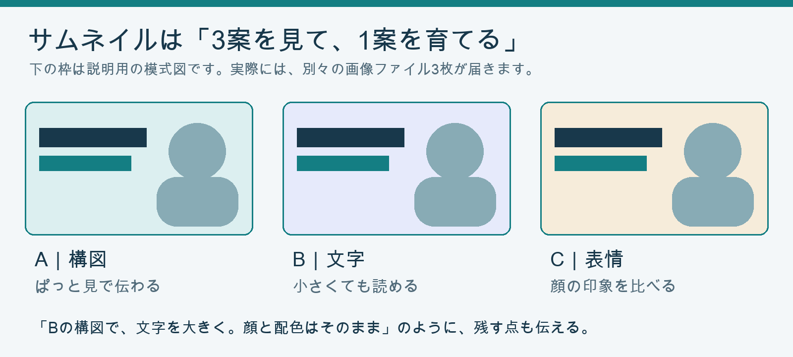

# 03｜サムネイルを作る

**参考画像と表示したい文字を渡し、3案から選んで仕上げます。**




この手順の完成形は、YouTube用の横長サムネイルです。通常は構図・文字・表情に違いをつけたA・B・Cの画像が1枚ずつ出ます。3案を見比べ、気に入った案だけを直して保存します。

## 1｜用意するものは、まず3つ

| 用意するもの | 何を渡せばよいか |
|---|---|
| ① 表示したい文字 | 画像に大きく載せたい言葉。動画タイトル全文とは別でも構いません |
| ② 参考画像 | 自分の過去サムネイルや、構図・配色の参考にしたい画像1枚 |
| ③ 参考に寄せる割合 | 「60％くらい」のような目安。画面が何％同じになるという測定値ではありません |

**自分の顔を出す場合は、本人写真も添付します。** 参考画像に写っている人を、あなた本人として使うことはありません。顔がよく見える写真を選び、メガネや髪型をどう扱いたいか希望があれば添えます。人物なしで作る場合は「人物なし」と伝えてください。

登録済みの本人写真や作風が、そのチャットから読める場合は再添付不要です。初回は必要な画像をまとめて添付すると進めやすくなります。

### 参考に寄せる割合の目安

| 割合 | 作り方の目安 |
|---|---|
| 30％ | 雰囲気を軽く参考にして、独自の構成を中心にする |
| 60％ | 構図や配色を参考にしながら、自分の内容へ合わせる |
| 80％ | 文字の位置、人物の大きさ等を強く参考にする |
| 90％以上 | レイアウトを強く踏襲する。人物やロゴまでコピーする指示ではない |

最初に迷ったら60％を試し、仕上がりを見て変えて構いません。参考画像の好きな点を「文字が大きい」「背景がすっきりしている」のように一言足すと、意図が伝わります。

## 2｜画像を添付して、この文章を送る

導入ガイドに沿ってDr.SHI-GYOを使うチャットを開きます。参考画像と、顔を使う場合は本人写真を添付してから、次の文章を送ってください。

```text
Dr.SHI-GYOで、YouTubeのサムネイルを作ってください。

動画のテーマ：［記入］
画像に入れる文字：［このまま表示したい文字を記入］
参考に寄せる割合：60％
参考画像：添付した「参考画像」
本人写真：添付した「本人写真」を使う
希望：背景はすっきり。スマホで文字が読みやすいもの。

A・B・Cを、それぞれ独立した実画像として3枚作ってください。
```

［ ］の部分を書き換え、実際の添付ファイルが分かる名前にします。人物を使わない場合は本人写真の行を「人物は使わない」に変えます。台本と同じチャットなら「この台本の内容に合わせて」と添えるだけで、テーマを長く書き直す必要はありません。

### 表示する文字がまだ決まらない場合

画像生成の前に、台本と伝えたい内容を渡して文言を相談できます。

```text
この台本に合う、サムネイルに載せる短い言葉を提案してください。
視聴者が自分に関係する話だと分かる言葉にしたいです。
台本の根拠より強い断言は避けてください。
まず言葉だけを決めたいので、まだ画像は作らないでください。
```

言葉を選んだら、「この言葉を使って、添付の参考画像に60％寄せて、実画像を3案作って」と続けます。

## 3｜A・B・Cを見比べる

画像の前に、構図や文字などの短い説明が出ます。続いて、次の3案が生成されます。

| 案 | 見比べるポイント |
|---|---|
| A｜構図を重視 | 参考画像の配置、余白、配色に近い案 |
| B｜文字を重視 | 文字の大きさと読みやすさが主役の案 |
| C｜表情を重視 | 人物の顔や感情が伝わる案 |

人物を使わない場合は、その指定を優先し、人物なしの3案を作るよう伝えてください。

欲しいのは、3枚が並んだ比較画像1枚ではなく、**使える画像ファイルが3枚**です。画像生成の途中では一枚ずつ届く場合があります。

選ぶときは、スマホで小さく表示しても読めるかを先に見ます。次に、本人の顔が自然か、表示文字が正しいか、台本で話している内容と一致しているかを確認します。たとえば台本が「関連があった」という説明なら、サムネイルだけ「必ず治る」に変えないことが大切です。

## 4｜気に入った1枚だけを直す

「もう少しいい感じに」より、**対象の案・変える点・残す点**を伝えると直しやすくなります。一度で完璧に説明する必要はありません。

### 例1｜文字を読みやすくする

```text
B案を採用したいです。B案だけを修正してください。
変える点：一番大きい文字を、今よりさらに大きくする。
残す点：人物の位置、顔立ち、背景の色はそのまま。
表示する言葉は変えないでください。
```

### 例2｜表情を落ち着かせる

```text
C案の文字配置は好きです。
表情だけ、驚きすぎない自然な表情に直してください。
添付した本人写真の顔立ちは保ってください。
文字と色は変更しないでください。
```

### 例3｜良い部分を組み合わせる

```text
A案の背景とB案の文字配置を合わせた1枚を作ってください。
人物はB案の位置で、私の写真を使ってください。
表示文字は「［確定した文字］」のままにしてください。
```

画像を指す必要がある場合は、直したい画像を添付し直し、「この画像のここ」と示してください。修正の依頼は同じチャットで続けると、採用案や直した履歴を引き継ぎやすくなります。

## 5｜枠を使いたい場合だけ追加する

標準では枠なしで進みます。毎回、決まった色の枠を使いたい場合だけ指定してください。プラグインには、外側の色帯・白い内枠・暗い中央からなる枠見本も入っています。

```text
この案に枠を付けたいです。
外周は青系、内側は白、上の帯だけ少し太くしてください。
文字と顔が窮屈にならないように調整してください。
今後もこの枠を使いたいので、採用後に本人設定へ引き継げる形にしてください。
```

自分の既存の枠がある場合は、その画像を添付します。本人設定へ反映するときも、生成した設定ファイルをProjectに登録・差し替えできたことまで確認してください。「このチャットで決めたから全チャットに永久に記憶された」とは限りません。

## 6｜完成画像を保存する

採用案が決まったら、最終版の画像ファイルを保存します。比較表示のスクリーンショットより、生成された画像そのものを取得してください。

```text
B案の修正版で確定です。
採用する最終画像を、分かりやすいファイル名で渡してください。
YouTube用の16:9になっているか確認し、実際の画像サイズと容量も、確認できた値を教えてください。
```

標準の制作目標は16:9・1280×720相当です。生成機能によって実際の画素数等が異なることがあるため、ファイルの確認結果を見ます。YouTubeへの設定は、受講生自身が動画の公開作業の中で行います。

次回も使いたい作風なら、完成画像を本人専用Projectに追加し、「大きい文字とすっきりした背景を、今後のサムネイルにも使いたい」と伝えて、本人用の作風メモも残しておきます。

## 7｜うまくいかないときは、この一言

| 困ったこと | 続けて送る言葉 |
|---|---|
| 説明やプロンプトだけで終わった | 「今回は外部ツール用の文章ではなく、実画像3枚を作ってください」 |
| 3枚が一つの画像にまとまった | 「A・B・Cを独立した3ファイルにしてください」 |
| 本人と違う顔になった | 「この本人写真を使い、顔立ちを保って、この1枚を直してください」 |
| 日本語に誤字がある | 「表示文字を『〇〇』に正確に修正。他の部分は維持してください」 |
| 参考に似すぎた | 「参考に寄せる割合を30％に下げ、構図を変えてください」 |
| 画像が1〜2枚で止まった | 「いま生成済みなのは何案ですか。残りの実画像を作ってください」 |

利用制限や画像生成のエラーが表示された場合は、その案内を確認します。プラグインを入れるだけで、利用できない画像生成機能が追加されるわけではありません。

なお、外部のNano Bananaで作りたいときは「Nano Banana用の英語プロンプトを3案」と指定できます。この場合は生成用の文章が成果物になり、画像は外部サービスで作る流れです。最初は、上の通常モードから始めるのがおすすめです。

## 完成したら、見本と独自スキルを残す

サムネイルの修正後は、AIから「完成版をProjectのソースの見本にしますか？」「今回の直し方を独自スキルへ反映しますか？」と別々に確認します。例えば「文字を大きく、背景はすっきり」を今後の作風に残すか、今回だけにするかを選べます。

```text
両方はい。採用画像を見本にし、今回の修正をサムネイル生成の独自スキルに反映してください。
今回だけの変更は除き、Projectのソースに入れるMarkdownと実画像を渡してください。
```

見本だけなら「1だけはい」、作り方だけなら「2だけはい」で構いません。独自スキルは本人専用のMarkdownで、共通プラグインの変更ではありません。ファイル作成後、Projectへの登録と読み戻しまで行います。「登録待ち」の場合は自分でソースへ追加してください。詳しくは[06｜自分専用の作り方を育てる](06_personal_growth.md)へ。
