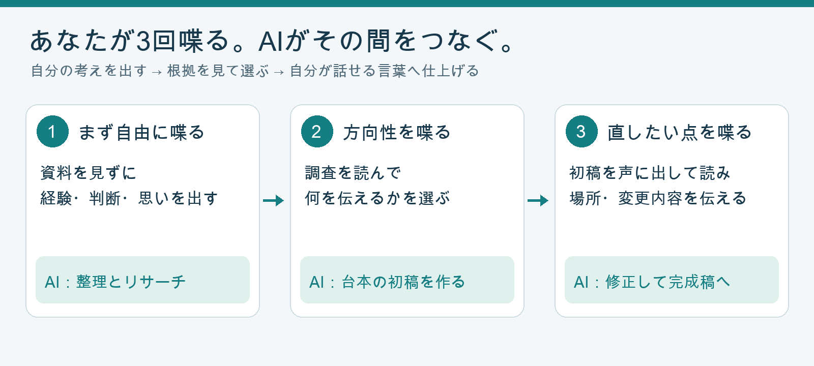
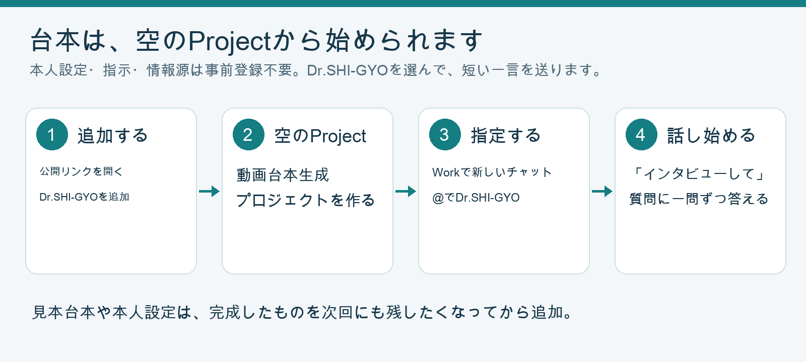
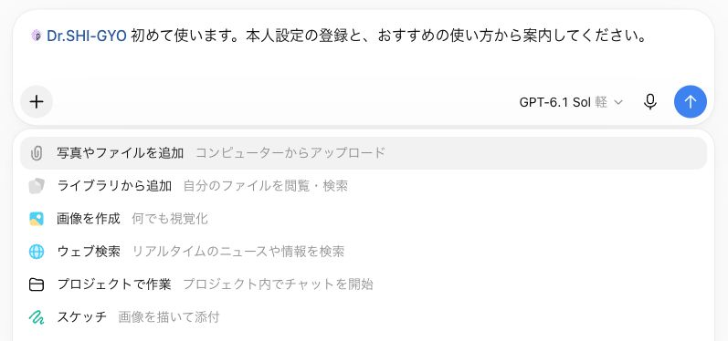

# 04｜「3回喋る」で、自分の言葉の動画台本を作る

**上手に話す必要はありません。まず自分の考えを出し、AIの調査を読んで考え直し、最後に自分が話せる言葉へ直します。** このガイドでは、一本の動画を同じチャットで完成させます。Dr.SHI-GYOの導入を済ませ、導入ガイドで案内したChatGPTのWorkから始めてください。



## 最初に、この流れだけ覚える

| あなたがすること | AIがすること | 次へ進む目印 |
| --- | --- | --- |
| **1回目：資料を見ずに喋る** | 経験・考えを整理し、論文と参考動画を調べる | 調査まとめが届く |
| **2回目：調査を読んで喋る** | あなたが選んだ方向性で台本を作り、点検・修正する | 初稿のHTMLが届く |
| **3回目：初稿を読んで喋る** | 違和感や追加したい話を反映する | 自分の言葉で読める完成稿になる |

「3回」は3段階という意味です。録音は各段階で何本に分かれても、修正が何往復になっても構いません。スキルの名前を覚える必要はなく、「3回喋る方法で台本を作りたい」で始められます。

## 0｜自分のProjectから、短い一言で始める

1. 自分専用の **「動画台本生成プロジェクト」** を作ります。
2. 初回導入では[01のProject指示](01_install.md)を保存しておくことをおすすめします。本人設定や見本などの情報源は、まだ空でも構いません。
3. そのProjectでWorkの新しいチャットを開き、まずは@を選ばず、次のどれか一つを送ります。Dr.SHI-GYOを利用できない場合は、そのチャットで**@の候補からDr.SHI-GYOを選び**ます。

```text
インタビューして
```

```text
初回音声インタビューをして
```

```text
動画台本を作りたいので初回音声インタビューして
```

すでに自分用のProjectがあれば、それを使って構いません。既存の指示は消さず、初回導入の案内を重複なく統合します。本人設定・見本台本・長い開始プロンプトの事前登録は不要です。

**設定より先に試す場合**は、指示・情報源が空でも、@の候補からDr.SHI-GYOを選んで短い一言を送れます。AIは設定を先に要求せず、質問から始めます。下の図は、この最短ルートです。Project指示による自動呼び出しをすべての環境で保証するものではないため、利用できない場合は@で選択してください。以前配った、プラグインを使わない方法の「台本制作ガイド」を情報源に入れる必要もありません。



テーマをまだ伝えていなければ、最初の返答は **「今回は、どんなテーマの動画台本を作りたいですか？」** です。答えると、患者さんから中心の疑問を聞かれた場面の質問に進みます。テーマを開始文に添えていれば、その質問から始まります。

> 患者さんに「〇〇」と聞かれたとします。絶対に「分かりません」という答えや曖昧な答えが許されないとしたら、この質問に対して患者さんに何を伝えますか？どういうふうに答えますか？

AIは一問ずつ聞き、あなたが答えたことをさらに掘り下げます。この段階は聞き取りだけです。調査や台本作成はまだ始めません。

## 1｜質問に答えながら、自分の考えを喋る

通常のチャットに届く質問へ、**音声入力で答える**方法が使えます。入力した文章を一度見てから送信し、次の質問に答えてください。文章で返しても同じ流れです。

Liveなどの音声会話で続ける方法もあります。ただし、音声会話中にプラグインの指示が使われるかは環境によります。まず通常チャットで質問が始まることを確認し、音声会話でも同じ役割が続くかを見ます。調査を始めてしまうなど、質問役にならなければ、通常チャットの質問に音声入力で答える方法へ戻れば続けられます。

まだ調べていないことがあっても、その場で調査を待つ必要はありません。「そこは後で調べて。次の質問へ」で進みます。話し終えたら次を送ります。

```text
ここまでを、具体例や理由を残してまとめてください。
```

まとめを見て、自分が話した意味や言い直しが正しく残っているかを確認します。**「まとめて」だけなら、調査へは進みません。** 調査へ進めるときは、続けて次を送ります。

```text
この内容を1回目の語りとして使って、医学論文と参考動画を調べてください。
調査まとめができたら、私の2回目の語りを待ってください。
```

### 一人で自由に話すなら、ボイスメモでもよい

テーマだけ決め、スマホのボイスメモなどで自由に話します。順番が前後しても、言い直しても大丈夫です。最初から論文名や根拠を揃えなくて構いません。

話し出しに迷ったら、この中から答えやすい問いを使ってください。

- 患者さんにこのテーマを聞かれたら、まず何と答えるか。
- 普段の診療で、何をよく説明しているか。
- 一般の方が誤解しがちな点は何か。
- 自分が実際に経験したこと、考えが変わった出来事はあるか。
- 「これは伝えたい」「ここは確かめたい」と思うことは何か。

体験を話すときは、患者さんを特定できる名前や具体的な所属などは入れません。「実際の経験」「自分の感想」「まだ確かめていない考え」は、話す時にも区別しておくと伝わりやすくなります。

録音をチャットに添付して、次を送ります。



```text
Dr.SHI-GYOの「3回喋る」方法で動画台本を作りたいです。
テーマ：［今回のテーマ］
視聴者：［届けたい人］
添付は1回目の自由な語りです。まず全文を読み取ってください。

私の経験・考えを残して整理し、医学的な主張の根拠を調べてください。
参考動画があればこちらです：［URL。なければ省略］
関連する参考動画も、確認できる範囲で3本を目安に調べてください。
調査まとめを返したら、私の2回目の語りを待ってください。
まだ最終台本は書かないでください。
```

まだ追加で話す場合は、最初に「何回かに分けて送ります。全部送ったと伝えるまで待ってください」と添え、最後に「1回目はこれで全部です」と伝えます。

### 音声を添付するだけで進められる？

**受講生がすることは、録音を添付して依頼するだけです。** 1.1.4から引き継ぐ音声処理では、標準機能で内容を取得できない場合、AIが必要な音声処理ソフトとモデルを作業用の専用環境に準備し、そのまま文字起こしへ進みます。ご自身で別アプリをインストールしたり、コマンドを打ったり、APIキーを用意したりする手順はありません。

初回は準備に時間がかかる場合があります。「準備しています」「文字起こししています」と表示されたら、その処理の完了を待ちます。録音を外部の文字起こしサービスへ送る方式ではなく、作業環境内で読み取ります。受講生のPC全体へソフトをインストールするものではありません。

「添付できた」と「中身を読めた」は別です。AIが返した内容に、実際に話した経験や考えが含まれているかを見てください。薬剤名、数値、否定の言葉が違っていたら、その部分だけ訂正します。全文を清書し直す必要はありません。

### 本当に読み取れなかったとき

AI側で準備・読み取り・回復を試してから、止まった理由と次の手順を案内します。録り直しは基本的に不要です。

- **添付ファイルが見えない場合**：同じ録音を再添付します。
- **そのチャットに実行機能がない場合**：案内に沿って、コード実行が使えるWorkのチャットで続けます。
- **環境の制限などで自動処理を続けられない場合**：最後の代替として、録音アプリ等ですでに得られている文字起こし全文や、音声入力の文章を使えます。

すべてのアカウントで同じ実行機能・ネット接続・利用枠が使えるわけではありません。プラグインの更新は、全環境での読み取り成功を保証するものではありません。文字起こし全文で続ける場合も、そのまま同じ段階を引き継ぎます。

```text
これは1回目の音声の文字起こし全文です。
この文章を原文として、同じ「3回喋る」の調査段階を続けてください。
```

## 2｜調査を読んで、話したい方向性をもう一度喋る

AIから調査まとめが届いたら、まず「分かったこと」「自分の話と一致した点・見直す点」「まだ分からない点」を読みます。詳細な論文情報は、気になる点から確認すれば大丈夫です。

ここで、単に「OK、書いて」と返すより、**調査を読んだ自分がどう考えたか**をもう一度話してください。

- 意外だった結果、いちばん伝えたくなったことは何か。
- 最初に話した経験のうち、どれを残したいか。
- 今回は扱わない話、強く言いすぎたくないことは何か。
- 見終わった視聴者に、何を理解・判断してほしいか。
- どの順番で、どんな言葉で伝えたいか。

### 2回目も、質問してもらいながら考えられる

一人では方向性をまとめにくければ、同じチャットへ次を送ってください。

```text
2回目も質問して。台本にしてと言うまで待って。
```

まず調査を読んで感じたことを自由に話します。その後、AIは方向性を決めるために足りない点だけ、一問ずつ聞きます。何を伝えたいか、どの発見を取り入れるか、何を残すかは、あなたの回答をもとに整理します。AIがあなたの方向性を代わりに決める工程ではありません。

考えがまとまったら **「この方向で台本にして」** と伝えます。その依頼までは、台本を書かずに聞き取りを続けます。

### 方向性が決まったら、初稿を頼む

2回目を自由な録音で話す場合は、同じチャットへ添付して次を送ります。質問に答えながら方向性を決めた場合は、その内容を使うよう伝えれば、録音し直す必要はありません。文章で話し言葉のまま入力しても同じように進められます。

```text
調査まとめを読んで話した、2回目の語りです。
今回の動画は、この語りの方向性を軸に台本にしてください。
1回目の経験も、今回採用したものを活かしてください。
登録済みの本人設定・マニュアル・見本台本があれば参照してください。
なければ今回話した内容から進めてください。

最低文字数：［希望があれば記入。未定なら相談］
タイトル・サムネイルの文言：［決まっていれば記入］
全文と文献を読めるHTMLファイルで初稿をください。
```

初稿は、医学を全く知らない視聴者、本人らしい話し方を守る編集者、数字や出典などの簡易事実チェック、の3つの観点で点検・修正する設計です。専門用語の説明不足、同じ構文の反復、続きを見る理由なども確認します。独立したサブエージェントを使えない環境では、自己点検へ切り替え、その未実施部分を伝えます。レビューは実際の視聴者調査や厳密な論文査読を保証するものではありません。

### 冒頭ダイジェストも、本文から磨く

台本には、視聴者が「自分にも役立ちそう」「この問題は知っておきたい」と感じる短い言葉を意識して入れます。**具体的な良い変化**、または**見逃したくないリスク**が伝わる候補を5〜10か所探し、その中から3か所程度を選びます。単なる「重要です」「研究があります」では、続きを見る理由になりません。

有力な短文がなければ、撮影前の台本本文を先に改善してから、その実際の文を抜き出します。研究にない数字や効果を作ることはありません。例えば「たった1分」という時間や「劇的」という強さは、根拠と内容に合う場合だけ使います。ポジティブとネガティブを無理に同じ数にせず、今回の動画で最も伝わる箇所を選びます。

## 3｜初稿を読んで、直したいことを喋る

届いたHTMLを開いて、実際に声に出して読んでみます。「この言葉は自分なら使わない」「この説明が足りない」と思った場所で、修正メモを録音します。文章を自分で全部書き直す必要はありません。

伝える順番は、**場所 → 変えたいこと → 自分ならどう話すか**。例えば「第2章の『ここが重要です』から始まる段落。少し固いので、『外来でもよく聞かれるんですが』という入りにしたい」のように、短く引用して場所を特定します。

```text
添付は、いまの初稿に対する3回目の修正音声です。
初稿と照合して、話した修正を反映してください。
合意済みの内容は保ち、修正に関係する見出し・冒頭・結び・
ダイジェスト・文献も整合させてください。
改訂後の全文HTMLと、反映した点・残る確認を短く返してください。
```

「第2章をもっとやさしく」のような短い文章でも直せます。画面録画を使える方は、対象の文を選択しながら話す方法もあります。ただし映像を読み取れない環境では、引用やスクリーンショットを添えて位置を補います。最初は音声と短い引用だけで十分です。

納得するまで同じチャットで修正を繰り返します。本人が経験していない症例や会話が追加されていたら削除・訂正してください。読み上げる自分の確認まで含めて完成です。

## 4｜完成稿を保存し、次の台本に活かす

最終的に読みやすくなったら、次を送ります。

```text
この版を完成稿にします。保存用の全文HTMLをください。
撮影用に、私が読む部分だけを残したMarkdownも作ってください。
編集指示・文献・制作メモを除き、必要な段落以外は改行を詰めてください。
```

保存するのは、**完成稿HTML**と**撮影用Markdown**。前者は本文と文献を確認する用、後者は実際に読み上げる用です。この時点の台本HTMLには、動画の差し込み素材がすべて入っているわけではありません。素材づくりは次の「05｜台本から動画素材を作る」で進めます。

修正が仕上がると、AIから二つの確認が届きます。

> **1．今回の完成した動画台本・素材などを、見本としてプロジェクトのソースに登録しますか？**
>
> **2．次回のために、今回の修正を反映した独自スキルを登録・更新しますか？**

「両方はい」なら、**完成台本の見本Markdown**と**動画台本生成の独自スキルMarkdown**を受け取ります。「1だけはい」「2だけはい」でも構いません。今回だけの内容と今後の作り方を分け、既存の独自スキル・台本マニュアルがあれば最新版へまとめます。

```text
両方はい。この完成稿を見本にし、今回の直し方を動画台本生成の独自スキルに反映してください。
今後も使いたい点は［記入］です。今回だけの変更は［あれば記入］です。
Projectのソースに入れる実ファイルと、登録状況を教えてください。
```

Projectに直接登録して読み戻しまで確認できた場合を除き、受け取ったファイルは「登録待ち」です。自分でソースへ追加し、新しいチャットで最新版を読めるか確かめます。見本はまず1本から、代表的なものを最大5本ほどに絞ります。

**育っていくのは、本人専用Projectの見本・独自スキルです。** 共通のプラグインが自動で書き換わったり、他の受講生へ自分の体験が追加されたりする仕組みではありません。詳しい操作は[06｜自分専用の作り方を育てる](06_personal_growth.md)へ。

## 補助｜Liveの質問役を明示したいときだけ使う文

標準は冒頭の短い一言です。以下は、Liveで同じ質問役が続かない場合などに、役割を直接指定するための補助文です。毎回貼る必要はありません。音声会話に切り替えるまで待ってほしい場合だけ、末尾の「はい」と「始めましょう」の指定を使います。通常の開始文では、その場で最初の質問が返ります。

```text
「3回喋る」で動画台本を作ります。テーマは［テーマ］です。
視聴者の知りたいことを軸に、私の知識・考え・判断・経験を
一問ずつ引き出してください。
最初は必ず、中心の疑問を患者さんから聞かれた場面にして、
「絶対に『分かりません』という答えや曖昧な答えが許されないとしたら、
この質問に対して患者さんに何を伝えますか？
どういうふうに答えますか？」と聞いてください。
今は調査も台本作成もしないでください。
不明点は後で調べる課題として残し、次の質問へ進んでください。
私が「まとめて」と言ったら、具体例と理由を残して詳しくまとめてください。
このメッセージには「はい」の一言だけ返してください。
その後、私が音声会話で「始めましょう」と言ったら質問を始めてください。
```

返答後に音声会話を始め、「始めましょう」と伝えます。答える材料を出しきったら「まとめて」と伝え、読める会話の整理を用意します。別のチャットで話した場合は、その整理を制作チャットへ貼り付けてください。自動共有を前提にしません。

```text
この会話の整理を、1回目の語りとして使ってください。
ここから医学論文と参考動画を調査し、まとめを返したら
私の2回目の語りを待ってください。
```

あとは、このガイドの「2｜調査を読んで、話したい方向性をもう一度喋る」へ進みます。
