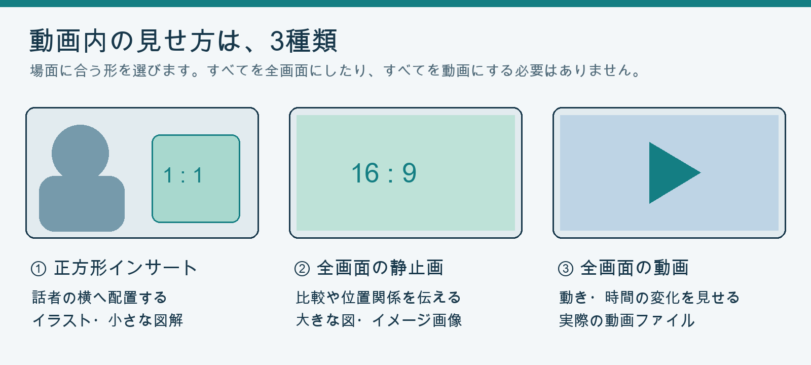
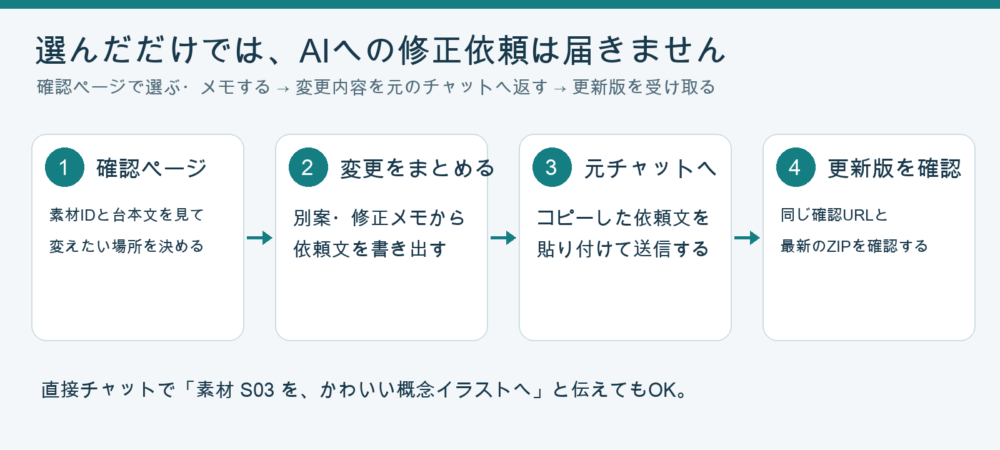
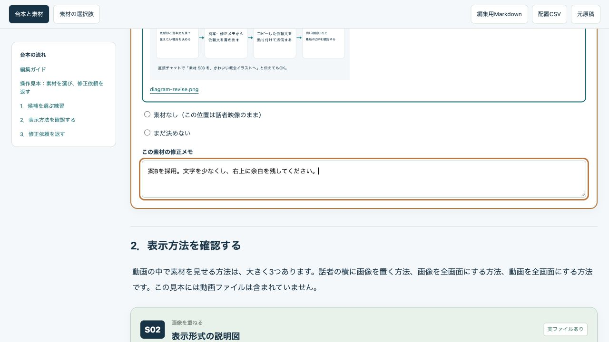
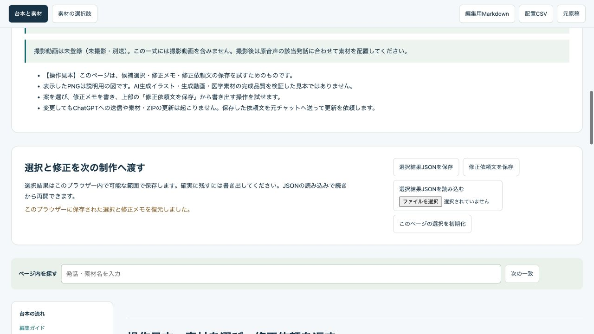

# 05｜台本から動画素材と編集用台本を作る

**完成した台本を渡し、届いたページで確認し、直したいところをチャットで伝える。** 基本の操作はこの3つです。イラストを一枚ずつ発注したり、ご自身でHTMLを書いたりする必要はありません。

目指す完成形は、**台本全文の該当するセリフの近くに、実際の画像・動画と編集指示が並ぶ状態**です。最後に、編集者へそのまま渡せるZIPファイルにまとめます。

> 初回だけ素材を登録 → 完成台本を渡す → おすすめで制作 → ページで確認 → 修正を伝える → 最新ZIPを編集者へ

## 1．最初の一回だけ、自分の定番素材を登録する

ご自身専用のProjectで、次の画像をまとめて添付します。手元にないものは後から追加できます。

| 渡すもの | 一緒に伝えること |
|---|---|
| 自己紹介カード・自己紹介画像 | 自己紹介のときに表示する画像であること |
| 終了画面の画像 | そのまま使う完成版か、プレゼントを重ねるテンプレートか |
| プレゼント画像。2種類以上でも可 | 正式名称、どのテーマで使うか、案内先URLがあればそのURL |
| 過去動画のURL・参考画像 | 踏襲したい配色、雰囲気、文字の大きさなど |

画像を添付したら、次をコピーして送ってください。

```text
これから動画の編集用台本を作ります。
添付した自己紹介画像・終了画面・プレゼント画像を、私の本人素材として登録してください。

プレゼントA：［正式名称］。［使う動画テーマ］で使います。
プレゼントB：［正式名称］。［使う動画テーマ］で使います。
終了画面は［完成版／プレゼントを配置するテンプレート］です。
参考にしたい動画：［URL］
好きな部分：［2分ごろの図解の配色、余白、文字の大きさなど］

次回も再利用できる「本人素材・デザイン設定_最新版.md」を作ってください。
```

角括弧の中だけ、ご自身の内容へ置き換えます。プレゼントが1種類ならBの行は削除してください。登録していないURLやQRコードをAIに作らせる必要はありません。

**設定ファイルと、実際の画像の両方をProjectの情報源へ保存します。** AIがファイルを作ったことと、Projectへ保存できたことは別です。「登録待ち」と案内された場合は、ご自身で情報源へ追加してください。新しいチャットで次の一文を送って、読み取れることを確かめれば準備完了です。

```text
登録した私の自己紹介・終了画面・プレゼント画像と、デザイン設定を確認してください。実際に読めたものと不足しているものを教えてください。
```

参考動画のURLだけでは、映像の見た目まで読み取れないことがあります。その場合は、好きな場面のスクリーンショットを添付すると早く進められます。ご自身の素材は、ご自身のProjectで管理します。全員が使うプラグインに追加されるわけではありません。

## 2．完成した台本を、そのまま渡す

同じProjectで、台本文を貼り付けるか、Markdownファイルを添付します。GoogleドキュメントのURLでも依頼できますが、内容を読み取れる接続・共有設定が必要です。読み取れない場合は、台本文を貼る方法が確実です。

まずは、これだけで始められます。

```text
この台本を、素材込みで編集者に渡せる形にしてください。
登録した私の本人素材・デザインを使い、おすすめ案で一式完成させてください。
台本全文と実際の素材を一緒に確認できるページ、script.html、編集者用ZIPまでお願いします。
```

スキル名を覚える必要はありません。明示的に選ぶときは、編集者用の素材一式を作るスキル「editor-handoff」が担当します。「おすすめ素材を提案して」だけだと提案段階の依頼になるため、**「実際に作って、編集者へ渡せる形まで」**と伝えるのがポイントです。

撮影前でも制作できます。撮影後の動画を添付でき、映像の内容も読み取れる環境なら、話者が映る位置や空白を確認して配置を調整できます。原本にアクセスできれば、ZIPへの同梱も依頼できます。大きくて添付できない場合は「撮影原本は編集者へ別送します。その旨を編集メモに残してください」と伝えて進められます。撮影動画がない段階では、実際の時刻ではなく「このセリフから、このセリフまで」を編集の目印にします。

## 3．「おすすめで一括」と「先に選ぶ」を使い分ける

| 進め方 | 送る言葉 | 届くもの |
|---|---|---|
| まず完成形を見たい | おすすめ案で一式完成させて | 推奨する実素材入りの一式。変更用の別案も提示 |
| 制作前に構成を選びたい | まだ生成せず、素材の種類と挿入箇所を提案して | 素材の構成案。選択後に制作へ進む |
| 実物を比べたい | この医学説明は、実画像を見て選びたい | 対象箇所の候補画像を制作して比較 |

初めてなら「おすすめで一括」が簡単です。すべての場面を選び直さず、気になるところだけ変更します。

## 4．素材の見せ方は、大きく3つ



| 表示形式 | 見せ方 | 向いている内容 |
|---|---|---|
| ① 正方形インサート | 話している映像の空白に、小さな画像を重ねる | 比較、短い図解、生活場面のイラスト |
| ② 16:9の全画面静止画 | 一時的に画面全体を画像へ切り替える | 大きく見せたい場面やイラスト |
| ③ 16:9の全画面動画 | 一時的に画面全体を動画へ切り替える | 動き・時間変化を見た方が分かりやすい場面 |

「イラストか図解か」は表現の種類、「正方形か全画面か」は表示の方法です。内容に合わせて組み合わせます。ストレッチの姿勢などは、実際に行っている人物イラストが向いています。動きが不要な場面に、無理に動画を増やす必要はありません。

**動画の実制作には、そのチャットから使える動画生成機能・接続・利用枠、またはご自身の動画素材が必要です。** プラグインを入れただけで外部サービスの契約や料金が含まれるわけではありません。使えない箇所は「制作待ち」として案内されます。動画のプロンプトや開始画像だけが出ている状態は、動画完成ではありません。

## 5．医学説明は、実画像の候補を見て選ぶ

臓器・筋肉・関節などの形や関係が説明の中心になる場面では、基本の3案を比較できます。

| 候補 | どんな絵か |
|---|---|
| 解剖関係を重視 | 必要な形・位置・接続・向きを優先した絵 |
| かわいい概念表現 | 丸い形や柔らかい色などで、親しみやすくした絵 |
| 要点だけの模式図 | 理解に必要な関係だけを残した図 |

全体と部位の関係や、たとえによる説明が有効なら、4〜5案に増やします。**同じ箇所でどれか1案を選ぶための候補**であり、すべてを動画中に連続表示する意味ではありません。全場面を3〜5案に増やす運用でもありません。

「解剖関係を重視」は制作方針です。医学的に完全という保証ではないため、先生ご自身でも部位・向き・矢印・ラベルを確認してください。かわいい絵でも、機能や位置関係の誤りをそのまま使うことは避けます。

## 6．届いた確認ページは、この順で見る

まず、ChatGPTが返した**確認用リンク**を開きます。台本全文を上から読み、セリフの近くにある素材を確認してください。

1. **本文**：冒頭から最後、引用文献まで入っているか。
2. **採用素材**：画像を拡大し、動画は再生して確認する。
3. **編集メモ**：どこから出し、どこで消し、画面のどこへ置くか。
4. **本人素材**：自己紹介、途中の案内、終了画面が自分のものか。
5. **別案**：もっと伝わる候補があれば、変更したい案を選ぶ。

確認ページの用意には、ページ配信機能が必要です。利用できない場合は代わりの確認方法が案内されます。確認ページを使えること、素材が完成していること、動画を再生確認したことは、それぞれ別の確認事項です。

図解だけの一覧、プロンプトだけの文章、本文のない画像ギャラリーでは、このガイドの完成形に到達していません。そのときは次のように伝えます。

```text
今回欲しいのは、台本全文に実画像・実動画と編集指示が付いた完成形です。
現在不足している素材や出力を確認し、制作できるものは実制作してください。
できないものは、未完成の箇所と必要な対応を明示してください。
```

### ダイジェストは、視聴者にとって強い3か所を選ぶ

本文から、「何が良くなるのか」「どんなリスクに関係するのか」が短く伝わる箇所を探します。5〜10の候補から、同じ内容を繰り返さない3か所程度を採用します。編集用ページでは、抜き出しと本文の該当箇所を対応させます。

**撮影済みの動画では、実際に話した言葉を使います。** 強い抜き出しがない場合は、追加したいセリフや撮り直し案を別に提案します。本文へ新しい文を足しただけで、撮影済み音声にも存在すると扱うことはありません。効果やリスクの数字は、確認した本文・根拠に沿って残します。

## 7．修正は「どの素材を、どう変えるか」を伝える



確実なのは、**元のチャットへ「素材ID＋変更内容」を送る方法**です。IDは確認ページに表示された番号を使います。IDが見つからなければ、その素材が付いているセリフを引用してください。

```text
以下の3点を修正してください。ほかの本文・素材は維持してください。

1. 素材［ID］：「今の写実的な臓器」から「生成済みのかわいい候補」へ変更。
2. 素材［ID］：背景の赤を、登録した青系へ変更。文字はそのまま。
3. 「［台本中のセリフ］」の素材：全画面から、正方形のインサートへ変更。

修正後は、確認ページ・script.html・素材・ZIPを同じ最新版にそろえてください。
```

「この場面は素材なし」「文字を半分に」「この動きだけ動画に」も伝えられます。生成済みの別案を選ぶだけなら、原則としてその画像を再利用します。

**ページ上で選ぶ・メモを書く操作だけでは、ChatGPTへ自動送信されません。** 変更依頼を書き出せる画面では、書き出した依頼文をコピーして元のチャットへ送るか、選択結果ファイルを添付します。書き出しが見つからない・保存できたか不明なときは、上の例のようにチャットへ直接送れば大丈夫です。

### 画面で試す：候補を選んで、修正を返す

配布フォルダの **demo → script.html** を開くと、同じ操作を練習できます。説明用の短い台本と図を使った操作見本です。AIが生成するイラストや動画の品質見本ではありません。

1. 素材S01の下の **「素材の候補を比較・選択する」** を開きます。
2. **案B** を選びます。
3. **「この素材の修正メモ」** に、変えたいところを書きます。



4. ページ上部の **「修正依頼文を保存」** を押します。
5. 保存されたファイルを元のChatGPTチャットへ添付し、「この依頼を反映して一式を更新して」と送ります。ファイルを開いて本文をコピーし、貼り付けても構いません。



**「変更待ち」「現在のZIPにはまだ反映されていません」** と出たら正常です。選択をAIへ渡し、更新された一式を受け取る前の状態を示しています。別の端末で選択を再開したいときは「選択結果JSONを保存」も使えます。最初は修正依頼文の保存だけで十分です。

修正後に返された同じ案件の確認リンクを開き、該当箇所が変わったことを確かめます。ページで選んだだけの古いZIPを、そのまま編集者へ渡さないようにしてください。

今後も使いたい好みなら、さらに「この配色を私のデザイン設定にも反映して」と伝えます。改訂された設定をProjectへ保存すれば、次の制作にも引き継げます。今回だけの変更は、今回の案件だけに残せます。

### 手持ちの画像・動画を、後から組み込む

素材一式が完成した後も、AIは必ず次のように案内します。

> **もしご自身で作成した、もしくはお持ちの画像・動画を組み込みたいときは貼り付けてください。どこに入れるかも指示してください。**

実際のファイルを添付し、台本のセリフ・段落・素材IDのいずれかで場所を示します。撮影動画の時刻が分かる場合は、その時刻でも構いません。採用素材の差し替えか、新しい追加かも伝えるとスムーズです。

```text
添付の「実演動画.mp4」を、素材S04と差し替えてください。
「［台本のセリフ］」から全画面で流し、音声は私の解説を残してください。
他の素材は維持して、確認ページ・script.html・配置一覧・ZIPを更新してください。
```

AIは実ファイルを確認して配置します。場所が曖昧な場合は、その箇所だけ聞きます。届いた更新版を開き、正しい素材が表示・再生されるか確認します。**前のZIPには後から追加した素材は入りません。必ず更新版を渡してください。**

手持ち素材を追加して仕上がった版についても、次の「見本にするか」「独自スキルにするか」を選べます。毎回すべて同じ配置にしたいわけではない場合は、「この位置は今回だけ」と添えてください。

## 8．完成したZIPを編集者へ渡す

最新版のZIPをダウンロードして渡します。ZIPには、script.html、実画像・実動画、配置一覧、編集用Markdown、元原稿、開き方のREADMEなどがまとまります。撮影原本を渡した場合は、その同梱状態も確認します。

編集者さんへの案内文は、そのまま使えます。

```text
動画編集用の台本・素材一式です。

1. ZIPファイルをダウンロードしてください。
2. ZIP全体を解凍・展開してください。
3. 展開したフォルダの中の「script.html」を、ブラウザーで開いてください。
4. 台本の該当セリフの近くに、素材と表示・切替の指示があります。
5. 素材フォルダは移動・削除せず、script.htmlと一緒に保管してください。

確認ページ上の別案は候補です。編集には、採用表示のある素材を使ってください。
```

**script.htmlだけを送ると、画像や動画が開けません。** 必ずZIP全体を渡します。本人向けの限定確認ページは、編集者がそのまま開けるとは限らないため、編集者への標準の受け渡しはZIPです。

## 9．渡す前の最終チェック

- [ ] 台本全文と引用文献が入っている。
- [ ] 採用画像が開ける。採用動画は実際に再生できる。
- [ ] 自己紹介・終了画面・プレゼントが今回の内容に合っている。
- [ ] 医学画像の部位・向き・矢印・文字を確認した。
- [ ] どのセリフで出し、いつ切り替えるかが分かる。
- [ ] 「提案」「制作待ち」が採用素材に残っていない。残る場合は未完成箇所を把握している。
- [ ] 最後の修正が、確認ページとダウンロードしたZIPの両方に反映されている。
- [ ] ZIPを一度展開し、script.htmlから素材が開くことを確かめた。

最初の一本は「おすすめで一式作る → 気になる3点だけ直す」くらいで始めると、操作を覚えながら、ご自身の好みに近づけられます。

## 完成したら、見本と独自スキルを残す

素材の修正が仕上がると、「完成版をProjectのソースの見本にしますか？」「今回の修正を独自スキルへ反映しますか？」と別々に確認します。今回変えた配色や表示形式など、今後も使う候補を見て選べます。

```text
両方はい。今回の完成一式を動画素材の見本にし、直し方を動画素材作成の独自スキルへ反映してください。
今後も使うルールと今回だけの変更を分けてください。
Projectのソースへ入れる見本Markdown、独自スキルMarkdownと、必要な実素材を示してください。
```

「1だけはい」「2だけはい」でも構いません。見本Markdownには台本と素材の対応を残し、画像・動画の実ファイルも再利用できる場所に保存します。Markdownにファイル名を書くだけでは、素材の保存は完了しません。

直接登録と読み戻しができた場合以外は「登録待ち」と案内されます。受け取った実ファイルをProjectのソースへ追加してください。詳しくは[06｜自分専用の作り方を育てる](06_personal_growth.md)へ。
