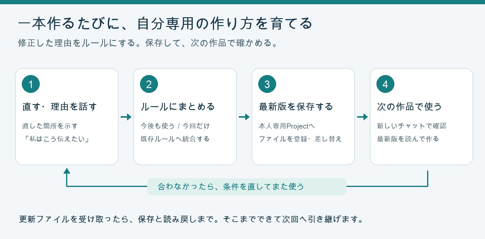
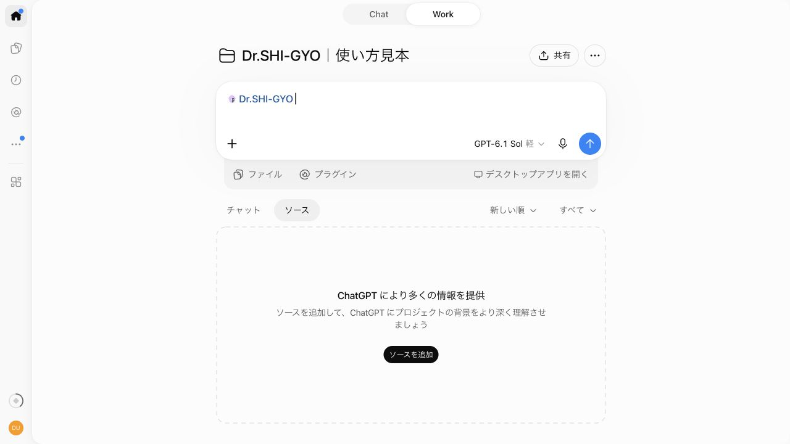
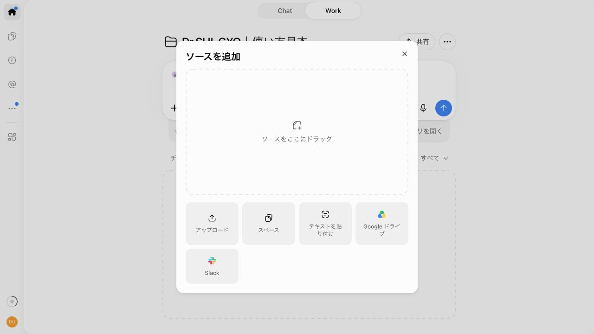

# 06｜自分専用の作り方を育てる

**直した完成見本と、その直し方を、自分専用のProjectへ残します。** 台本・動画素材・サムネイルの修正が終わると、AIから二つの確認が届きます。両方を使って育てても、片方だけを残しても構いません。文章を自分で整理し直す必要はありません。

このガイドでは、本人専用の作り方を「独自スキル」と呼びます。現行の標準は、**自分のProjectに保存する台本マニュアルやデザイン設定**です。ChatGPTのSkill一覧への登録を意味するものではありません。全員が使うDr.SHI-GYOのプラグインはそのまま、自分用の資料を育てます。

**この育て方は、最初の制作を始めるための条件ではありません。** 初回導入では「必ずDr.SHI-GYOを使う」Project指示を保存しておきます。本人設定や見本は、完成した台本を見て「次もこの形にしたい」と思ったときから追加できます。設定前でも、空のProjectでDr.SHI-GYOを選んでインタビューを始められます。



## 0｜修正後に届く、二つの質問に答える

修正版を受け取り、今回変えた点を短く確認した後、AIは次の二つを別々に聞きます。初回インタビュー中や作業途中に、登録のために制作が止まることはありません。

> **1．今回の完成した動画台本・素材などを、見本としてプロジェクトのソースに登録しますか？**
>
> **2．次回のために、今回の修正を反映した独自スキルを登録・更新しますか？**

2番には「専門用語の前に日常語で説明する」「スマホで読める文字サイズを優先する」など、**今回から残すルールの候補**が短く添えられます。何を覚えてもらうか、内容を見て選べます。

| あなたの返事 | 残すもの |
| --- | --- |
| 「両方はい」 | 完成見本と、次回用の独自スキルMarkdown |
| 「見本だけ」「1だけはい」 | 完成見本だけ。作り方のルールは更新しない |
| 「独自スキルだけ」「2だけはい」 | 独自スキルMarkdownだけ。今回の作品を見本にはしない |
| 「今回は不要」「両方いいえ」 | 今回の制作で完了。登録はしない |

「はい」だけではどちらへの返事か分からないとき、その点だけ確認します。すでに「両方登録して」と伝えた場合、同じ確認を繰り返す必要はありません。一度答えた版について毎回尋ね直すこともありません。

### 最初の一本は「両方はい」で試す

```text
両方はい。
1. この完成版を、私の見本として残してください。
2. 今回の修正から、今後も使う作り方を独自スキルに反映してください。
今回だけの変更はルールにしないでください。
Projectのソースに入れる実ファイルを作って、登録状況を教えてください。
```

AIからは、完成見本と独自スキルが**ダウンロードできるファイル**で届きます。画面に文章が表示されただけで終わらせず、ファイルがあることを確認してください。直接Projectへ登録できない環境では「登録待ち」と案内されるので、後述の手順でソースへアップロードします。

## 1｜直したものと、「なぜ直したか」を渡す

台本や画像を修正したチャットで、そのまま続けます。同じチャットに修正前後があれば、毎回添付し直す必要はありません。別の場所で直した場合は、修正前と完成版の両方を添付し、どちらが前後かを伝えます。

一番役立つのは、**「なぜこちらがよいのか」**です。「僕はこんな言い方をしない」「小さくすると読めない」のように、口頭でも文章でも構いません。録音ファイルを添付すれば、AIが必要な準備と文字起こしを行います。環境の制限で自動処理を続けられないと確認できた場合だけ、文字起こしや音声入力の文章で続けます。詳しくは04の音声案内を参照してください。

| 作ったもの | 直した理由の伝え方 |
| --- | --- |
| 台本 | 「専門用語から始まると、患者さんに伝わりにくい。普段の言葉で説明してから用語を添える形に直しました」 |
| サムネイル | 「スマホで見たら背景がにぎやかだったので、背景をすっきりさせて文字を大きくしました」 |
| 動画素材 | 「比較の図は、僕が話す映像の横で見せたいので、全画面から正方形にしました」 |

```text
添付の修正前と完成版を比べてください。
修正した理由は［ここに自由に書く／添付音声で話す］です。
私の意図と、AIが推測したことは分けて整理してください。
```

## 2｜「今後も」と「今回だけ」を分ける

一度変えたことを、すべて永久のルールにする必要はありません。長さ、テーマ、撮影した画面によって、良い形は変わります。

例えば台本なら、「専門用語の前に日常語で説明する」は次回も使えます。一方、「今回は第2章を短くする」はその動画の指示です。サムネイルなら「背景を整理して文字を読みやすくする」は作風として残せますが、「今回は青を赤に変える」だけで、今後すべて赤にするとは決まりません。

素材も同じです。「比較の図は、文字が読める範囲で正方形インサートを優先する」と条件をつければ、全画面で見せたい場面も残せます。「素材を全部正方形にする」と広げすぎないことが大切です。

迷ったら、次の一言で整理を頼めます。

```text
この修正のうち、今後も使える作り方と、今回だけの変更を分けてください。
理由が分からないところは、好みを決めつけず、その点だけ聞いてください。
```

研究の数値や医学的な結論は、話し方の好みとして覚えさせません。本人の経験は、実際に話した内容と使える範囲を残し、別の体験を作り足さないようにします。

## 3｜「独自スキルにまとめて」と頼む

次回も使いたい点が決まったら、初回は「独自スキルにまとめて」、2回目以降は「独自スキルに追記して」で相談を始められます。用途も添えると、更新先が伝わりやすくなります。

```text
この修正を、私専用の［台本／サムネイル／動画素材］の作り方に反映してください。
今後も使いたい点：［記入］
今回だけの変更：［あれば記入］

既存の本人用マニュアル・デザイン設定があれば、そこへ統合してください。
なければ今回の完成版と理由から作成してください。
同じ意味のルールはまとめ、矛盾する点だけ確認してください。
更新版の全文、変更点、Projectへの保存状況を教えてください。
```

独自スキルは用途ごとに分けます。例えば台本の話し方を直したルールが、すべての画像の作風へ混ざらないようにします。

| 用途 | 残すルールの例 |
| --- | --- |
| 動画台本生成 | 日常語から説明する順番、口調、繰り返しを避ける構文 |
| 動画素材作成 | 配色、正方形と全画面の使い分け、本人素材の配置 |
| サムネイル生成 | 文字の大きさ、余白、表情、参考に寄せる範囲 |

標準のファイル名は `独自スキル_動画台本生成_最新版.md`、`独自スキル_動画素材作成_最新版.md`、`独自スキル_サムネイル生成_最新版.md` です。本文内の版をv1、v2と更新します。既存のマニュアルを原本として統合する場合は、その名前を引き続き使えます。

既存の台本マニュアルやデザイン設定がある場合は、その最新版を読んでから統合します。重複や矛盾は整理し、版番号・更新日・変更履歴を残します。「何を変えたか」「なぜ変えたか」「どんな場合に使うか」「例外」が分かる内容にします。**同じ用途の最新版を一つにまとめる**のが基本です。

医学的な主張や研究の数字を、別テーマでも使う固定のルールにはしません。本人の体験も、実際の出典と使用範囲を守り、他の医師へ流用しません。

## 4｜返ってきた内容を、3か所だけ確認する

AIからは、更新版の全文と変更点を受け取ります。まず「今後使うルール」が自分の意図どおりか、次に「今回だけの変更」が混ざっていないかを見ます。以前と逆の方針になっていたら、「今回は例外です」「以前の方針を置き換えてください」と伝えます。

最後に、**保存の状態**を確認します。「ファイルを作成しました」と「Projectに登録して読み戻しました」は別です。実際に保存・読み戻しまでできた場合を除き、次の手順で自分のProjectへ登録します。

```text
今回の更新で、追加・変更・削除したルールを短く教えてください。
更新版の版番号と日付、保存済みの場所、私が登録するファイルを示してください。
```

## 5｜Projectのソースへ、最新版を保存する

更新版のファイルをダウンロードし、自分のProjectを開きます。**「ソース」→「ソースを追加」→「アップロード」**の順に進み、渡された更新版を追加してください。





同じ用途のルールが混ざらないよう、次の順で差し替えます。ファイルの本文にも版と更新日を入れておきます。

1. 旧版をパソコンなどの手元へ保存し、戻せる控えを残す。
2. 新版をProjectへ追加し、開いて内容・版番号を確認する。
3. 今回置き換えた旧版だけを、Projectのソースから外す。プロフィールや見本など、ほかの資料は残す。
4. 本人設定から別ファイルを参照している場合は、その参照名・版も更新して保存する。

参照の更新が分からなければ、「本人設定から、この新版のマニュアルを参照できるようにして。差し替えるファイルを教えて」と同じチャットへ頼めます。

### 見本と独自スキルは、別のファイルで残す

「両方はい」と答えた場合は、次の組み合わせを追加します。

| 作ったもの | 見本として残すもの | 次回用の作り方 |
| --- | --- | --- |
| 台本 | 完成した本文・文献を収めた見本Markdown | 動画台本生成の独自スキルMarkdown |
| 動画素材一式 | 台本・素材の対応を記録した見本Markdownと実素材 | 動画素材作成の独自スキルMarkdown |
| サムネイル | 採用画像と、その選定理由を記録した見本Markdown | サムネイル生成の独自スキルMarkdown |

**Markdownに画像名やURLを書いただけでは、画像・動画そのものを保存したことにはなりません。** 再利用したい実素材も、Projectで扱える形式・容量の範囲で登録し、登録できない大きな動画などは保管場所と参照方法を残します。アクセスできない素材は次回の再添付が必要になることがあります。

台本の見本は、まず1本から代表的なものを最大5本程度で十分です。上限を超えて追加する前に、どれを残すか選びます。独自スキルは例を集める資料とは別に、用途ごとの最新版を一つ持ちます。

初回導入で保存したProject指示は、そのまま使えます。まだ保存していなければ、Projectの **「…」→「プロジェクト設定」→「指示」** に次を追加して「保存」を押します。既存の指示は消さずに統合し、すでに同じ案内があれば重ねて追加しません。保存後に文が残っていることを確認してください。

```text
このProject内の情報発信に関する作業では、必ずDr.SHI-GYOプラグインの該当スキルを使ってください。
各チャットで私がプラグイン名やスキル名を指定しなくても、依頼内容に合うスキルを確認して進めてください。
利用できない場合は、その旨を伝え、プラグインを選択する方法を案内してください。
使っていないのに使ったと報告しないでください。

情報源に登録済みの本人設定と、用途に合う最新版の独自スキル・台本マニュアル・デザイン設定・見本を、実際に読める範囲で参照してください。
未登録の資料を求めて制作を止めず、今回の会話から進めてください。
私の経歴・経験と、参考資料の著者の経験を混同しないでください。
今回だけの指示と、今後も使う方針を分けてください。
更新版の保存・読み戻しを確認するまで、登録済みとは言わないでください。
初回インタビューの最初の一問や「はい」だけ返す開始待機には、見本登録・本人設定・Project指示の案内を挟まないでください。
```

## 6｜次の新しいチャットで、効いているか確かめる

Project指示を初めて保存した場合は、同じProjectの新しいチャットで、まず@を選ばず「インタビューして」と送って呼び出しを確認します。プラグインを利用できない場合や利用を確認できない場合は、@の候補からDr.SHI-GYOを選んでください。この指示は自動インストールや、全環境での自動読込を保証するものではありません。

本人用の作り方が読めるかは、同じProjectの新しいチャットで次を送って確かめます。読めないと言われたら、まずProjectとソースの登録先を確認します。プロフィールを一から入力し直す必要はありません。

```text
ソースの本人設定と、今回使う最新版の作り方を読んでください。
ファイル名・版と、今回適用するルールを3点で教えてください。
今回は［テーマ］の［台本／サムネイル／動画素材］を作ります。
```

正しい版を読めたら制作を進め、完成後に「前回直した点が、今回は自然に反映されたか」を見ます。本人用の資料を保存する運用なので、アップロードしただけでAI本体が学習し続けたり、すべてのチャットへ確実に記憶されたりするわけではありません。

## 7｜増やすだけでなく、整理して育てる

作り方が合わなくなったら、条件を狭める、重複をまとめる、不要なルールを削ることもできます。

| 気づいたこと | 整理の例 |
| --- | --- |
| 「短く」「簡潔に」が重複 | 「一文に論点を詰めすぎず、必要な説明は残す」に統合 |
| 「全素材を正方形」が合わない | 「比較図は正方形を優先。細部を大きく見せる場合は全画面」に変更 |
| 新しい口調が自分に合わない | そのルールを削除し、直前の版の口調へ戻す |

```text
前回追加した［ルール］は、今回はうまく合いませんでした。
［条件を限定する／削除する／前版へ戻す］形で更新してください。
ほかの採用済みルールは保ち、更新版全文と変更点をください。
```

直した理由と完成見本を残し、次の一本で確かめながら、自分専用の作り方を育てていきます。
