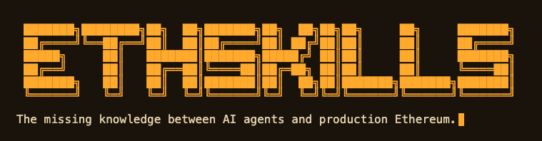
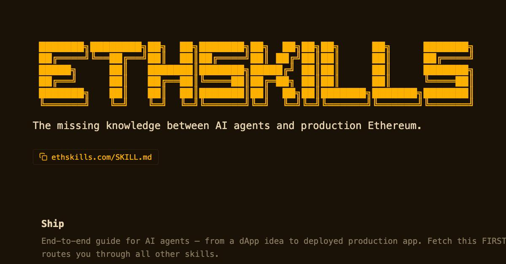

<p align="center">
  <a href="https://ethskills.com"></a>
</p>

<p align="center">
  <b>ethskills, as a ChatGPT and Codex plugin.</b>
</p>

<p align="center">
  <a href="https://ethskills.com">ethskills.com</a> ·
  <a href="https://github.com/austintgriffith/ethskills">source skills</a> ·
  <a href="LICENSE">MIT</a>
</p>

---

ChatGPT thinks gas is 30 gwei. It's 0.05. It has never heard of ERC-8004 or x402. It makes up contract addresses.

This plugin fixes that. Install it and ChatGPT uses current, verified Ethereum knowledge when you ask things like:

- *"How do I launch a token on Base?"*
- *"What's the USDC address on Arbitrum?"*
- *"Is this contract safe to deploy?"*
- *"Which L2 should I build on?"*
- *"How much does it cost to mint an NFT?"*

## Skills

| Skill | What it fixes |
|---|---|
| **ethereum** | Entry point. Picks the right skill for your question. |
| [ship](https://ethskills.com/ship/SKILL.md) | Idea to deployed dApp, step by step |
| [why-ethereum](https://ethskills.com/why/SKILL.md) | Pectra/Fusaka shipped, gas is cheap, the AI agent angle |
| [gas](https://ethskills.com/gas/SKILL.md) | Gas is 0.05–0.3 gwei, not 10–30 |
| [l2s](https://ethskills.com/l2s/SKILL.md) | L2 txs cost under $0.001 |
| [wallets](https://ethskills.com/wallets/SKILL.md) | EIP-7702 is live, Safe, agent key safety |
| [standards](https://ethskills.com/standards/SKILL.md) | ERC-20/721/1155, ERC-8004, EIP-7702, EIP-3009 |
| [tools](https://ethskills.com/tools/SKILL.md) | Foundry, Scaffold-ETH 2, x402, Blockscout MCP |
| [building-blocks](https://ethskills.com/building-blocks/SKILL.md) | Current DeFi: Uniswap, Aave, Aerodrome, Pendle |
| [addresses](https://ethskills.com/addresses/SKILL.md) | Verified addresses, no guessing |
| [security](https://ethskills.com/security/SKILL.md) | Reentrancy, decimals, oracles, pre-deploy checklist |
| [audit](https://ethskills.com/audit/SKILL.md) | 500+ checks across 19 domains |
| [crops](https://ethskills.com/crops/SKILL.md) | Censorship resistance, open source, privacy, security |
| [concepts](https://ethskills.com/concepts/SKILL.md) | Nothing is automatic, incentives are everything |
| [protocol](https://ethskills.com/protocol/SKILL.md) | What actually shipped vs. what's on the roadmap |
| [testing](https://ethskills.com/testing/SKILL.md) | Fuzz and fork tests, not getter tests |
| [indexing](https://ethskills.com/indexing/SKILL.md) | Events, The Graph, Dune |
| [orchestration](https://ethskills.com/orchestration/SKILL.md) | Scaffold-ETH 2 three-phase build |
| [frontend-ux](https://ethskills.com/frontend-ux/SKILL.md) | Button rules, approval flow, USD values |
| [frontend-playbook](https://ethskills.com/frontend-playbook/SKILL.md) | IPFS, Vercel, ENS deploys |
| [qa](https://ethskills.com/qa/SKILL.md) | Pre-ship review checklist |

## Install

**ChatGPT:** search "ethskills" in the plugin directory. *(In review.)*

**Codex:** add this repo as a plugin marketplace and install `ethskills`.

## Develop

Skills come from [austintgriffith/ethskills](https://github.com/austintgriffith/ethskills). Edit them there, then sync:

```sh
scripts/sync.sh              # pull latest from GitHub
scripts/sync.sh ~/ethskills  # or from a local checkout
```

Build the upload ZIP:

```sh
zip -qr dist/ethskills-plugin.zip plugin.json skills assets LICENSE README.md -x '*.DS_Store'
```

---

<p align="center">
  <a href="https://ethskills.com"></a>
</p>
