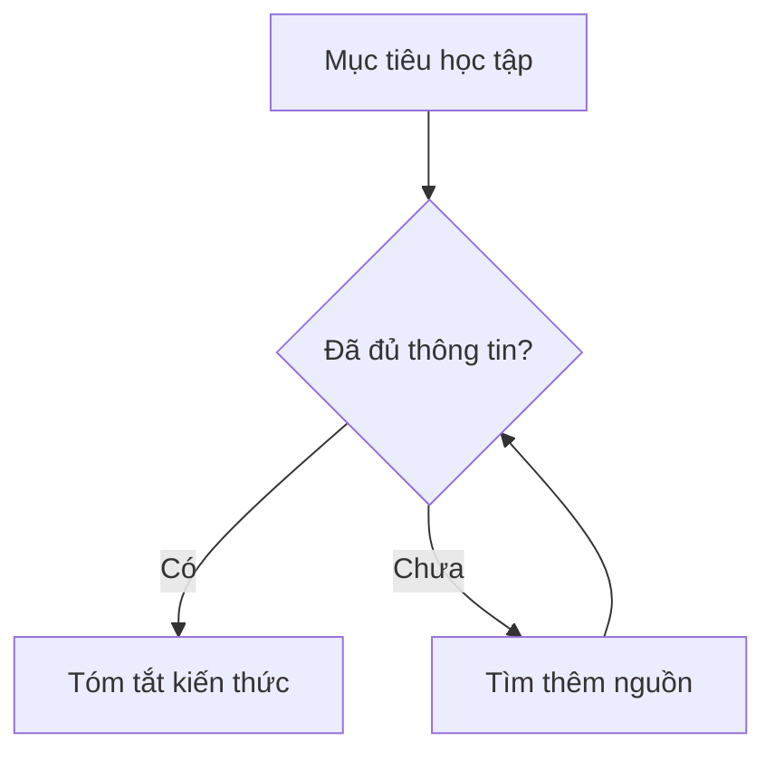

# Mermaid flowchart và đầu ra vector

Dùng mã Mermaid hợp lệ khi người dùng muốn sơ đồ tự render:

Mã nút đơn giản và không trùng. Dùng dấu nháy kép quanh nhãn tiếng Việt/phức tạp. Tránh reserved token `end` viết thường làm ID; ưu tiên `EndNode`. Tránh label quá dài và ký tự chưa escape có thể phá render. Mermaid không tương đương file PNG đã render.

Nếu có renderer, ưu tiên SVG khi cần sắc nét và có thể chỉnh sửa, PNG 2x khi cần chiếu slide; nếu không có renderer chỉ cung cấp mã nguồn và nêu rõ không phải ảnh đã xuất. Không tuyên bố SVG có thể chỉnh sửa trọn vẹn trong mọi trình biên tập nếu chưa kiểm tra.

**Nguồn tài liệu kỹ thuật (đã mở 26/10/2026):** Mermaid official flowchart syntax, https://mermaid.js.org/syntax/flowchart.html [L3, HTML full page].
